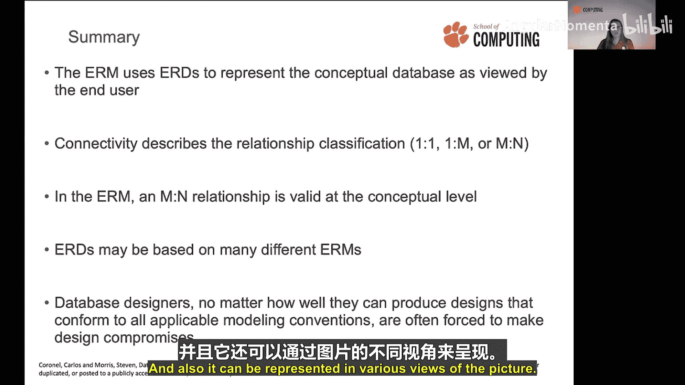

# 018：实体关系建模复习 🧠

在本模块中，我们学习了实体关系建模所必需的大量信息。具体来说，我们探讨了实体、强弱关系、强弱实体，以及它们在ER图中的表示方法，特别是Crow‘s Foot表示法中的属性描绘。我们还深入研究了关系、参与度和基数。为了巩固这些关键概念，本节我们将进行一次复习。

## 派生属性

上一节我们介绍了属性的不同类型，本节中我们来看看派生属性。派生属性或计算属性是指可以从表中的其他属性计算得出的属性。我们面临的选择是存储这个派生属性，还是在每次需要时进行计算。

以下是存储派生属性的一些优点：
*   减少获取该属性时的实际处理需求，因为它已经存在，这可以缩短获取时间。
*   数据始终存在且可用。
*   如果需要追踪历史数据，存储属性可以保留旧版本的数据。

然而，存储派生属性也存在缺点：
*   必须保持其更新。例如，在员工数据库中存储“年龄”属性，需要每天检查并更新当天过生日的员工年龄。
*   如果不存储，而是在需要时计算，则无需担心存储错误数据的开销。

## 弱实体

接下来，我们回顾弱实体的概念。一个实体要被归类为弱实体，必须满足两个条件：
*   必须存在依赖于其父实体，即没有父实体，该实体就不能存在。
*   必须从其父实体继承至少一部分主键。例如，在“家属”表中，“员工编号”既是其主键的一部分，也是外键。

需要记住的关键点是：弱实体的条件与实体和父实体之间形成强关系的条件是相同的。因此，一个弱实体必然会产生一个强关系。

## 强关系

基于上一节的内容，我们来明确什么是强关系，它在Crow‘s Foot图中如何表示，以及存在依赖性在数据库中如何实现。

强关系存在于一个实体存在依赖于另一个实体，并继承其至少部分主键时。在ER图中，它用**实线**表示（弱关系用虚线）。在数据库中的实现方式是使用**非空外键**。这意味着，例如，不能存在一个没有对应员工的“家属”记录，因此外键字段不能为空。

## 数据存储设计

现在，我们思考一个设计问题。假设在员工表中，我们有一个“学位”列，以逗号分隔的形式存储员工的所有学位（例如“AS, MS, PhD”）。

这种存储方式的缺点是什么？主要问题在于查询效率低下。例如，要查找所有拥有硕士学位的员工，必须对“学位”列进行字符串解析和搜索，这在计算上非常昂贵。

以下是两种更好的替代方案：
1.  **创建多个单值列**：为每个学位创建单独的列（如`degree1`, `degree2`, `degree3`）。但这种方法的问题是必须预先知道最大学位数量，可能导致空间浪费，并且查询仍然复杂。
2.  **创建独立的学位表**：这是推荐的方法。创建一个独立的“学位”表，包含`员工编号`（外键）和`学位代码`等字段。这样，可以快速查询拥有特定学位的员工。在这个表中，主键可以是`(员工编号, 学位代码)`的组合，因为一个员工不会重复拥有同一个学位。

## 属性类型辨析

我们再来区分两个概念：单值属性和简单属性。
*   **单值属性**：只能有一个值。例如，一个人只有一个“姓氏”和一个“社会保险号”。
*   **简单属性**：不能再分解为更小的组成部分。例如，“尺寸：中”或“区号：123”。

**重要提示**：单值属性不一定是简单属性。例如，“序列号：TN-P5-S2-20231001”是单值的，但它可以分解为“州(TN)”、“工厂(P5)”、“班次(S2)”和“日期”等组成部分。如果业务需要基于这些组成部分进行查询（例如查找田纳西州生产的所有产品），将其分解存储是更佳选择。

## 多值属性

与单值属性相对的是多值属性。多值属性拥有多个值，在关系型数据库中通常需要特殊处理。

处理多值属性的常见方法是创建一个新的实体或组件。例如，对于“汽车”实体，其“颜色”可能包括车身色、内饰色、车顶色等多种。最佳实践是创建一个“汽车颜色”实体，包含“汽车VIN”和“颜色类型/部位”等字段，这样更容易管理和扩展。

## 基数判定

在ER图中确定基数时，需要依据业务规则。例如，在“教授-课程”关系中，如果业务规则是“一位教授最多教授3门课”，那么基数应明确标注为`(0, 3)`。如果图中没有额外信息，则通常使用`(1, N)`或`(0, N)`等通用表示。

## 多对多关系

最后，我们回顾如何处理ER图中实体间的多对多关系。解决方案是创建一个**关联实体**（也称为复合实体或桥接实体）。这个新实体位于两个多对多实体之间，分别与它们建立一对多关系，从而将多对多关系分解为两个一对多关系。

## 总结

本节课中我们一起学习了实体关系建模模块的核心要点：
*   使用**ER图**来概念化表示数据库结构。
*   理解并应用不同的**关系连通性**：一对一、一对多、多对多。
*   认识到多对多关系需要通过创建**桥接/关联实体**来解决。
*   了解ER图可以用不同的**ER模型**（如Crow‘s Foot）和**视图**来表示。

掌握这些概念是设计高效、合理数据库模式的基础。