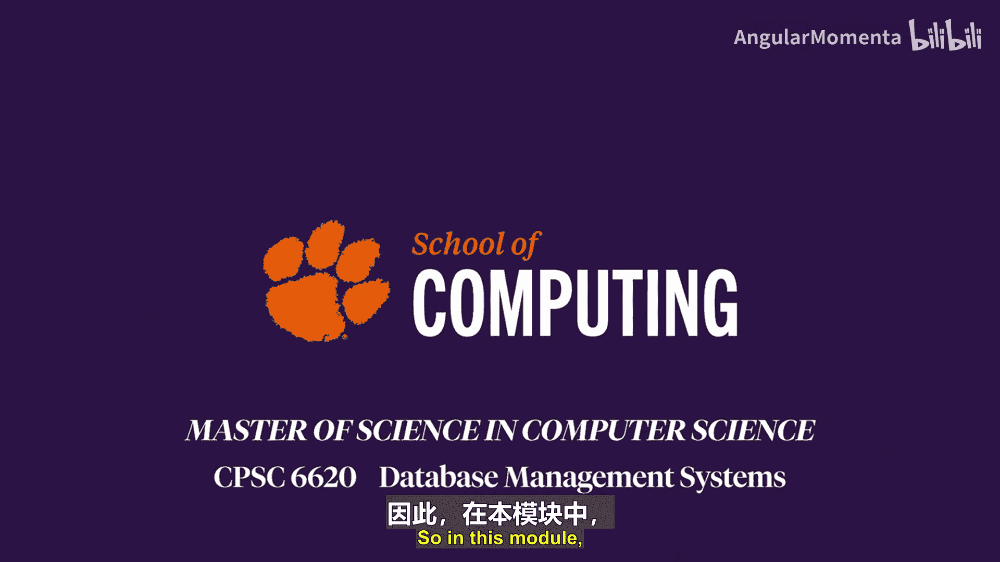
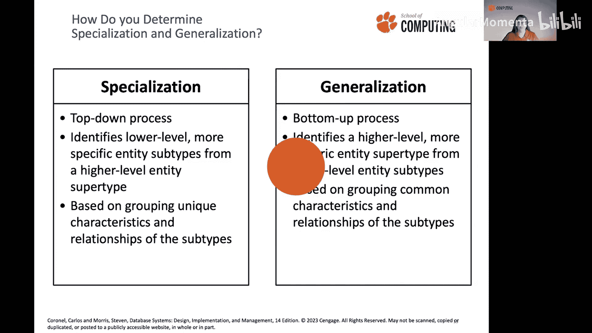

# 019：扩展实体关系模型

## 概述

在本节课程中，我们将学习数据建模的进阶概念——扩展实体关系模型。我们将了解超类型与子类型的概念、继承机制，以及如何通过特殊化层次结构来组织实体。这些知识将帮助我们为具有复杂分类和特性的数据设计更清晰、更高效的模型。

---

## 扩展实体关系模型简介

上一模块我们学习了基础的实体关系模型。本节中，我们将在此基础上，引入扩展实体关系模型的概念。

扩展实体关系模型为ER模型增加了更多结构，其对应的图表称为扩展实体关系图。我们主要将学习**超类型**和**子类型**。

*   **超类型**：一个实体，它包含一个或多个具有独特特征的**子类型**。
*   **子类型**：从超类型派生出的实体，它们继承了超类型的所有属性和关系，并拥有自己独特的属性。

这类似于面向对象编程中的**继承**概念。子类型实体将继承其超类型的所有属性和关系。

何时需要使用这种结构？当你有一个实体，其不同类型具有各自独特的属性或特征时，就可以考虑使用子类型。

---

## 特殊化层次结构与示例

超类型和子类型被组织成一种称为**特殊化层次结构**的体系。子类型位于超类型之下，它们之间的关系被描述为 **“是一个”** 关系。一个子类型只存在于其超类型的上下文中。

让我们来看一个例子。下图展示了一个名为 `EMPLOYEE` 的超类型，以及三个子类型：`PILOT`、`MECHANIC` 和 `ACCOUNTANT`。

图中包含一些我们尚未介绍的新符号，稍后会详细解释。目前可以看到，`EMPLOYEE` 与 `DEPENDENT` 之间存在一个一对多的关系。`DEPENDENT` 的主键是一个由 `EMPLOYEE_NUMBER` 和 `DEPENDENT_NUMBER` 组成的复合键。

`EMPLOYEE` 中的所有属性都被 `PILOT`、`MECHANIC` 和 `ACCOUNTANT` 继承。因此，`MECHANIC` 不仅拥有 `EMPLOYEE` 的姓氏、名字、首字母、雇佣日期和类型等属性，还拥有 `HOURLY_RATE` 和 `CERTIFICATION` 这两个特定于机械师的属性。同样，`MECHANIC` 也继承了与 `DEPENDENT` 实体的关系。

---

## 继承与多层次结构

如前所述，**继承** 是核心特性，它使得子类型能够继承超类型的所有属性和关系。

这种层次结构可以是多层的。如下图所示，`PERSON` 可以是 `EMPLOYEE` 或 `STUDENT`。而 `EMPLOYEE` 又可以是 `ADMINISTRATOR`、`PROFESSOR` 或 `GRADUATE_ASSISTANT`；`STUDENT` 可以是 `GRADUATE` 或 `UNDERGRAD`。

你还可以定义特定于某个实体的关系。例如，`EMPLOYEE` 与 `OFFICE` 有一个关系，而 `STUDENT` 则没有。因此，不能将 `OFFICE` 关系放在 `PERSON` 级别，否则 `STUDENT` 也会错误地继承这个关系。

---

## 子类型鉴别器

在超类型和子类型的连接线上，你会看到一个属性名，例如 `STUDENT_TYPE`。这个属性被称为**子类型鉴别器**。

它的作用是标识一个 `STUDENT` 实体具体属于哪个子类型（是 `GRADUATE` 还是 `UNDERGRAD`）。根据 `STUDENT_TYPE` 的值，实体将拥有不同的属性集：
*   如果 `STUDENT_TYPE = ‘GRADUATE’`，则实体拥有 `THESIS_TITLE` 和 `ADVISOR` 属性。
*   如果 `STUDENT_TYPE = ‘UNDERGRAD’`，则实体拥有 `UNDERGRAD_HOURS` 属性。

在大多数情况下，这通过判断 `STUDENT_TYPE` 的值是否等于“研究生”或“本科生”来实现。

---

## 约束：不相交与重叠

在层次结构图中，超类型和子类型之间的连接线上标有 **‘O’** 或 **‘D’**。这表示子类型之间的约束关系。

*   **‘D’ (Disjoint)**：**不相交**。一个超类型实例只能属于一个子类型。例如，一个 `STUDENT` 只能是 `GRADUATE` 或 `UNDERGRAD`，不能同时是两者。
*   **‘O’ (Overlapping)**：**重叠**。一个超类型实例可以同时属于多个子类型。例如，一个 `EMPLOYEE` 可以同时是 `ADMINISTRATOR` 和 `PROFESSOR`。

关于不相交与重叠约束，还有一个要点涉及子类型鉴别器的使用。对于不相交约束（如 `STUDENT`），鉴别器（`STUDENT_TYPE`）的值非常明确，非此即彼。但对于重叠约束（如 `EMPLOYEE`），如果只有一个 `EMPLOYEE_TYPE` 字段，用“两者都是”来表示会很不方便，特别是当子类型很多时。在这种情况下，更好的做法是为每个可能的子类型设置一个独立的布尔型鉴别器字段（例如 `IS_ADMIN`、`IS_PROFESSOR`），这样就能清晰地表示重叠关系。

下图底部展示了这种重叠鉴别器的取值示例。

---

## 约束：完全性与部分性

连接线下的单线或双线代表了**完全性约束**。

*   **单线 (Single Line)**：**部分完全性**。并非每个超类型的实例都必须属于某个子类型。
*   **双线 (Double Line)**：**完全性**。每个超类型的实例必须至少属于一个子类型。

结合之前的例子：
*   `STUDENT` 使用双线，意味着一个学生**必须**是研究生或本科生。
*   `EMPLOYEE` 使用单线，意味着一个雇员**可以**只是雇员，而不必是管理员或教授。

将不相交/重叠约束与完全性/部分性约束结合，可以产生多种组合：
*   **不相交 + 部分完全**：超类型实例可以不属于任何子类型，若属于则只能属于一个。
*   **重叠 + 部分完全**：超类型实例可以不属于任何子类型，若属于则可以属于多个。
*   **不相交 + 完全**：超类型实例必须属于且仅属于一个子类型。
*   **重叠 + 完全**：超类型实例必须至少属于一个子类型，并且可以属于多个。

---

## 如何识别与设计特殊化层次

如何在设计过程中识别是否需要使用这种特殊化层次结构呢？主要有两种方式：

1.  **自顶向下**：在初始设计时，你可能将所有属性都放在一个实体中（例如，将研究生论文题目和本科生学时都放在 `STUDENT` 实体里）。随着设计深入，你发现很多属性对某些实例是空的或不适用，这时就可以考虑将它们拆分到子类型中。
2.  **自底向上**：从一开始你就清楚存在不同的类别（如研究生/本科生、教授/管理员），并且在设计低级实体时发现它们有许多共同属性。这时就可以将这些共同属性提取出来，形成一个共享的超类型。

没有固定的方法去“发现”这些结构，它通常是在设计迭代过程中自然浮现的。通过反复审视和优化设计，是否需要特殊化层次结构会变得显而易见。

---

## 总结

本节课我们一起学习了扩展实体关系模型的核心概念。我们了解了**超类型**与**子类型**如何通过**继承**来共享属性和关系，并如何组织成**特殊化层次结构**。我们探讨了**子类型鉴别器**的作用，以及**不相交/重叠**、**完全性/部分性**这两组重要的约束条件。最后，我们讨论了在实际数据库设计过程中识别和应用这些结构的方法。掌握这些概念，将帮助你为复杂的数据关系构建出更精确、更灵活的模型。

在接下来的部分，我们将更深入地探讨主键的选择。