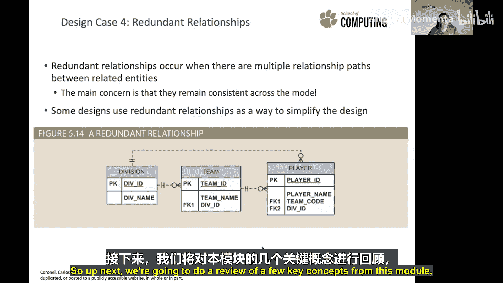

数据库管理系统：05：灵活的数据建模解决方案

在本节课中，我们将要学习数据建模中的几种特殊情况及其解决方案。我们将探讨一对一关系、时变数据、扇形陷阱以及冗余关系的处理方式，帮助初学者理解如何在实际场景中灵活应用数据建模原则。

上一节我们介绍了常规关系建模，本节中我们来看看几种需要特殊处理的设计情况。

### 一对一关系建模

在关系数据库模型中，最常见的是“一对多”关系，但也存在“一对一”关系。处理这种关系时，需要在一个实体中放置另一个实体的外键来表示关联。关键在于确定外键应放在哪个实体中。

以下是三种处理一对一关系的方法：

*   **情况一：一方为强制参与（Mandatory）**。如果关系中一方必须存在（例如，每个A必须对应一个B），则将强制方实体的主键作为外键，放入可选方实体中。此外键**不允许为空**（NOT NULL）。
*   **情况二：双方均为可选参与（Optional）**。如果双方都可能独立存在，则需要考虑两点来决定外键位置：
    1.  哪个实体中外键为空的记录会更少？
    2.  关系主要描述的是哪个实体的角色？（例如，“员工拥有家属”，关系角色主要由“员工”扮演）。
*   **情况三：双方均为强制参与**。如果双方都必须同时存在，则需要重新考虑设计。或许这两个实体本应合并为一个实体。我们将在模块6中深入探讨何时应该拆分或合并实体。

### 时变数据建模

时变数据在当今数据库中极为常见，例如销售历史、财务记录、订单历史等。我们需要在关系模型中保存历史信息，而不仅仅是当前状态。

建模时变数据的标准方法是通过“一对多”关系。例如，一个“员工”可以对应多条“薪资历史”记录。这样，我们就能追溯员工薪资随时间的变化，这可能是业务分析或法规遵从所要求的。

时变数据的建模可以更复杂。除了薪资历史，你可能还需要记录“经理变更历史”或“部门变更历史”。一种更清晰的设计是将所有与职位相关的变更集中到一个“工作历史”实体中，该实体记录薪资、经理、部门等所有变更。

需要理解的是，每个公司的业务需求不同，时变数据的建模方式也会不同。关键在于认识到数据会随时间变化，而数据库设计需要能够捕捉和存储这些变化。

### 扇形陷阱

扇形陷阱是一种设计陷阱，即模型在语义上看起来正确，但无法推导出某些重要的关联信息。

考虑一个篮球联赛的例子：一个联赛有多个赛区，一个赛区有多支球队，同时一个赛区也有多名球员。初始模型可能设计为：
*   赛区 (Division) → 球队 (Team) (一对多)
*   赛区 (Division) → 球员 (Player) (一对多)

这个模型语义正确，但它**无法确定具体哪位球员属于哪支球队**，因为球员只与赛区关联，与球队没有直接联系。这种从中心实体（赛区）向外“扇形”展开多个一对多关系，却丢失关键路径的设计，就称为扇形陷阱。

消除扇形陷阱的方法是建立正确的关联路径。修正后的模型应为：
*   赛区 (Division) → 球队 (Team) (一对多)
*   球队 (Team) → 球员 (Player) (一对多)

通过“球队”这个中间实体，我们现在可以明确地知道每位球员所属的球队。

### 冗余关系

冗余关系是指在模型中表达了不必要的、可由其他关系推导出的关联。

以上述修正后的扇形陷阱模型为例：我们已经建立了“赛区→球队”和“球队→球员”的关系。此时，如果再添加一个直接的“赛区→球员”关系，那么这个关系就是冗余的。

虽然冗余关系在技术上没有错误，但它增加了模型的复杂性且不提供新信息。为了模型的简洁和清晰，通常应将其移除。

本节课中我们一起学习了几种特殊的数据建模场景：一对一关系的三种处理策略、使用一对多关系建模时变数据、识别并修正会导致信息丢失的扇形陷阱，以及移除模型中不必要的冗余关系。理解这些灵活的设计方案，将帮助你构建更准确、更高效的数据库模型。