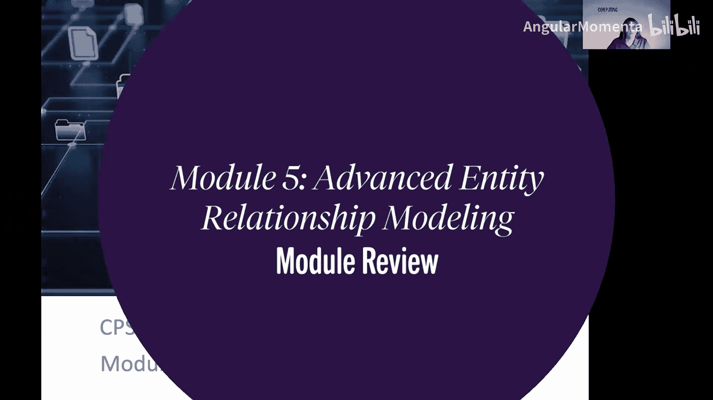
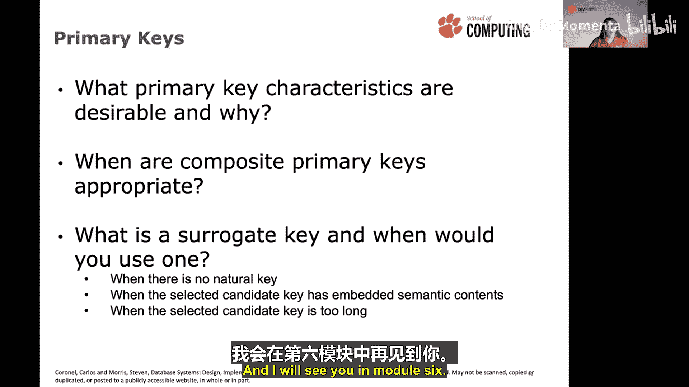

# 022：模块回顾 🧠

在本模块中，我们学习了数据库设计中的几个核心概念。本节将对模块五的关键知识点进行回顾和梳理，帮助巩固对**特化层次结构**和**主键选择**的理解。

## 特化层次结构回顾

上一节我们介绍了特化层次结构，本节中我们来看看其中的关键约束。

特化层次结构包含超类型、子类型以及**鉴别器**的概念。我们讨论了**部分/完全完备性**约束以及**重叠/不相交**约束。

以下是一个示例图，展示了具有**不相交**约束和**完全完备性**的层次结构，其鉴别器为 `product_type`，子类型可以是 `book`、`CD` 或 `movie`。

基于此图，我们思考两个问题。

**第一个问题：`movie` 实体具有哪些属性？**

答案是：`movie` 将拥有自身的属性（如 `movie_rating` 和 `movie_director`），同时会继承其超类型 `product` 的所有属性（如 `product_number`、`release_date`、`title`、`price` 和 `type`）。因此，`movie` 的属性是这两部分的集合。

**第二个问题：`product` 表中的每一个实例，是否都必须与 `CD` 表中的一个实体实例相关联？为什么？**

答案是：**不需要**。因为图中存在**不相交**约束和**完全完备性**约束（用双线表示）。这意味着一个 `product` 实例必须是 `book`、`CD` 或 `movie` 三者之一，但它不必非得是 `CD`，也可以是其他两种类型之一。

下图再次清晰地展示了这种**不相交**与**完全完备性**的组合约束。

## 主键选择原则

接下来，我们回顾关于选择合适主键的核心概念。良好的主键设计对数据库性能和数据完整性至关重要。

以下是围绕主键的三个关键问题：

**1. 理想的主键应具备哪些特性？为什么？**
理想的主键应具备以下特性：
*   **唯一性**：确保每条记录能被唯一标识。
*   **非智能性**：不包含业务含义，避免因业务规则变化而修改。
*   **不变性**：其值一旦创建便永不更改。
*   **安全性**：不包含敏感信息。
*   **简洁性**：最好是**数字型**且为**单属性**，这有助于提升查询效率。

**2. 何时应使用复合主键？**
复合主键在以下两种情况下是合适的：
*   用于标识**弱实体**。
*   用于作为多对多关系中介的**桥接实体**。

**3. 什么是代理键？何时使用它？**
代理键是由数据库管理系统自动生成的唯一标识符。

在以下情况应考虑使用代理键：
*   当表中不存在合适的自然键时。
*   当自然键过于复杂、包含过多信息或长度过长时。为了保持主键的简洁性，可以使用代理键替代。

## 总结与展望

在本节课中，我们一起回顾了模块五的两个核心主题：**特化层次结构中的约束规则**以及**主键的设计原则与选择策略**。理解这些概念对于设计出结构清晰、高效可靠的数据库至关重要。

感谢您完成模块五的学习。在接下来的模块六中，我们将深入探讨另一个极其重要的概念：**规范化**。我们模块六再见。

