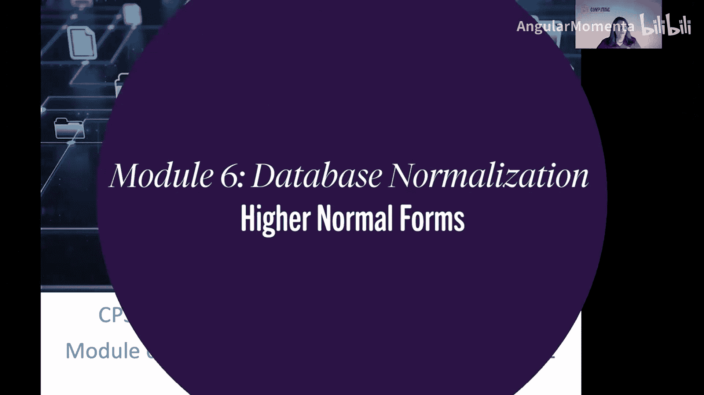
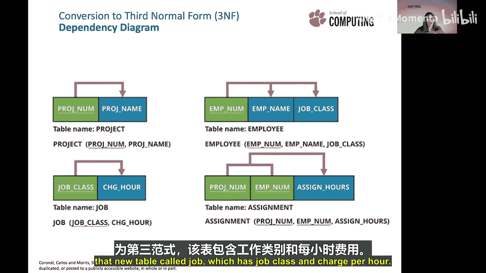

# 024：高级范式




在本节课中，我们将学习数据库表规范化的具体过程，即如何将一个低范式表逐步转换为更高范式的表。我们将通过一个详细的例子，演示从初始状态到第一范式、第二范式，最终达到第三范式的完整步骤。

## 从初始表到第一范式

上一节我们介绍了范式的概念，本节中我们来看看规范化的第一步：转换为第一范式。这是一个三步过程。

首先，我们需要**消除重复组**。这意味着确保表中没有多组相同类型的条目，并且每一行都包含所有列的值，没有空白。

其次，我们需要**识别主键**。主键必须能唯一标识表中的每一行。

最后，我们需要**识别所有依赖关系**。我们将使用依赖图来可视化这些关系。依赖关系主要有两种：
*   **部分依赖**：当非主键属性仅依赖于**复合主键的一部分**时发生。
*   **传递依赖**：当一个非主键属性依赖于**另一个非主键属性**时发生。

让我们通过一个例子来理解。假设我们有一个初始表格，数据可能来自Excel表格，其结构如下：

| 项目编号 | 项目名称 | 员工编号 | 员工姓名 | 职位类别 | 时薪 | 工时 |
| :--- | :--- | :--- | :--- | :--- | :--- | :--- |
| 15 | Evergreen | 103 | June E. Arbough | 电气工程师 | $84.50 | 23.8 |
| 15 | Evergreen | 101 | John D. News | 数据库设计师 | $105.00 | 19.4 |
| 15 | Evergreen | 105 | Alice K. Johnson | 数据库设计师 | $105.00 | 35.7 |
| 18 | Amber Wave | 114 | Annelise Jones | 应用设计师 | $48.10 | 24.6 |
| 18 | Amber Wave | 104 | Anne K. Ramoras | 系统分析师 | $96.75 | 23.8 |
| 22 | Rolling Tide | 114 | Annelise Jones | 应用设计师 | $48.10 | 45.3 |
| 22 | Rolling Tide | 105 | Alice K. Johnson | 数据库设计师 | $105.00 | 32.4 |

**第一步：消除重复组**
上表已经是填充了所有数据的格式，没有重复组或空白，因此满足第一范式的第一个条件。

**第二步：识别主键**
观察数据，单一属性如“项目编号”或“员工编号”都有重复，无法唯一标识一行。但是，“项目编号”和“员工编号”的组合可以唯一确定一个员工在特定项目上的工作记录。因此，**复合主键**是 `(项目编号, 员工编号)`。

**第三步：识别所有依赖关系**
我们使用依赖图来分析。主键 `(项目编号, 员工编号)` 被加下划线。

```
项目编号, 员工编号
    ↓    ↓    ↓    ↓    ↓    ↓
项目名称 员工姓名 职位类别 时薪 工时
    ↑         ↑         ↑
    └─────────┴─────────┘
      部分依赖       传递依赖
```

以下是依赖关系的详细说明：
*   **对主键的完全依赖**：“工时”属性完全依赖于整个主键，即要知道某员工在某项目上工作了多久，必须同时知道项目编号和员工编号。
*   **部分依赖**：
    *   `项目编号 → 项目名称`：知道项目编号就能确定项目名称。
    *   `员工编号 → 员工姓名, 职位类别, 时薪`：知道员工编号就能确定其姓名、职位和时薪。
*   **传递依赖**：`职位类别 → 时薪`。时薪由职位类别决定（例如，所有“数据库设计师”的时薪都是$105.00），而职位类别本身不是主键的一部分。

至此，我们完成了第一范式。我们识别了主键，确保了没有重复组，并找出了所有依赖关系。但表中仍然存在部分依赖和传递依赖。

## 从第一范式到第二范式

上一节我们达到了第一范式，但表中存在部分依赖。本节中，我们将通过**消除所有部分依赖**来达到第二范式。

根据依赖图，我们需要处理两个部分依赖：
1.  `项目编号 → 项目名称`
2.  `员工编号 → (员工姓名, 职位类别, 时薪)`

消除的方法是，将依赖于部分主键的属性分离到新的表中，并保留原表（现在称为“分配”表）来关联它们。

转换后的结构如下：

*   **项目表 (PROJECT)**
    *   主键：`项目编号`
    *   属性：`项目名称`
    *   *说明：所有属性都完全依赖于主键“项目编号”。*

*   **员工表 (EMPLOYEE)**
    *   主键：`员工编号`
    *   属性：`员工姓名`, `职位类别`, `时薪`
    *   *说明：所有属性都完全依赖于主键“员工编号”。但注意，“时薪”和“职位类别”之间仍存在传递依赖。*

*   **分配表 (ASSIGNMENT)**
    *   主键：`(项目编号, 员工编号)`
    *   属性：`工时`
    *   *说明：此表用于关联项目和员工，并记录具体的工时。属性“工时”完全依赖于整个主键。*

现在，我们达到了第二范式。每个表中的所有非主键属性都完全依赖于其主键。然而，在“员工表”中，传递依赖 `职位类别 → 时薪` 仍然存在。

## 从第二范式到第三范式

上一节我们消除了部分依赖，达到了第二范式。本节中，我们将通过**消除传递依赖**来达到最终的第三范式。

我们需要处理员工表中剩余的传递依赖：`职位类别 → 时薪`。消除的方法是将“职位类别”和“时薪”这两个属性提取出来，形成一个独立的表。

最终的结构如下：

*   **项目表 (PROJECT)**
    *   主键：`项目编号`
    *   属性：`项目名称`

*   **职位表 (JOB)**
    *   主键：`职位类别`
    *   属性：`时薪`
    *   *说明：新创建的表，消除了传递依赖。*

*   **员工表 (EMPLOYEE)**
    *   主键：`员工编号`
    *   属性：`员工姓名`, `职位类别` (作为外键，引用JOB表)
    *   *说明：移除了“时薪”，通过外键“职位类别”与JOB表关联。*

*   **分配表 (ASSIGNMENT)**
    *   主键：`(项目编号, 员工编号)`
    *   属性：`工时`

现在，我们成功达到了第三范式。每个非主键属性都完全依赖于主键、且仅依赖于主键，不存在任何传递依赖。

## 总结

本节课中，我们一起学习了数据库表规范化的完整流程：
1.  **第一范式**：确保表中没有重复组，识别主键，并识别所有依赖关系（包括部分依赖和传递依赖）。
2.  **第二范式**：在满足第一范式的基础上，**消除所有部分依赖**。这通常涉及将存在部分依赖的属性拆分到新表中。
3.  **第三范式**：在满足第二范式的基础上，**消除所有传递依赖**。这通常涉及将存在传递依赖的属性拆分到新表中。




通过这个从初始表到第三范式的逐步转换示例，我们看到了规范化如何通过减少数据冗余和避免更新异常，来使数据库结构更加清晰、高效和稳定。