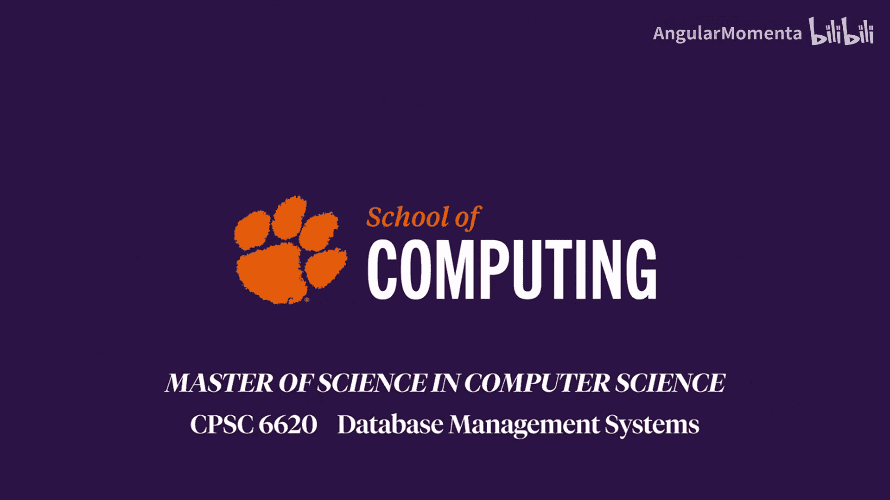
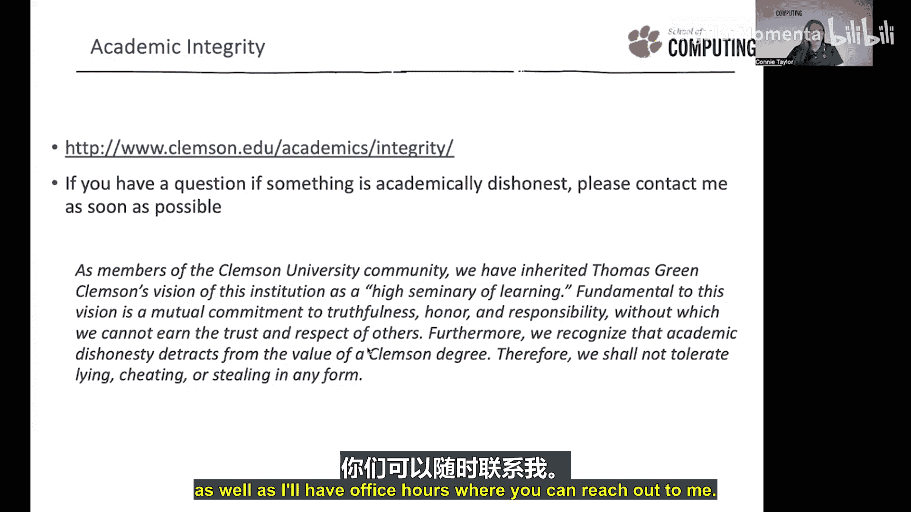

# 【克莱姆森大学】数据库管理系统 ｜ Database Management Systems p01 01_01_01_introduction-to-the-class -BV1y6rzBXE34_p1-

Yeah。

Welcome to CPSC 6620 Dataase Management System I'm Connie Taylor。

 I'm a professor of practice and I've been at Clemson since 2020 prior to that I spent 30 years in industry building large applications that use complex distributed databases。

In this course we'll learn about databases and data communications， how to build design。

 create maintain large scale multius databases we'll also look at some of the emerging technologies out there in databases I'm sure you may have heard of No SQL as one example。

 however we are not going to focus a lot on that we're going to primarily focus on the design and use of relational databases and also structured query language which you can call SQL or SQL。

So why focus on relational when all these cool new databases are coming out Well at the heart of all the industry today is relational databases still and as you can see in this chart the top databases in use are all relational databases so even if you want to use noSQL or go into areas of technology that maybe don't build relational databases you will probably be getting your data out of a relational database so it's a really important technology to know and learn and if you have some knowledge or I've already done some relational database work or SQL I hope that this class will let you have a better look under the hood and understand the technology even deeper than you already do。

So like I said， SQL is a big。You know heavily used in industry right here in the IEE spectrum they showed is the number one programming language and that might be kind of surprising。

 you might not even think of it as a programming language。

 but it is used to build scripts to access data and in today's day and age where data is such a huge part of industry with AI etc。

Having the SQL or SQL skills， I'm going to call it both。

mI is really going to be great for your overall growth as you move through your career。

This is a list of topics that we'll be covering。In our course this semester。

 these correspond pretty closely to the modules。And as part of this course。

 we do have a textbook required and also the textbook， I will let you know per module。

 the chapter to read， and sometimes it'll maybe be more than one chapter。

 but in most cases it maps to one chapter in the book。So for each module。You will read a chapter。

 I think there's only maybe one or two cases where you read two。

 there'll be some homework for you to complete。Practice exercises for you to test your knowledge and they're not graded。

And then lastly， we have a quiz now note that for module7 and eight。

 there are multiple SQL lab assignments and those will give you more time to complete。

 they're more in depth， but they're pretty critical for you to build that SQL proficiency。

Here's the grading for this course where the project， which I'll talk about in a moment。

 is 25% of your grade and the SQL labs are also 25%。

Quzzes and homework each make up 15% with the midterm and final exam being 20%， not each。

 but in total midterm and final exam。So what is this project you're going to build a Java application that connects to a MySQL relational database I wouldn't worry too much if you're not a super Java skilled person because we give you most of the code and we want you focusing primarily on using the database connection capabilities and SQL it's called embedded SQL to access the database it'll be multipart projects so you'll build on prior parts and as you go through we'll give you feedback so you don't have to wait to the end。

Also， it's important just to remind you of our academic integrity policy in this class。

 it's as important as others。We we take this very seriously。

 so please do the work on your own and I promise you if you focus on the work。

You can do well on this in this class， keep up with the assignments and again there'll be opportunities to work with our TAs as well as I'll have office hours where you can reach out to me。

And I'll end the introduction with this quote， who has the data has the power。

In this world of AI today and big data， this is more true than ever and I really am looking forward to instructing you and giving you the power to。

Own your data， understand your data and build amazing databases。🎼The。

