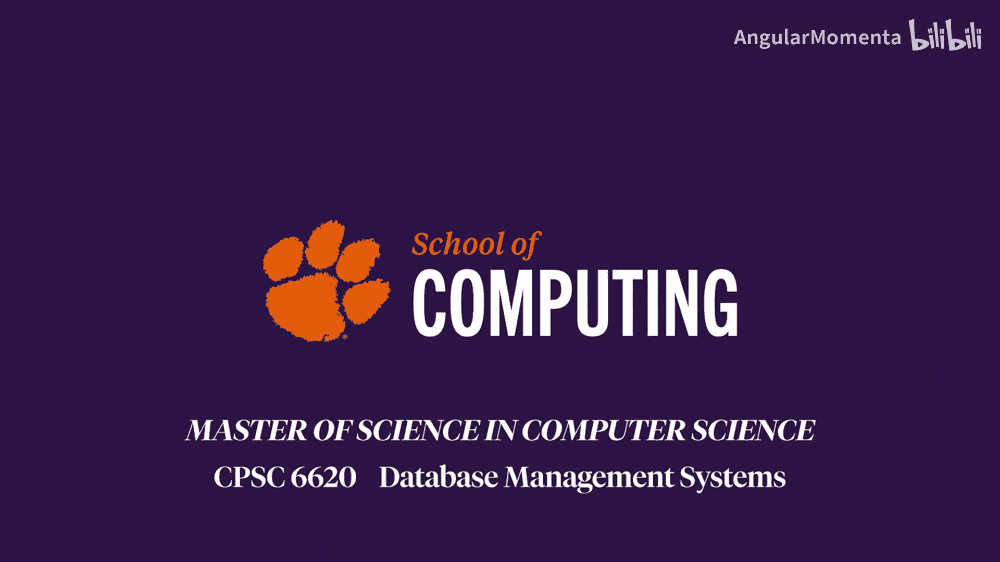
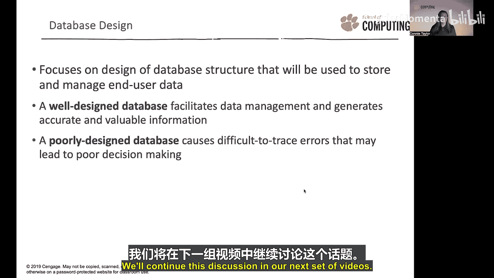

# 【克莱姆森大学】数据库管理系统 ｜ Database Management Systems p02 01_02_03_types-of-databases-and-database-design -BV1y6rzBXE34_p2-

🎼。🎼。

So we're going to go ahead and start module1， just asking the question。

 what are database systems and thinking about various types of database systems。

In particular in this first session， we're going to talk about the various types of databases and the importance of database design as you build out a database system note that this module corresponds to chapter1 of our reading。

So just think about for a moment what's the difference between data and information。

 how would you think about the two differently？As we're inundated with data every day versus information。

So I'll let you think about that for a moment。So what is the difference so if you think about data。

 data is raw facts， it's really not processed， doesn't necessarily have any meaning。

 but you need data to build out information。So what you do is you process that raw data to reveal meaning and create information。

You have to be able to have context， some level of knowledge。

 and you have to have accurate and relevant information。

All of this building out of information from raw facts and data is done using a database。And overall。

 like I just said， data and facts lead to information， which then overall can lead to intelligence。

 which is some belief or risk， and we're in a data today with lots of beliefs and overall interpretations of information when you go out to social media and the newspapers。

 so you know the information and how it's used really can be different depending on who's taking that and putting their own spin on it or their own beliefs against that data。

Here's just a little bit of some different views of data。

 so you can have first somebody puts in a bunch of data in a screen。All of that data。

When you look at it in a in a spreadsheet iss just raw data。

 But then now I'm going to actually look at this information。 I've taken the input from。

Somebody at a university。 And now I can actually count up types of instructors。

 look and gain some knowledge from that data as I process it。

 And I can even put it in graphical form。 So this is something you see all the time today where data is entered。

It's still just raw data， but then it's summarized in some format。So how do we store all this data。

 how do we manage it， how do we turn it into information， this is done with a database。

It's some structure that stores data and there's in addition to the actual rawfaax and data。

 you will have something called metadata， a very important term。

 this is data about data and it's how that end user data is integrated and managed it describes the data characteristics and relationships and we'll learn a lot more about metadata as we go further in the class taking all the programs together that are used to store the data。

 it becomes a database management system， it's various programs that manage that structure and control access to the data stored。

So what is the role of a DBMS and that is a easier way to say database management system。

 so that's what I'll be calling it from now on how do you access and use your data is managed by the DBMS it lets you share your data。

It gives a view of the data to all the users。It's the most effective and efficient way。

To manage data and just improve overall security and sharing。

A lot of data management today is done through spreadsheets and then maybe you have some kind of a file sharing system at your company or with wherever you're at that you can share data。

 but even though that can work to some extent when you get to larger volumes of data。

 that's really just not the most efficient and effective way to manage your data。

So here's a view of the DBMS in a overall enterprise where you would have end users accessing the data。

You have you can have actual applications accessing the data， not just people。

 so you can have a process running without people being involved。

You can have the web interacting with your database and then all of that data is stored in a database structure which contains both that metadata。

 the data about data as well as the end user data so in this case it's storing customers。

 invoices and products in this database。So there's different ways to classify databases and i'm going to go through different different ways different ways to think about a database you don't necessarily pick one way to classify a database。

 but they they're just important to understand the various aspects of a database and how you think about them so for example。

 you can have you know a single user database， this is just something sitting on your desktop or a multi-user database。

 which is the most common use case is where you have multiple users accessing the data at the same time。

So so that's one way to classify you can also classify by a location so you have a centralized database that's one single site。

 so it could be multiuser but it's sitting in your company data center at one location and all those people access in that one centralized database or it can be distributed so the database in the data itself is distributed across multiple sites again multi-users using it across multiple locations and then the third which is becoming much more prevalent today is our cloud databases which are。

Really distributed databases， but managed usually by a cloud vendor and that database is something that we'll talk about more because there's a lot of aspects of cloud databases that provide some assistance as you think about database management。

You can also think about classifying databases by data type。

So is it a general purposese database it just has a lot of different variety of data that you're using across multiple disciplines or is it very specific to one area。

 so maybe I have all the data about my my various brands that I am managing my as a retailer or is it operational so is it data that's being used day to day you know could be every second or millisecond and that is called transaction processing databases。

 OLTP online transaction processing。Is the acronym that is often used for online or for transaction heavy databases or is it an analytical database。

 so is it something that is used to look at trends or monitor for certain anomalies。

So think about examples as you think， you know， look at various types of databases that could be out there。

 what are some different examples of a general purpose database and maybe where you put in a lot of different types of data。

And that would probably be used if you didn't really have multiple discipline specific databases and you were just starting out and you wanted to have a database to just help you manage things。

 but as you get into more complex enterprises， you'll see the discipline specific databases and those databases being both operational and analytical。

So a little bit more about analytical databases， they usually are used to store historical data。

 like I said you're focused on trends business metrics。

Are also stored so I'm looking to use an analytical database for more strategic decision making and this is where you get into data warehouses where theyre you know extremely large databases storing data in a format that's optimized to help you make your decisions and then as opposed to OLTP。

 another term used for analytical databases is OLAP or OLAP。And that's not just the database。

 but all the tools around the database for retrieving and processing and modeling various analytical data。

And then another term you'll hear a lot in conjunction with analytical databases is business intelligence。

 capturing that data， processing that data to generate information for that strategic decision making。

So you may have heard one or all of these terms， but I wanted to put them all in the umbrella of an analytical database as you think about these types of data stores。

Another way to classify a database may be to how much the data is structured。

There are cases where you may be getting data that's very unstructured and in a raw state and why would you want data in that state。

 Well that might be the only way you can get data before you structure it so you actually have databases sitting there that are full of data that's unstructured before you have an opportunity to process it and structure it or suppose you might have a combination of both。

There's not a lot of use of unstructured data in its raw state more for auditing or if you need so if you need to go back and look at maybe you input a bunch of raw data and you want to go back and check maybe you process it incorrectly so you want to keep it around to go back as a reference。

So the last topic I'll talk about before we break is database design and。

We're going to talk a lot more about this， but as you think about all these database classifications and structures。

It really doesn't matter what data is in it if it's not a well designed database。It really helps you。

Create that valuable information if it's well designed and will not become cumbersome over time。

If you have a poorly designed database， it may lead to lots of errors and。Poor decision making。

 And then ultimately， I also have use the term garbage in， garbage out。 So if you put in bad data。

 you can also have issues with your decision making。 So database design， data quality。

 all extremely important as you get into database management systems。

We'll continue this discussion in our next set of videos。

