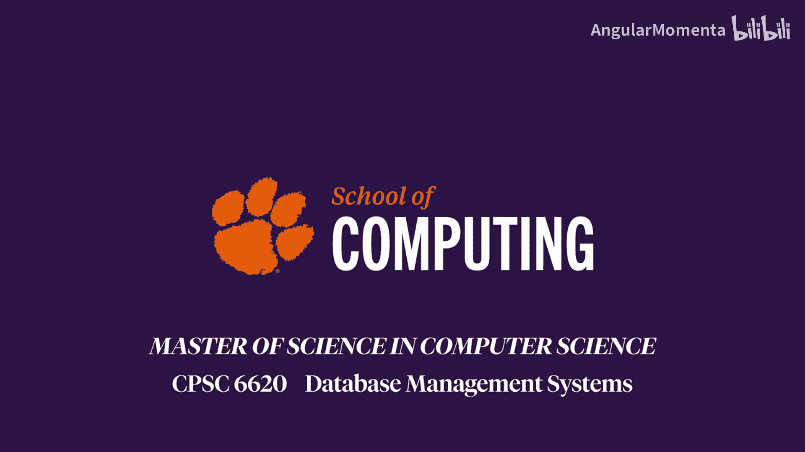
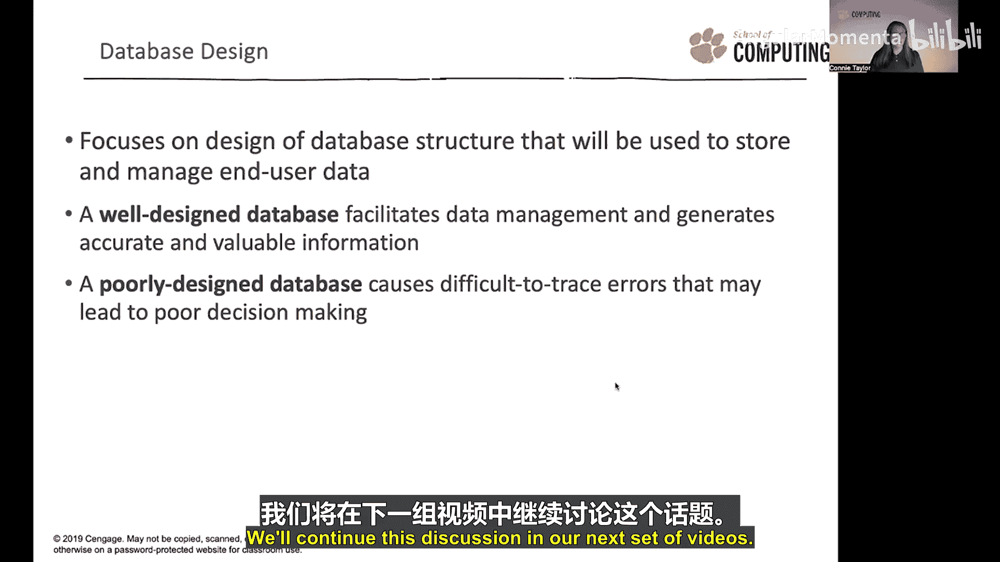

# 数据库管理系统：1.1：数据库类型与设计概述

在本节课中，我们将学习数据库系统的基本概念，探讨不同类型的数据库，并理解数据库设计的重要性。

## 数据与信息

首先，我们来思考数据与信息的区别。数据是原始事实，未经处理，本身可能没有特定含义。信息则是通过处理数据、赋予其上下文和知识后所揭示的意义。准确且相关的信息对于决策至关重要。

从数据到信息，再到最终形成见解或信念（即所谓的“情报”），整个过程都依赖于数据库。在当今社会，我们被海量数据包围，但如何解读和使用这些数据，会因个人或组织的视角不同而产生差异。

## 什么是数据库与数据库管理系统

为了存储、管理数据并将其转化为信息，我们需要使用数据库。数据库是一种用于存储数据的结构化集合。除了最终用户数据，数据库还包含**元数据**，即描述数据特征和关系的数据。

将所有用于存储和管理数据的程序集合起来，就构成了**数据库管理系统**。DBMS 是管理数据结构并控制数据访问的一系列程序。

DBMS 的角色至关重要，它管理数据的访问和使用方式，允许多用户共享数据，提供统一的数据视图，并以最高效、安全的方式管理数据。虽然电子表格和文件共享系统也能处理数据，但对于大规模数据而言，DBMS 是更优的选择。

在一个典型的企业架构中，最终用户、应用程序乃至网络都可以通过 DBMS 与数据库交互，访问其中存储的客户、发票、产品等数据以及元数据。

## 数据库的分类方式

数据库可以从多个维度进行分类，理解这些分类有助于我们全面认识数据库的特性。

以下是几种常见的分类方式：

**1. 按用户数量分类**
*   **单用户数据库**：通常位于个人桌面，供单一用户使用。
*   **多用户数据库**：最常见的类型，允许多个用户同时访问数据。

**2. 按位置分类**
*   **集中式数据库**：数据位于单一站点（如公司数据中心），供多用户访问。
*   **分布式数据库**：数据分布在多个站点，供位于不同位置的多用户使用。
*   **云数据库**：一种由云服务商管理的分布式数据库，在现代应用中日益普及。

**3. 按数据类型/用途分类**
*   **通用数据库**：包含跨多个领域的多种数据类型。
*   **特定领域数据库**：专注于某一特定领域的数据（如零售商的品牌数据）。
*   **操作型数据库**：支持日常高频业务操作，也称为**联机事务处理**数据库。
*   **分析型数据库**：用于存储历史数据、分析趋势和业务指标，支持战略决策。这类数据库常涉及**数据仓库**、**联机分析处理**和**商业智能**等概念。

**4. 按数据结构化程度分类**
*   **结构化数据库**：数据具有明确定义的格式。
*   **非结构化数据库**：存储原始、未处理的数据，可能用于审计或作为处理前的原始参考。
*   **半结构化数据库**：介于两者之间，是两者的结合。

## 数据库设计的重要性

在结束本节之前，我们必须强调数据库设计的重要性。无论数据库中包含何种数据，糟糕的设计都会导致系统难以维护、产生错误，并最终影响决策质量。

一个设计良好的数据库能有效地将数据转化为有价值的信息，并且不会随着时间推移变得臃肿不堪。反之，设计不良的数据库可能导致“垃圾进，垃圾出”的局面，即低质量的数据输入会产生低质量的决策输出。因此，数据库设计和数据质量是数据库管理系统中至关重要的环节。

## 总结

本节课我们一起学习了数据库系统的基础。我们明确了数据与信息的区别，认识了数据库和数据库管理系统的核心作用。我们还从用户数量、位置、用途和结构化程度等多个角度探讨了数据库的分类。最后，我们强调了良好数据库设计对于确保数据质量和支持有效决策的极端重要性。在接下来的课程中，我们将继续深入探讨这些主题。