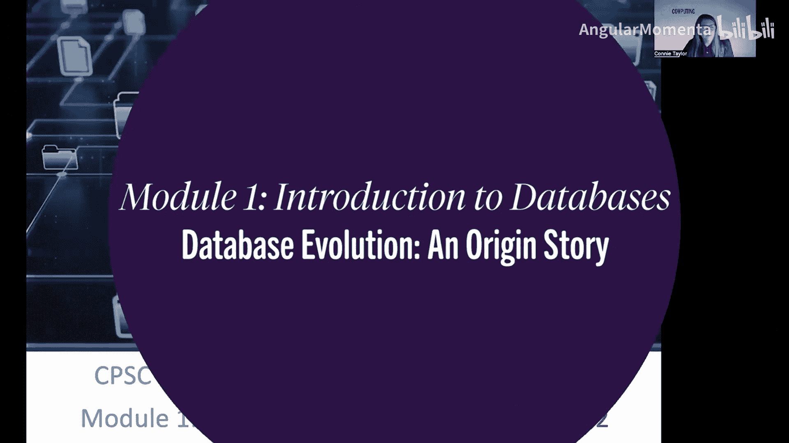
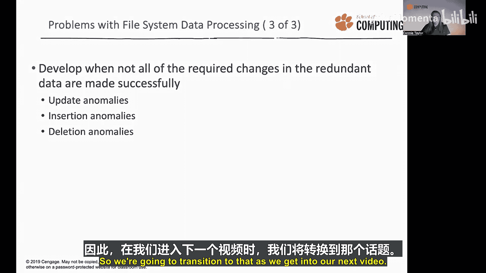

# 【克莱姆森大学】数据库管理系统 ｜ Database Management Systems p03 01_02_04_database-evolution-an-origin-story -BV1y6rzBXE34_p3-

🎼Okay， so let's continue with what are database systems。

By understanding where we came from and specifically how modern databases evolved from file systems。

And we're really a reaction to the various flaws and file system data management。

When you think of files， it's not it all started in filing cabinets and that the。

Various icons you see on your desktops or file systems all started with the concepts you see here with files and folders。

And if you had large rooms of many filing cabinets， it was very important to be organized。

 But as you can imagine， it was very slow to go find something very manual。

 People had to go look at look for things， And it was really prohibitive to have too large a volume of data because at some point。

 it just doesn't scale。And even though these people look really happy in their filing cabinets。

 it certainly is not the optimal way to deal with large volumes of data。So those manual file systems。

 you know， you have file folders and filing cabinets。

 and then we moved into computerized file systems again， having those files and data on your。

On various hard drives and being able to access those files， and we use files a lot today。

 we still use Excel as I've mentioned previously， to manage data and access data。

So if you look at data in a file， one way to look at it and I tend to refer to Excel because Excel is sort of。

 you know has the same structure of when we get to relational。

 we'll talk about tables and columns so if you think about a file today you have data raw facts and you know each field in that data has some specific meaning。

If you take all of those fields and put them together。And connect them， it'll be a record。

And then that whole file is that collection of related recordspers。

So you could have a file that contains data about all the students at a university。And again。

 a way to help you think about this is to think about Excel in the way you store data in Excel。

So you could have files sitting on file systems that people are sharing like a customer file。

 a sales file， and you have programs that access those files and they're typically you know this happens still in a lot of companies today they're not using a database system they're using files and various people have shared files and I mean it's used in Clemson it's used all over the place。

But it's again， there's some challenges when you are sharing files。What are those challenges？Well。

It's really about you know creating you know that that information is limited on what how you access it and accuracy。

 for example， if I had software programs trying to access that data sitting on files it would take a lot of time to write those programs so that's what it means by lengthy development times it's a lot of work。

And getting answers from those files could take a long time because it might not be easy to find the information。

The administration of all those files， organization， I've been at many， many companies and our files。

 you know that we had out on shared drives got to a point where you couldn't find anything。

Security can be a real challenge there's been a lot of improvements over the last 10 15 years on security mechanisms with files and files sharing。

 but it is still not as optimal as we'd like and there's a lot of opportunities for things to leak and get into the wrong hands。

And then also again， back to the programming you need to do around accessing that data。

 so if you just had a file with all the names of various instructors at Clemson and you had to go access anybody with a last name of Smith。

It may take you a long time because you have to parse through all that data， not optimal at all。So。

I think that the other tendency with file system data is having the same data at different places and I'm guilty of this just as much as you know a company is。

 so having multiple copies means I got to keep both up to date or figure out which ones the actual source of truth。

 what's the latest version， you have to be really good about using versioning which also has gotten better in files。

 but it's still it's not optimal。It also， that can lead to data redundancy。 What's data redundancy。

 I have data that is the same in multiple places。 And so things can get in inconsistent。

 So if I have that file of。Instructors at Clemson and the instructors with one of them with the last name of Smith changes their name and I don't remember to change it in all the different places。

 it can really cause all sorts of data integrity problems it can just you know when I go to enter new data I got to remember to add it in multiple places。

And that's going to lead to security challenge also because now if I have multiple places。

 I got to make sure that its it's secure in those multiple locations。

So when you have all these various copies of data。And you're not managing it properly。

 you get what's called data anomalies and that's when things don't match。

And that can happen when you're doing an update like the example I had with an instructor's name changing。

 so I do an update and I don't update it in all the right places。

 I insert somebody new only in one file and not another or I delete somebody from one file and not another all of those types of situations can lead to anomalies。

So we're going to talk about the next step here， how do you ensure you don't have these anomalies and you know it is all about using a real database management system。

 so we're going to transition to that as we get into our next video。

