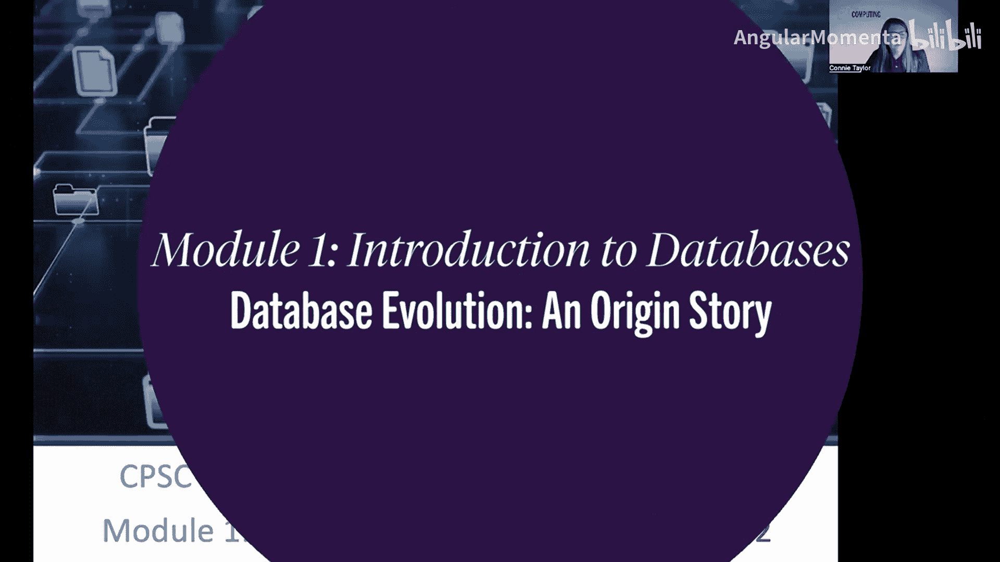
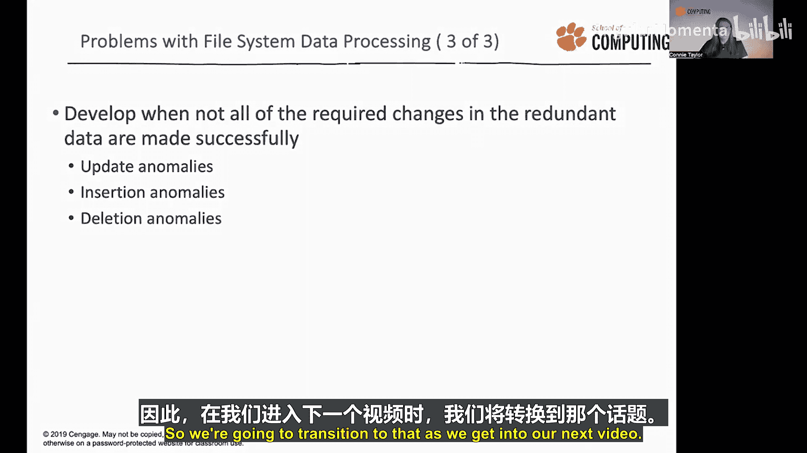

# 数据库管理系统：P03：数据库的演变与起源故事

在本节课中，我们将学习数据库系统是如何从早期的文件系统演变而来的。我们将探讨文件系统在数据管理方面的缺陷，以及这些缺陷如何催生了现代数据库管理系统。

## 从文件系统说起

上一节我们介绍了数据库系统的基本概念。本节中，我们来看看数据库系统的前身——文件系统，并理解其局限性。

文件系统的概念源于实体文件柜。无论是电脑桌面上的图标，还是现代操作系统中的文件结构，其核心思想都始于文件和文件夹。当数据量庞大，需要多个文件柜甚至整个房间来存放时，组织管理变得至关重要。

然而，手动文件系统存在明显问题。查找信息速度缓慢，完全依赖人工操作。当数据量增长到一定程度时，这种管理方式根本无法扩展。尽管图片中的人们在文件柜前显得很开心，但这绝非处理海量数据的最佳方式。

## 计算机化文件系统

随后，我们进入了计算机化的文件系统时代。数据以文件形式存储在硬盘上，供程序访问。时至今日，我们仍然大量使用文件，例如用Excel管理数据。

理解文件中的数据，可以借助Excel的表格结构来类比。文件中的数据是原始事实，每个字段都有特定含义。

以下是文件中数据的组织方式：
*   **字段**：数据的最小单位，代表一个特定属性（如“姓名”、“学号”）。
*   **记录**：由多个相关的字段组合而成，代表一个完整的实体（如一名学生的全部信息）。
*   **文件**：相关记录的集合（如包含全校所有学生信息的文件）。

在许多公司和机构（包括克莱姆森大学），仍然存在通过共享文件（如客户文件、销售文件）并由程序访问这些文件来管理数据的情况。但这带来了诸多挑战。

## 文件系统管理的挑战

以下是使用共享文件系统管理数据时面临的主要问题：

*   **开发周期长**：编写程序来访问和操作文件中的数据需要大量时间和工作。
*   **查询效率低**：从文件中获取答案可能非常耗时，因为查找信息并不容易。
*   **管理困难**：随着文件数量增长，组织和管理会变得混乱，难以查找所需内容。
*   **安全性挑战**：尽管近十多年文件安全机制有所改进，但文件共享仍存在数据泄露的风险。
*   **数据冗余**：同一份数据经常在不同地方有多个副本。
*   **数据不一致**：冗余数据导致更新时容易产生不一致。例如，一位姓Smith的讲师改了名字，若未在所有相关文件中更新，就会产生数据完整性问题。
*   **数据异常**：当数据管理不当时，就会发生数据异常，即数据在不同地方不匹配。

数据异常通常发生在三种操作中：
1.  **更新异常**：更新了某个数据项，但未在所有副本中更新。
2.  **插入异常**：新增数据时，只插入了一个文件而遗漏了其他文件。
3.  **删除异常**：删除数据时，只从一个文件中删除，导致其他文件中仍存在无效数据。

## 向数据库管理系统过渡

那么，如何确保避免这些异常呢？答案就是使用真正的数据库管理系统。

本节课中，我们一起学习了数据库系统如何从手动和计算机化的文件系统演变而来。我们详细探讨了文件系统在数据共享、管理、安全和一致性方面的固有缺陷，这些缺陷正是催生现代数据库管理系统的关键原因。下一节，我们将正式进入数据库管理系统的世界。