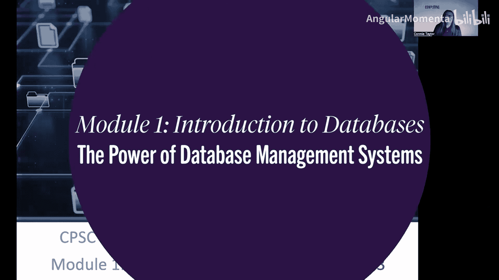
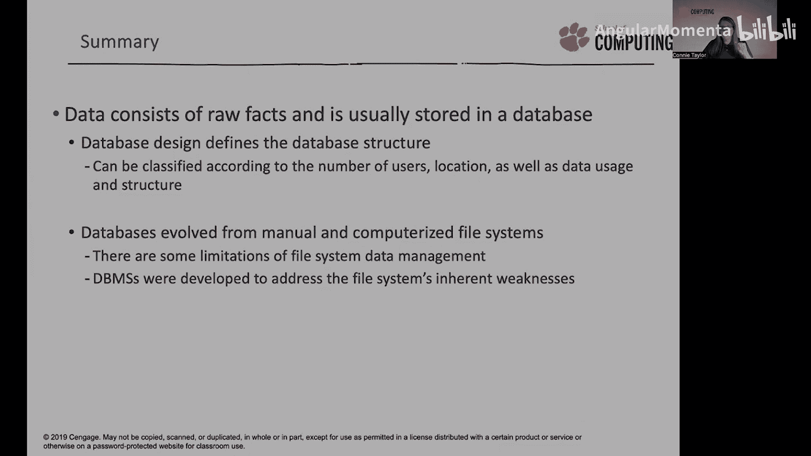

# 【克莱姆森大学】数据库管理系统 ｜ Database Management Systems p04 01_02_05_the-power-of-database-management-systems -BV1y6rzBXE34_p4-

Welcome back， this is our final。Section of module1。And defining what our database systems。

And in our last。Video we talked about file systems。And all the various flaws in a file system。

And that leads us to why a database system is so powerful and necessary。Before we talk about。

Database systems， though I do want to talk about two terms which are around structural and data dependence and independence。

So， if a。If a system is structurally dependent， such as a file system。

That means when I'm accessing data。I can't expect that it won't change the structure。

And if I write a program to access that data。I'm going to have to change the program every time the file structure change。

So I am structurally dependent on that data system， which happens to be a file if I'm independent。

You can change things， but I always know how to get the data， I don't have to change any programs。

So clear， structurally independent is superior to dependence。And likewise。With data。

Data dependence means。If I have my data stored on a disk at a certain location， I want to access it。

 I have to know where it is。 I'd have to go to a certain。Sector on a disk。Not optimal。

 I want to be independent of that。 I want to access my data。 no matter where it's located。

 I don't care。 I want a system that hides those details from me。 So when I go to access data。

 even if it had to change the disk， because maybe the disc crashed。I still can get to my data。

AndWhen it comes to data dependence， another way to think about it is logical and physical format。

All the data you see in a database and you access is sitting somewhere on a disk。

But you don't really have the knowledge or care to know where that physical location is。

 You just want to know logically my data is sitting in the database and I can get it when I need it。

So。Now we can talk about what is a database system。And a database system。

Is having logically related data stored in some single repository。

It eliminates all those inconsistencies we talked about with file systems。

 and you know that is because it's giving you that both structural independence and data independence。

Current DBMS software。Is addressing all the relationships between the data and the way it's structured access to the data。

So again， you're just focused on making sure， you know the data in your system， you can get to it。

 but I'm。I have a level of abstraction where I don't have to worry about the data and where it's located and I can be ensured that the structure won't change。

And here in this case， just a physical representation， I have a file system on the bottom。

Where the personnel department， the sales department。

 accountingcount department all has data that they're managing in files。

 and when you get it into a shared database system。

 you can keep that information in sync by having that shared system with a shared structure and there's just so many benefits that you'll get out of having the data out of file systems and input put into databases。

Now when you think of the database system， you got to think about the entire environment。

 so there is the DBMS software， but and then you have hardware people that have to manage that。

 there's a lot of procedures that go into database management and making sure your data is secure that it's consistent you don't just let anybody throw whatever they want into your database and then you have the data itself。

 what data do you allow into your system。So here's some of the various roles involved in a DBMS software and enterprise。

You could have as you see here， procedures and standards allowing。

 you know what people can do with data， you have various programs that programmers are writing that access the data。

 there's got to be some overall enforcement and procedures for that。

The end users will go through the applications to get to the data。

 Where is that database sitting with hardware， Is it managed by your company。

 Is it in the cloud and who's managing the hardware？

 So system administrators are having to manage all that。

And then who's designing the actual database and making sure it's structured properly and is optimal。

And you have database designers and database administrators working together。

On all of that so this is just one example I've been in environments where many of these roles were combined into one and certainly as you move to the cloud。

 some of these roles changed significantly， some of them were pushed into the cloud provider。

 but ultimately somebody has to do these things。So what is the database management system。

 the DBMS doing？It is storing information about the data， it is storing the metadata。

And that's usually called a data dictionary and or sometimes called a system catalog。

 we'll talk about that， both of those more， but if you have a DBMS。

 you can expect it'll have a data dictionary。It's managing the storage， again。

 ensuring that structural independence through data storage management。

It's formatting your data correctly， so I expect maybe the data is in bits and bytes right or it is in bits and bytes I want to see it as a date or I want to see it as a decimal make sure I can see it in the way I expect。

Very important security management forcing the security and privacy of my data now it doesn't magically do that。

 but it gives your database administrators the ability to manage data or manage information and roles and how data is accessed。

And again， that goes back to multius access control actually this is more around hey I've got thousands。

 millions of users accessing my data， how does it make sure people aren't overriding each other or it gives people the access they need。

Another extremely important part of DBMS functions， backup and recovery。

 so if something happens to your database， did it have a copy that you can access if something happens under the covers。

 it's managing integrity of your data so that the data is consistent。

It also will provide access to your data through typically some query language if it's not relational。

 but you know most of the systems use SQL， if they're relational。

 they have to use SQL and even nonsQL are trying to support SQL as a language because it is as you saw in that one chart in the beginning of the introduction to the class。

 SQL is a very popular and well-known language and supporting that helps any database system。

Also provides the interfaces so that it can you know it can be connected to from various locations。

 so if I have a database in a separate site or in the cloud。

 it has all the networking sophistications so that you can access that database。

So before I talk about some of the disadvantages， I just want to make one more comment about the database systems and。

It actually you know it is one of the disadvantages of complexity。

 I actually think of databases similar operating systems。

 they are that complex in a future module we talk about managing databases and administering them and the amount ofnobs and gears you can turn and managing a database is extremely complex and you need people with a lot of expertise in a specific technology like relational as well as if you're using MySQL or oracle they have their own knobs in gears that you can mess with。

 so databases are very complex systems， they give you huge power you know that they're tried and true relational is tried and true and a lot of big companies feel very safe putting their data in relational databases but they do you have a higher cost。

In the past， when there was fewer vendors， Oracle was sort of the king of relational databases。

People were spending more on their database technology than the application programmings running the databases。

The cost is gotten a little bit more manageable， but as people move to the cloud you know just you know paying cloud fees can be very expensive and again like I said you have complexity you have issues with you know having everybody access and making sure your database is up to date for all the varying constituents you want to。

Think about vendor dependence So you know if do I need to worry about， you know。

 I'm on MySQL and maybe it needs to work for Postgres or various vendors This again is an issue a lot of the reason people go to the cloud because they they don't want to worry about this MysQL run on this version of Linux or that version of Linux it just runs out in the cloud and I don't have to think about that。

And then。Just like operating systems， databases have very frequent upgrades and replacement cycles。

 they are continually needing to put security updates， bug fixes， etc ce， and those upgrades。

 if you are managing the database yourself and you're not in the cloud。

 you're going to have to take care of that。And this slide， our last slide is just a nice view of。

variarous jobs in database management and as you think about careers， if you're interested in data。

 there's just so much out there， some of these roles will collapse and you know you can wear multiple hats but if you look at the bottom data scientist that's a very hot job these days。

 very highly paid job and a lot of people are running to that as a career again。

 knowingSQL knowing relational databases is I believe fundamental skill of a data scientist and all of these various roles you know you can be building applications as a database developer you can be more on the system side of databases because like I said they're so complex and maybe be a security officer or a database admin or a cloud architect。

So lots and lots of opportunities to think about as you think about， you know。

 if you're interested as you go through this class is there you know， is there you know。

 a future in being able to take these skills out there absolutely it's an exciting field with lots happening a lot of technology changes so I'm happy if you ever want to reach out to me and talk to me about opportunities。

But I just wanted to show you this because there is so much， there are so many possibilities。

So I'll see in the next module and oh before we get there， I just give you a quick summary。

 you know just what we covered， certainly can't put it in on one slide。

 but you know just make sure you think about the difference between you know raw facts and information。

 how do you classify data。And then that movement from file systems to database management systems。

So we'll get into more database design in module2， and I'll see you there。

