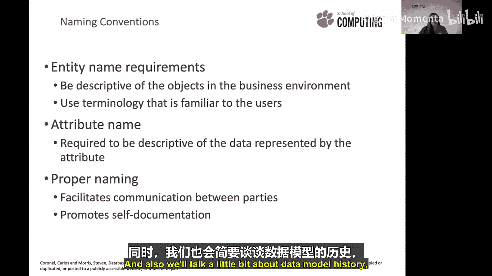

# 【克莱姆森大学】数据库管理系统 ｜ Database Management Systems p05 02_01_05_data-modeling-overview -BV1y6rzBXE34_p5-

Yeah。

So we're ready for module two。And in module one， if you remember， we talked about。

Databases and the importance of database management systems。

A little bit of the history and in module two， we're going to focus on data modeling。So why。

 you data modeling is so important。How to do data modeling at a high level and also the different types of models there are。

Module 2 corresponds to chapters two and9 in your textbook。

So let's start off and talk about data modeling and the importance of data models。

The basic building blocks of a data model。And define what business rules are and how they are actually used in data modeling。

Few definitions， you probably are all aware what a model is。

 is it's an abstraction of a more complex object， so at the you know simplest level when you want to you know show somebody what you're going to build。

 for example， you'd have a blueprint as a model or you could actually create a small scale model of a building or a car。

 so just helps communicate before you go through all the process of building the actual real worldorld object。

Specific to databases， you would create a data model。

 which is what you do to create that model for a specific problem that you're trying to solve and then the act of actually creating that。

Data model is data modeling。So let's just reflect a little bit and think about why are data models important if you think about any modeling that you've done maybe be in other contexts。

 why were those important？So data models are important on really you know the number one reason being communication。

 so you want to again， before you actually start building anything you want to have a way to communicate to the people that are asking for this database what it is you're going to create it gives you the ability to create different views of the various models that you create so that you can tailor it to your end users and organize it so they understand it better。

 so you wouldn't want necessarily to show all the detail to maybe somebody higher up in an organization but for developers they would definitely want to see the entire detailed data model。

And you know， just。Overall， you need that abstraction to help you think about and plan ahead on what you're going to be building。

A good example I have of how important data models are is when I was an industry。

 I worked at a software company and we provided software supply chain software to a company called Circuit City and Circuit City now is no longer a business but they're similar to like a Best Bu and so our software and our database in particular was so important to Circuit City they took our data model they blew it up into huge posters and put it all around their data center just so everybody could see it and have that you right there in front of them it was just such an important part of their business so you know they couldn't go in and necessarily look at all the data all the time but they could see the data model and understand the various components。

Okay， so what are the components of a data model， what are those basic building blocks？

First of all you have an entity， so it's just a person place or thing or event and it is you know usually a noun when you talk about understanding requirements So if you've done any kind of object modeling and object or in a design is very similar and so in a data model it's just an entity it's a thing So overall it'll have additional attributes。

 what are the characteristics of that entity for example， if we take the car example。

 you know it has a door it has a steering wheel， so there are you know maybe the color of the car。

 those would be characteristics of that that car， the number of doors it's a two door。

 it's a four door it's a blue sitan， whatever would be attributes particular to that entity and then relationships are if you have multiple entity So if I were to break my car up and have the chassis and the steering wheel that's a one to one relationship you have one steering wheel。

Or one chassis， but if you were to do。Tires to the chassis， you'd have four。

 I'd assume it's if it's a car， four tires to one chassis or four wheels to one chassis。

 And that's a many to one relationship。 and there。Those relationships go in both directions we'll talk about that in a moment and then any kind of a constraint you have on your data so in the car example a constraint would be I have to have four wheels I can't have two。

 I can't have three this this particular data model would enforce that I would have four。

So what is a business rule， a business rule is another way of saying requirements。

 what is it that I'm trying to create with my data model？

And it really is giving you that description and understanding of what it is you're trying to model。

It should provide you enough information that you can figure out entities， relationships。

 and constraints， as I described in the prior slide。

Now the reality is a lot of times you won't have all this information。

 sometimes you'll be asked to create a data model looking at an existing database。

 and that may be the best you can do ideally though in an ideal world。

 you can actually talk to the business users， you can talk to maybe if you're in a software company you can talk to product management。

 understand what is the business and the rules you're trying to model。So again。

 where do you get these business rules you can get them from it's really the constituents who are asking for this should be able to tell you if they can't tell you they'll point you to the right people is it you know certain people within the business in a if you're focused on like HR software or HR data models。

 maybe you want to talk to the HR department and their managers and their policy makers so those are the sources are going to you know depend on the domain of what you're modeling。

And overall you're also you could have documentation。

 so in the example that I said you're given an old system and you need to rewrite it and put it into a data model。

 you could look at the existing documentation for that older system。

So having business rules is really a nice a nice to have。

 very nice to have when you're sitting down to do your data modeling。

 it makes sure even before you create the data model that you have that understanding of what the needs of your customers are and it gives you a tool to communicate with those constituents so you can go back to business rules or requirements and understand why did I make this decision。

I'm a little hesitant to say you're always you know that you absolutely have to have business rules because my experience has shown me that a lot of times you're not going to have the luxury of talking to customers or talking to end users when you create your databases or at least not being able to talk to enough of them so there may be a need for you to create your own version of a business role or use existing requirements that may have been used for the software and again the other thing I have found in industry is business rules not necessarily the term you'll hear a lot I tend to hear more requirements as opposed to business rules。

So just when you look at business rules or requirements。

 they really are going to give you the key terms and attributes that you need to know when you do the data modeling so a noun in that business rule requirement will be an entity and verbs would be the relationship so example being a car has four wheels so you know the has as a relationship a car has four wheels and both car and wheels are nouns and would translate into entities。

So the other thing you have to think about is not just， you know car to wheels， but wheel to cars。

 so you would have a relationship that could go both ways or would go both ways。

 so a wheel would be associated with one car。And lastly， as you think about creating business rules。

 even if you aren't given them and you're creating your own requirements， your own business rules。

 make sure that when you are getting those you understand the business names and translate those into your data models because if you create a data model and it uses some ambiguous terms。

 worst case scenario， if you just use like X， Y and Z， which no one would do。

 but you want to make sure when you're communicating the model to somebody。

 you're alsore reviewing any of the requirements， you're using descriptive names。

 that the business will understand。And same goes with attributes。Okay。

 so I'm going to stop there and in the next section we're going to get into a little bit more on how you do the data modeling and also we'll talk a little bit about。

Data model history， where they came from and where they are today。

