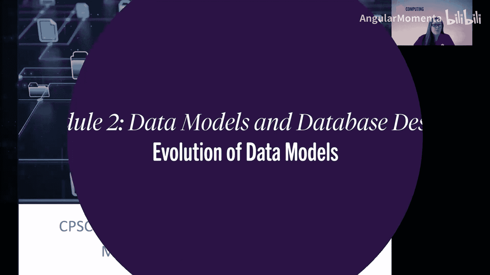
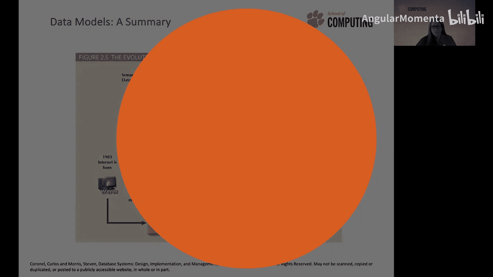

# 【克莱姆森大学】数据库管理系统 ｜ Database Management Systems p06 02_01_06_evolution-of-data-models -BV1y6rzBXE34_p6-

All right， we're now ready to move into part two of module two。And in part one。

 we talked about data modeling from a high level， why it's important to do data modeling。

 and in part two， we're going to talk about how data models evolved。

Some of the emerging data models and more detail about relational data modeling。

 which is what we're going to focus on in this class。

So if you go back in history on how data models evolved。Originally， you had the hierarchical model。

 and that model really came out of complex manufacturing， a concept of bill of materials。

where you would have a structure of data that would look like the pieces and parts you needed to build something。

 so you had levels and segments so in our car example a car would have a chassis wheels。

 an engine etc， and then an engine may have its parts you know a wheels would have its parts so it would kind of go down as a hierarchy as the bill of materials for that item or manufacturing required and had you know had a very defined structure that made your data model structurally dependent which we talked about and that evolved to more of a network model。

As opposed to hierarchical， so it had more complex relationships that you could represent。But again。

 there was still that structural dependency， even though it did improve performance。

It's more important from those models to understand some of the key terms that came out of those early models。

 one being a schema， which is the entire database as viewed by the DBA a database administrator or somebody managing the database and then a portion of that database would be a sub schema。

 which would be maybe a part that's seen by a particular application or a particular set of users in a company in their domain area。

 so sub schemas can vary depending on。The information you want out of the entire schema。

Next would be another term that's very very important data manipulation and i'll actually bring in data definition language as well both these dL and dDL will talk a lot more in future in future modules。

 but for now the important thing to know is you had。

The ability to manipulate data using whatever tools and capabilities so I want to change specific data so if I had a card defined in my database and I wanted to change the color from blue to red。

 I would have some way to be able to do that using data manipulation language。

If I wanted to actually add a whole other part or a whole other。

 let's say you know I was going to go from a two door set of cars and I'm adding I'm going to four doors and I need to actually add more columns or information to my database。

 then I have to use something called data definition language which is。

Letting you change the structure and change the components of that data model。

So now we're going to get into relational databases。

 which as we said in the introduction is going to be the primary focus of this class is relational databases and what is a relational database。

 it's based on something that's called a relation if you have a math background you may that term may mean more to you I would think of it as a table。

 so and again if you use Excel， every one of those tabs you have those sheets has a table in it with rows which are called tuples in the relational model and attributes which are the columns。

So the relational model though， has a very precise set of ways of manipulating the data and accessing the data。

 and we'll get into that as well。When you get into a DBMS that is relational， it's called an RDBMS。

 no surprise there。And using an RDBMS gives you a lot of capabilities to understand。

 use and access data without having to have all the details of underneath the system。

So let's look at an example in a relational model。 So in this example I have two tables。

 you see the first one is called agent。And the second one is called customer。

And agent and customer are related by a column called agent code。 So in the agent table。

 it gives all information about a sales agent。 So this is an insurance company。

 And so you have an agent named Alex Alby， So his last name and first name， their middle initial。

 their phone number with an area code and a phone number。 And they're linked to a customer table。

 which has all the customer。But if you look at the agent code。

 you can figure out who are Albi Alex Albi's customers based on connecting that agent code to the agent table。

 so that is you know the relational model through looking at tables。Now。

You will have an application that is built on top of your RDBMS to allow you to access that data using DDL and DL with SQL structured query language and you'll have a user interface or a command line where you can actually interact with the data。

And look at the independent tables。And there is an engine running in the background that's executing all your queries against that database。

So those are all sort of requirements of the relational model。

Now I want to draw or represent my database in a model before I build it in my RDBMS and I'll do that with something called an entity relationship diagram or ERD。

And ERDs， that was actually in my example， I talked about Circuit City。

 it was the ERD that they had hanging all over their IT data center。

So it's a graphic representation to model your database。

It shows the entities and the attributes in the connections between those entities。

And there's various ways that you can draw or create your ERD。

Various notations specifically there's a。The notation called Chen。

There's a crow foot notation and then you can， if you have an object oriented background。

 there's also a way to do it using UL。For this this class we're going to be using prosefoot it's also what I have seen primarily in the industry and the reason you have the name prosefoot if you look here on this on this picture and I'm putting my cursor around the the many symbol so when you have in this employee to skill on many to many relationship the many symbol looks like a crow foot so cut they didn't work hard to come up with that name。

 but it's prose foot notation。And。You， you know， that's what we're going to be using now。

There's other data models besides our ERD there have been in the past a lot more popular were object oriented data models。

 so when people were creating databases to support object oriented applications。

 it was really nice to be able to just use the already created object oriented models you had to model your database so。

Again， very similar with entities and attributes， you have objects and attributes。

 but this is I just want to go you know bring this up more of an awareness we will not be doing any object oriented data modeling。

And it uses the concepts that you see in object oriented development with classes and hierarchy and inheritance and unified modeling language is the mechanism to create the diagrams。

 et cea， a model of system。And this is just an example， and like I said。

 I'm not going to focus on this as part of the class。

 we're not going to be doing any object oriented data modeling， but it was more of an awareness。

Another another mechanism for data modeling is extending your ERD。

Using you can you can extend it with object oriented features。

 you can also extend it with XML which is a markup language where you can you know exchange data so databases do allow you to have unstructured data and this is just the capability for the models to support that again this is more of awareness we won't be doing this as part of this course。

And the last topic I want to talk on is what you probably have also heard more about if you're interested in data modeling and data science。

The whole area of big data， and no sQL。And these emerged over， I'd say the last 10 years。

 maybe more now， where we had to deal with large volumes of data that was moving quickly and it's the threeVs。

 high volume of data， high velocity and high variety of data。

And you need different mechanisms beyond relational to manage data with these characteristics。So。

As you think about these new data models。They， you know。

 they require different tooling and different ways of。Representing and storing this data。

 and there are a lot of new technologies。We're going to in future classes focus more on No SQL as opposed to some of these other ones。

 though Hadoop and MaRduce are still in certainly in use today。

 noSQL is becoming you know sort of the hot area in emerging data models that we'll focus on as part of this course。

Specifically a little bit more about NoSQL in as I said。

 we will have a future module to cover this they are not based on relational models。Very。

 very distributed database architecture。 So if you think about， you know。

 huge volumes of data accessing that data across multiple locations has to be highly available and scalable so that it's there to use all the time。

 there could be what a concept called sparse data。 So I have a large amount of data that is empty。

 I don't have anything， but I have other parts。 So if I had a table of data in Excel。

 and I let's say you only had five of your columns filled in。 So that's considered sparse data。

And really that focus in no SQL is on high performance， high availability。So this is really。

 you know， just scratching the surface on no SQL and in a future module。

 we'll talk a lot more about it。So just in summary。Around data models， you know， historically。

 starting with that hierarchical network models， which had that structural dependency。

Then you get into relational， which relational has really evolved。

To include the entity relationships。The semantics， you can you can take a relational database and actually there are extended relational techniques for object oriented。

 which have evolved as the application programming world moved into。Into object oriented。

 and then now we're in the whole no sQL world， which is very separate from。From the relational。

 however， you can't understand No SQL unless you know the relational based databases because a lot of the explanation for no SQL and understanding is based on concepts in the relational world so。

So that is conclusion of our part two， some data model history， importance of data models again。

 and using ERDs， entity relationship diagrams to represent relational databases is what we're going to build on more as we get into future modules。

