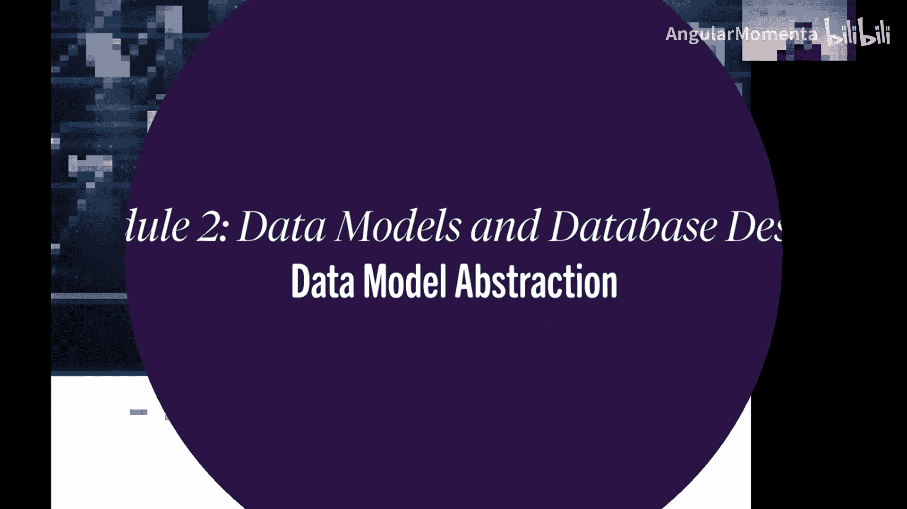
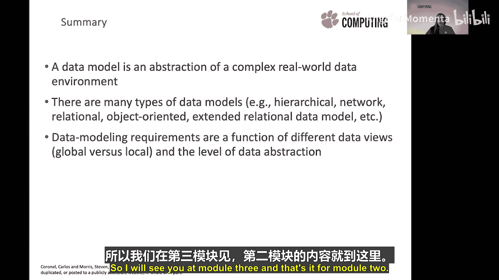

# 【克莱姆森大学】数据库管理系统 ｜ Database Management Systems p07 02_01_07_data-model-abstraction -BV1y6rzBXE34_p7-

。

This is the last part of module2 data models and we're going to cover data modeling abstraction so what does that mean it's different views of your data model and different levels of abstraction of that data model so when you're abstracting something you're trying to make it simpler if you're at a higher level of abstraction and you're more that weeds in detail the lower level of abstraction。

So this view at the very highest level you're going to have what you can call an external model。

 it's a piece of a conceptual model which is a high level view of your data model that you would be showing to a customer。

 for example， so maybe if you're building an entire enterprise system you would only show the data model to the HR department that they care about and you would only show to the sales department a subset of that conceptual model that they are interested in so you're taking the conceptual model。

And making that more more applicable by taking a subset for a particular end user So if you think about those degrees of abstraction at the very highest level that external model completely independent of how you're building it so your end user doesn't care has no idea is this deployed in a cloud is this going to be written in Java is it using a MysqL database or a oracle database。

 none of that matters， they just want to see the data model and make sure it has all the entities and attributes they care about。

And that's the same as you get into the conceptual model it's just the entire organization is represented。

 and it's not until you get down into the internal model where you're being creating the actual specific components needed by the RDBMS or DBMS and that specific to that DBMS software。

 so you're getting to be software dependent in that internal model。

 and then as we talked about in module1， you know having a physical model。

 the bits and bytes on the disk， you're not going to be worried about that in terms of your data modeling。

So as I mentioned that external model is that theres the end user view so again a great example is if you're building a database for an entire company。

 you only want to show the HR department the data model parts that they care about and maybe the research and development has a portion that they are interested in you don't need to show them the entire view and you would use an ER diagram to represent those views and specifically when we create your diagrams again we'll be using crrowfoot。

 but this will just be a subset of the diagram。And here's an example I think for you to look at of a higher level external model for a tiny college so if I were going to create a data model for the entire Clemson University and I wanted to go to the registrar's office and show them the part of the data model they would care about they'd be interested in student registration and class scheduling so this data model that you see in front of you has some actual written words to help that external user understand the semantics in the model so or the constraints so if you want to make sure that you're communicating with your external user that you understand constraints so for example I have a student in this student registration model and I'm writing there that they may take up to six classes per registration if I didn't have those words right here。

In the model and just showed it without that。It would it would there's nothing else in the model that says I understand this constraint so putting those kind of words next to your model are very useful when you're sharing this with external user。

The other part of this model that you see is for each of the relationships like between student and enrolled。

 there's the actual relationship verb so you can again communicate。

 you understand that relationship between a student and enrolling in a class。

So we will get into more details on all the various symbols and what they mean。

 but you know the crow foot part of this means。Many in the dashes mean one or only one。

 and then each of these boxes representing the various entities within the data model。

And I would be sharing this with， like I said maybe a Reggi's office。

 but I do have a much bigger data model if I were to talk about all of the tiny college various entities and relationships。

 there'd be many more outside of these too， for example。

 you don't see anything here in detail about payments or those types of information。So。

If you get into the entire model that's your conceptual model。

 you're taking a subset again and giving that to an end user， that's an external model。

 creating this entire view is your logical design， you're not worrying about any of the implementation that's happening and it gives you a high levell view that you can communicate with people。

 what are the main data objects going into the database， what are the main relationships。

 and I don't have to worry about anything about software and hardware。

So in this example of the conceptual model of。The tiny college so in this case being a class having a room assigned to a course and a professor teaching this class。

 now I want to actually show the internal model， which is right next to this conceptual model， it is。

This right here， like create table professor， that is the software specific。

Language that I' am using to create a table and it actually shows the attributes。

 their attribute types。 and so when you get into that internal model。

 it is software specific the this semantics of creating the tables professor class room and course。

 maybe slightly different in a relation different relational databases。

 we're going to in this class use my SQL。And again， most SQL relational databases are very similar。

 but they all have their nuances， so you do have to get into you know particulars when you get into the internal model and it is software specific。

Okay， so this is again， that internal model mapped， I go back to this picture。

 maps that conceptual model to the actual representation in the database and how it's constructed for that chosen database。

Okay， so。Your schema will be you know that's the entire schema that you're creating you are still hardware independent。

And you， you know， you will not have to worry about the details of where are these class。

I'll go back i'm going to keep going back to this picture class in room where is the data going to be stored on the disk etc ce。

 the database is taking care of that for you you just have to be able to specify using data definition language here that we spoke of earlier dDL。

The creation of these various entities and their attributes。Now， and。

 and the nice thing about this is you want to have that conceptual model to be logically independent from the internal model so I could possibly。

Change the type of a particular attribute。And not affect my conceptual model。Okay。

 so the very lowest level of the data modeling is the physical model。And again。

 this is saying how does this data？Get stored on the actual desk。

Whether it's you know magnetic or solid state and it is completely dependent on your hardware and your software。

 so you are not independent of those your software and hardware dependent。Now the nice thing again。

 you're not going to worry about this in this class it's just important to know and appreciate that the database management system is taking care of all of this for you and keeps you at a higher level of abstraction so that you can be solving the business problems and not having to worry about what's happening on the back end and all the RDBMSs。

 have that independence from the physical storage so that if things change on the storage。

 you don't have to change your data model at all， they're completely independent of each other。

So just in summary on the various levels of data abstraction。

 so at the highest level is the external model that again you're showing your end users completely independent of hardware and software conceptual you may add some more detail and it's also across the entire domain that you are doing your data model for it is again continues to be hardware and software independent so you know it's not till you get to your internal model where you are getting into the specifics of the database that you're using therefore you become software dependent。

But not hardware dependent。 And then at the lowest， lowest level。

 you are at the physical model level and your， you know。

 low lowest level of abstraction focusing on how do you access the data。

 Where is it stored and it is。It is neither hardware nor software。Independent， so。In this class。

We will be creating the conceptual and external being a view of conceptual。

 you can kind of put the two together and we'll be also creating internal models so you will have the opportunity to work on both。

So just in summary of this module too。Data modeling is extremely important as you get into database development and you want to do a step ahead of time where you do your model。

 you understand the requirements and you have a model you can communicate to your stakeholders。

There's lots of different data models that have have emerged over time。

 we're going to be using ER and entity relationship diagrams。Using crowfoot notation。

 so we talked at a high level about that and that data modeling can have different levels of abstraction depending on your audience。

 you have that external view versus all the way at the lowest level at the physical model。

So I will see you at module three。

And that's it or module2。

