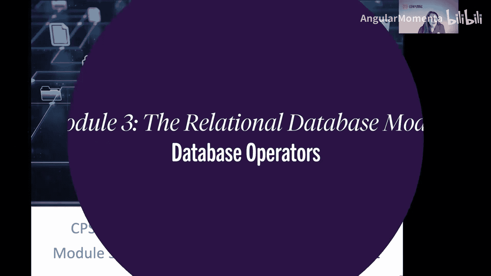
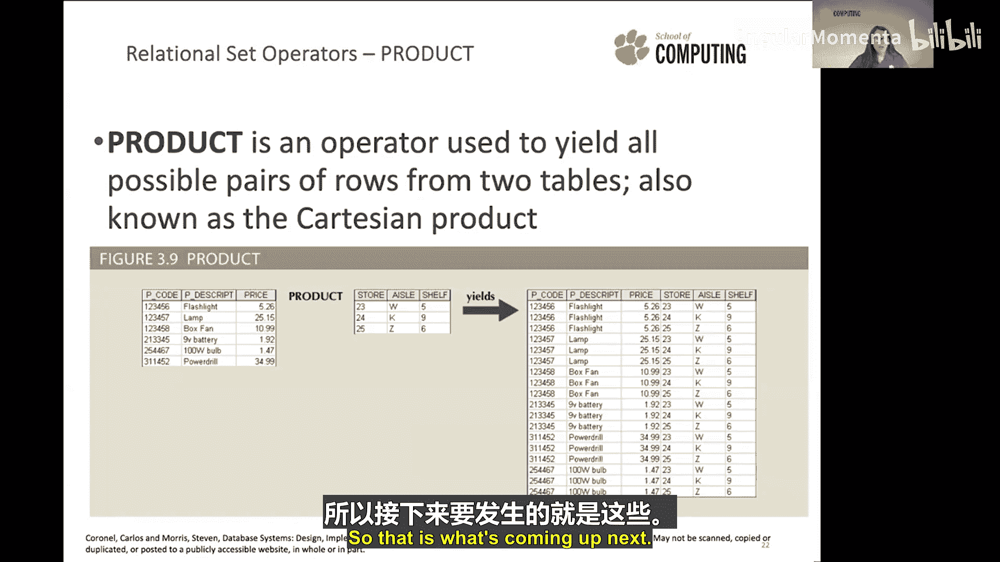

# 【克莱姆森大学】数据库管理系统 ｜ Database Management Systems p09 03_01_04_relational-database-model-operators -BV1y6rzBXE34_p9-

We're going to continue now after we got our brief overview of the relational database model。

 talking about relational operators and how you can do basic data manipulation。

 using these operators in using relational algebra to help you understand how you manipulate table contents。

So relational algebra is a mathematical principle set of mathematical principles that really form the basis of relational table manipulation。

And。It is theoretical， but it gives you an understanding of how the various SQL commands that we'll start using and future lessons。

 how they work。And the just underlying principles behind those operations。So good news。

 you really don't have to be conversant in relational algebra to understand and use a relational database。

 but again， I just think it's important to understand some of these basic principles and just so you know。

 I mean the relational algebra was underpinning of the relational databases and tables in relational database are also known as relations so every table you see in the data in it is called a relation。

Also to be considered a minimally relational database， you need to support select。

 project and join at a minimum。All the various functions select， project， join， intersect。

 union difference， product and divide。 don't have to be supported， but select project and join due。

 We're going to cover all of these at a high level， except for divide。

 So let's go ahead and get started。We'll start with select and when you think of a select you're taking a table or a relation and use those interchangeably and restricting to a subset of rows so sometimes it's known as a restrict if you do a select all you get all the rows。

Of that particular table and when you select create and use an operator on a table。

 it creates a new table， a new relation and that new relation then can be used with another operator so it's something that you want to keep in mind and it'll carry over as we get into using a SQL with databases。

Another example， if you are selecting。A particular set of rows that have price less than $2。

 you only get two rows and then you select a particular product code。

 gives you one row and you should only get one row because assuming product code is a primary key。

 you would only get one row because it has to be unique。

The next operator is project and project is used on columns as opposed to rows as we talked about with select。

So you project price on your product table and it gives you a one row table of just price if you project description and price。

 you get both those two columns in your new table and etc。

Another important relational operator is Union， union is used to merge two tables into a new table and will drop any duplicate rows。

Before I show you this example， I want to make sure you understand a very important concept called union compatible。

 this is used but to describe two tables， you would say two tables are union compatible if they share the same number of columns。

 but they also have to share compatible domains in those columns so for example。

 if these two tables I have here are look to be exactly the same tables， both product tables。

 but if my second table was a set of just numerics three you know five columns and all of them were decimals。

 not just price， then you do not have union compatible and you could not do a union。In this case。

 you can。You can union these two tables， they have same number of comms and they look to be the exact same。

Tables with same columns， not the same data， but they do share one row in common that is box fan。

 so they only have that in the resultant table one time。

Interssect is used to give you only the rows that are common to the two union compatible tables so in the previous example it would be a row just the box fan and this example I have student first name and last name and employee first name and last name and even though the column names are different they're different tables one is a table of students ones a table of employees they the same number number of columns and they are the same domains。

 their characters you know there's a business understanding here too because I could have you probably wouldn't want to do an intersect with two columns that are information about product descriptions you're looking for names so in this case the business question you're asking is what employees are also students and and Franklin Johnson is both in employee and he's in the student table。

Difference operator gives you all the rows that are not found in another union compatible table。

 so as opposed to giving me in this case， the employees that are students。

 it's the students that are not in the employee table。

 so they are all the students that are not employees。

And the last operator we're going to talk about is product and product is used。

 You basically are doing something called a Cartesian product。

 So you're taking the two tables and yielding all possible pairs of rows。

 So if you look in this case， I have a product table。And a store table。

 And the result has for every product。 it is combined with every store and。

So then I get three flashlights， one flashlight at each store。So that is the product now。

That's the last operator I'm going to cover in this section and the next section we're get into join which I want to spend an entire video going through so。

That is what's coming up next， see you in the next section。

