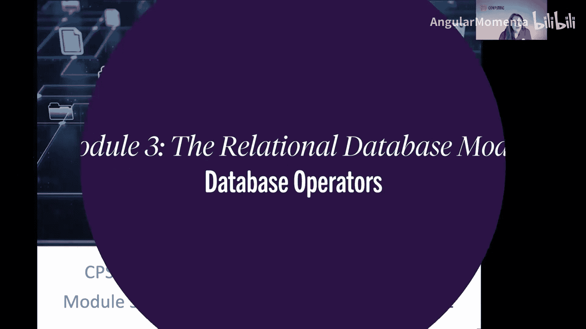
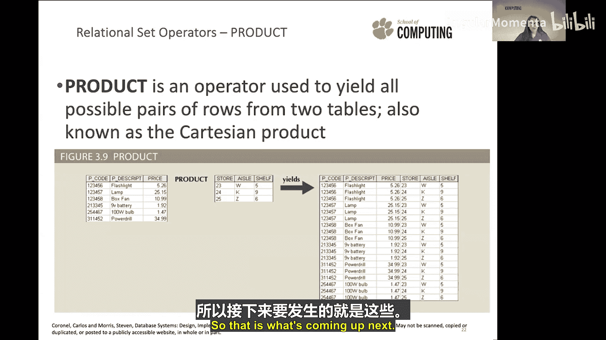

# 数据库管理系统：09：关系数据库模型运算符 🧮

在本节课中，我们将学习关系数据库模型中的核心运算符。这些运算符构成了关系代数的基础，是理解如何操作表中数据的关键。即使在实际使用SQL时不需要精通关系代数，了解这些基本概念也能帮助你更好地理解数据库操作的底层原理。

上一节我们简要概述了关系数据库模型，本节中我们来看看关系运算符，以及如何使用这些运算符和关系代数进行基本的数据操作。

关系代数是一套数学原理，为关系表的操作奠定了理论基础。它是理论性的，但能帮助你理解我们将在后续课程中使用的各种SQL命令的工作原理及其背后的基本操作原则。需要明确的是，关系数据库中的表也称为“关系”。

一个数据库要被称为“最小关系型”的，它至少需要支持**选择**、**投影**和**连接**这三种操作。我们将概览性地介绍所有主要运算符（除了“除”运算）。

## 选择运算符 (Select)

选择运算符作用于表的行。它从一个表（或关系）中提取出满足特定条件的行的子集。有时这也被称为“限制”。如果选择所有行，你将得到整个表。

对一个表使用选择运算符会创建一个新的关系（表），这个新表可以继续用于其他操作。这个概念在我们后续学习使用SQL时同样适用。

以下是选择操作的几个例子：
*   `SELECT * FROM Product;` 会返回产品表中的所有行。
*   `SELECT * FROM Product WHERE Price < 2.00;` 会返回价格低于2美元的产品行。
*   `SELECT * FROM Product WHERE Product_Code = ‘XY01’;` 会返回产品代码为‘XY01’的那一行（假设产品代码是主键，则结果唯一）。

## 投影运算符 (Project)

与选择运算符针对行不同，投影运算符针对表的列。它从表中选择特定的列来创建一个新表。

以下是投影操作的例子：
*   `PROJECT Price FROM Product;` 会生成一个只包含`Price`列的新表。
*   `PROJECT Description, Price FROM Product;` 会生成一个包含`Description`和`Price`两列的新表。

## 并集运算符 (Union)

并集运算符用于将两个表合并成一个新表，并自动去除重复的行。

在介绍例子前，需要理解一个非常重要的概念：**并兼容**。两个表要能进行并集操作，必须满足两个条件：1) 拥有相同数量的列；2) 对应列具有兼容的数据域。

例如，这里有两个产品表，它们列数相同，对应列的数据类型也兼容，因此是并兼容的。对它们进行并集操作后，两个表共有的“Box Fan”行在结果表中只出现一次。

## 交集运算符 (Intersect)

交集运算符用于获取两个并兼容表中共同存在的行。

在之前的例子中，交集结果将只包含“Box Fan”这一行。在这个学生与员工的例子中，虽然两个表的列名不同（`Stud_FName`/`Stud_LName` vs `Emp_FName`/`Emp_LName`），但它们列数相同且对应列的数据域兼容（都是字符类型）。从业务角度理解，这个操作是在回答“哪些员工同时也是学生？”这个问题，结果中`Franklin Johnson`同时出现在两个表中。

## 差集运算符 (Difference)

差集运算符用于获取存在于第一个表、但不存在于第二个并兼容表中的所有行。

与交集相反，在这个例子中，差集操作的结果是找出“哪些学生不是员工”，即返回所有不在员工表中的学生记录。

## 笛卡尔积运算符 (Product)

笛卡尔积运算符，也称为乘积运算。它对两个表进行操作，生成所有可能的行组合。

在这个例子中，有一个产品表和一个商店表。执行笛卡尔积后，结果表中的每一行都是每个产品与每个商店的组合。例如，每个手电筒（Flashlight）都会分别与三家商店组合，生成三行记录。

---

本节课中我们一起学习了关系代数的核心运算符：**选择**、**投影**、**并集**、**交集**、**差集**和**笛卡尔积**。理解这些运算符如何对行和列进行操作，是掌握数据库数据操作逻辑的基础。下一节，我们将专门深入探讨**连接**运算符，这是数据库查询中至关重要且常用的操作。