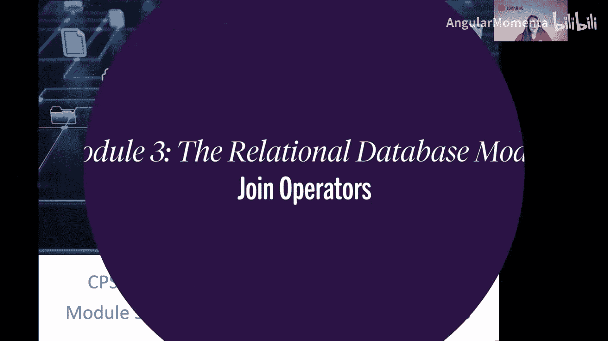
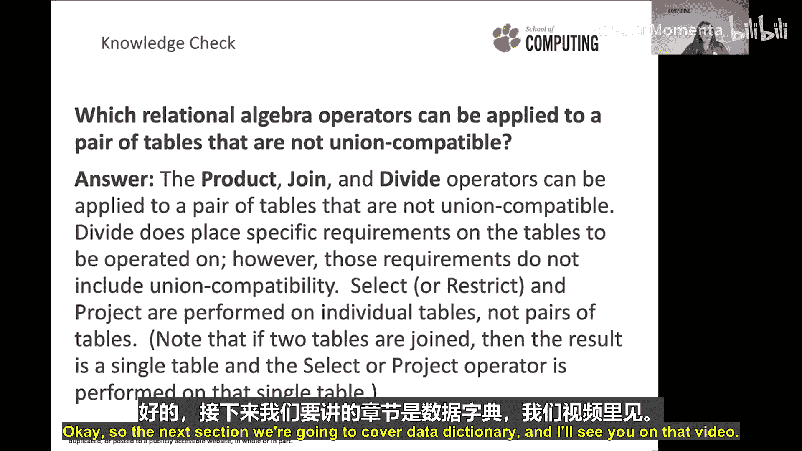

# 【克莱姆森大学】数据库管理系统 ｜ Database Management Systems p10 03_01_05_relational-database-join-operators -BV1y6rzBXE34_p10-

Let's continue on relational operators with the join operator。

And join will build off of some of the other operators we discussed in the last video if you remember those we did select project union。

 intersect， difference and product。So a join allows you to combine two or more tables， which is。

Very common， very much needed as you use relational databases and relational tables。

So you select only the rows， which have common values in a common attribute。

So the column you're joining on is called it's a join column and it's the common column between two tables。

 so in this case it would be agent code is the same in both tables。But to do an actual join。

 it's a three stage process using some of the operators we talked about previously， so the first。

Is to do a product of those two tables。 And you remember the product as a Cartesian product。

 So looking at the prior two tables， I have to take all the customers and associate them with each agent。

 So there are four agent。 So for Walker， I have four walkers associate each walker with each agent。

 So here is my product。Next， step two in a join， a natural join is a select is performed on the output of that last step。

To yield only the rows for which the agent code values are equal。And again。

 these common columns are the join columns。 So we go back here。

 I have the customer agent code and the agent agent code， because I used。

Both tables and they each they each had their own version of agent code。

 and you can see there are rows where they're both the same。Here with Walker 2，31 down here。

 Ads has 1，25， so。I have those rows identified。And then and remember select is doing a subset of rows。

 so I'm only selecting rows where the agent code from customer equals the agent code from agent。

And then I do project and remember， project is。Is all about a subset of columns and what I do is I remove。

The duplicate column， so I don't need both agent codes they have the same data。

 so now I have one agent code。In my resulting table。

So in few notes to think about as you go through this process， just if you look at what we just did。

If there's no match between the table rows， it does not include the unmatched rows。 So in our case。

 agent code 421。Or Smithson are not included。 So let's look back at the original data。

Agent 421 Smithson does not have an agent here， so it is not resulting in my join。Again。

 you only have one agent code column in your final resulting table。

Natural join is often just referred to as join。If you hear people say join。

 they're talking about the natural join。Okay， so。That's the kind of most common natural join join that you'll be using in actual SQL。

 but there's other types of joins in the relational algebra。That I want to talk about。

 there's an E join which will link tables based on an equality condition， there's a theta join。

An inner join， which is really just matching records from。

On the tables and I'm going to give you examples of each of those so we'll get we'll make this a little more real and then you have outer joins and specifically you have something called a left and a right outer join and I'll show you examples of those。

So an equi join is really everything we did in our join。

 except you're not eliminating the duplicate column。

 so it's that step two that we went through in the three step process for the natural join。

If you were and so it's really about again， equality looking at the two columns being the same。

 which is why it looks like that step two and you don't eliminate the duplicate column if you were doing anything else besides an equality between the two columns。

 that is a theta join if you were using a less than or a greater than comparison operator for example。

Another type of join is the。Inner join， and that's really just。

What we've looked at with joints so it's just another way of saying the join so we've we've said natural join join and inner join。

The last one we're going to spend a little more time is outer joints and。

This is really looking at two tables and retaining matched and unmatched values in a different way and i'll show you examples it's very a little bit confusing because people think oh an outer join is the opposite of an inner join。

 but it's more the same as the join but it's join plus。Specifically on a left outer join。

I would return all so the reason they use left and right is because you have two tables you're joining。

 a customer and an agent。So in this case， in a left outer join。

 you would return all the rows in that are in the left table， the customer table。

 including those that don't have a match。So it yields all the rows in the customer table。

 so remember the Smiths an example。So that would be in your result set。 So that's the left table。

 Give me everything right outer join is yielding all the rows in this second table， the right table。

 including those that don't have matched values。 So agent 333 did not have any matches so we list it still in the output And you can also see we're not removing duplicate columns because I want to see these additional。

 I want to see the customer agent code 421 in the agent agent code 333。

 So I shouldn't I can't merge the two columns into one column。Okay。

 so that's just a very high level overview of the various relational。Operators。

 we're going to get into more details and more。Focused on SQL specifically and how it is on top of those relational operators when we get into module seven and eight。

 but this gives you some good background and important to understand where relational databases came from。

So let's just do a quick knowledge check here and think about。

What relational algebra operators can be applied to a pair of tables that are not union compatible？

So remember what the definition of union compatible is。

Union compatibleible means you have two tables with the same number of columns and that have domain compatible columns so that they make sense to bring the two tables together。

So I'll let you think about that for a minute。Okay， let's look at our answer。So the product。

 the join and the divide operators are all applied to a pair of tables that are not union compatible。

Select or restrict and project are only performed on individual tables。

 so union compatibleible doesn't even really make sense。I know we didn't go over divide。

 so you wouldn't know that answer， but I more important than knowing all these operators that are aren't union compatible is just understanding the concept of union compatible。

 what it means。And make sure you have a good grasp of that。Okay。

 so the next section we're going to cover data dictionary and I'll see you on that video。

