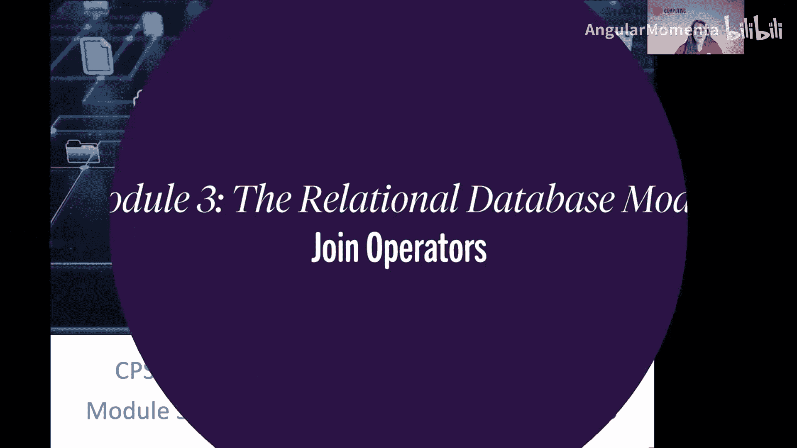
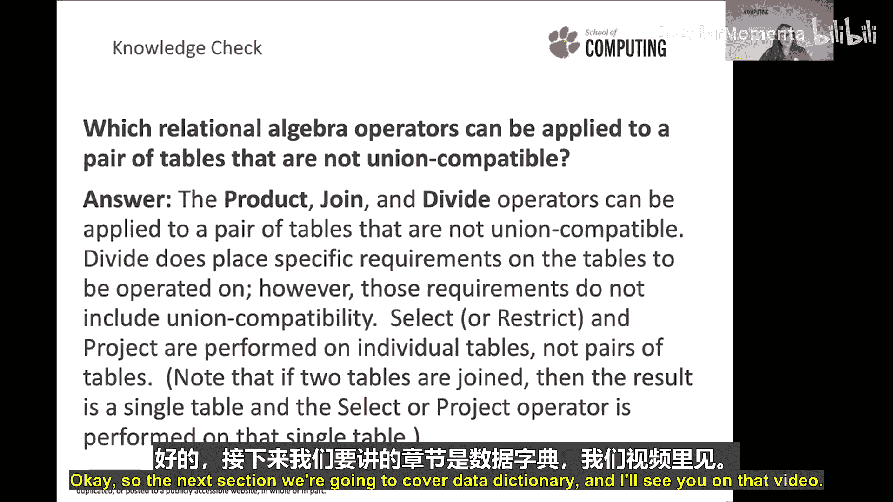

# 数据库管理系统：03：关系型数据库连接操作符 🔗

在本节课中，我们将要学习关系型数据库中的一个核心操作——连接（Join）。连接操作允许我们将两个或多个表中的数据组合起来，这在处理关系型数据时非常常见且必要。我们将从连接的基本概念开始，逐步深入到不同类型的连接操作。

## 概述

上一节我们介绍了选择、投影、并集、交集、差集和笛卡尔积等关系操作符。本节中，我们来看看连接操作符。连接操作基于我们之前讨论过的某些操作符，它使你能够组合两个或更多表。

## 连接操作详解

连接操作仅选择在公共属性上具有共同值的行。你用于连接的列被称为连接列，它是两个表之间的公共列。在本例中，`agent_code` 是两个表中都存在的列。

执行一个实际的连接是一个三阶段的过程，使用了我们之前讨论过的一些操作符。

### 第一阶段：笛卡尔积

第一步是对这两个表进行笛卡尔积运算。回顾之前的两个表，我必须取所有客户，并将每个客户与每个代理关联起来。这里有四个代理。对于 Walker，我有四个 Walker 实例，将每个 Walker 与每个代理关联。这就是我的笛卡尔积结果。

### 第二阶段：选择

在连接操作中，自然连接的第二步是在上一步的输出上执行选择操作，以仅生成那些 `agent_code` 值相等的行。同样，这些公共列就是连接列。回到这里，我有 `customer` 表的 `agent_code` 和 `agent` 表的 `agent_code`，因为我使用了两个表，并且它们各自拥有自己的 `agent_code` 列。你可以看到存在一些两列值相同的行。选择操作是选取行的子集，因此我只选择 `customer` 表的 `agent_code` 等于 `agent` 表的 `agent_code` 的那些行。

### 第三阶段：投影

然后我执行投影操作。投影操作是关于列的子集，我所做的是移除重复的列。我不需要两个 `agent_code` 列，因为它们的数据相同，所以现在我的结果表中只有一个 `agent_code` 列。

## 关于连接过程的注意事项

回顾我们刚刚所做的过程，需要注意以下几点：
*   如果表行之间没有匹配项，则不会包含不匹配的行。在我们的例子中，`agent_code` 为 421 的 Smithson 没有被包含进来，因为他在 `agent` 表中没有对应的代理。
*   在最终的结果表中，你只有一个 `agent_code` 列。
*   自然连接通常简称为连接。当人们提到“连接”时，他们通常指的就是自然连接。

## 其他类型的连接

自然连接是你在实际 SQL 中最常使用的连接类型。但在关系代数中，还有其他类型的连接需要了解。

以下是其他几种连接类型：

1.  **等值连接**：基于相等条件链接表。它本质上就是我们刚才在连接中做的所有步骤，只是不消除重复的列。它对应我们为自然连接描述的三步过程中的第二步。
2.  **θ连接**：如果你在两个列之间使用除了相等以外的比较操作符（例如小于或大于），那就是 θ 连接。
3.  **内连接**：这基本上就是我们目前看到的连接，只是另一种说法。我们说过自然连接、连接和内连接，它们本质相同。
4.  **外连接**：这将以不同的方式查看两个表，并保留匹配和不匹配的值。这有点令人困惑，因为人们可能认为外连接是内连接的反义词，但它更像是连接操作的扩展。

## 深入理解外连接

外连接具体分为左外连接和右外连接。使用“左”和“右”的原因是因为你有两个要连接的表，例如 `customer` 表和 `agent` 表。

*   **左外连接**：返回左表（`customer` 表）中的所有行，包括那些没有匹配项的行。因此，它会生成 `customer` 表中的所有行。以 Smithson 为例，他将会出现在你的结果集中。
*   **右外连接**：返回右表（第二个表，即 `agent` 表）中的所有行，包括那些没有匹配值的行。例如，代理 333 没有任何匹配项，但我们仍然在输出中列出它。

在外连接中，我们不合并重复的列，因为我希望看到这些额外的信息。例如，我希望看到 `customer` 表的 `agent_code` 421 和 `agent` 表的 `agent_code` 333，因此我不能将这两列合并为一列。

## 知识检查

现在让我们快速做一个知识检查，思考一下：哪些关系代数操作符可以应用于一对并非“并兼容”的表？

请记住“并兼容”的定义：并兼容意味着两个表具有相同数量的列，并且具有域兼容的列，这样将两个表组合在一起才有意义。

**答案**：笛卡尔积、连接和除法操作符都可以应用于一对并非并兼容的表。选择（或限制）和投影操作只对单个表执行，因此“并兼容”的概念对它们来说并不真正适用。

虽然我们没有讲解除法操作符，你可能不知道这个答案，但比知道所有这些不要求并兼容的操作符更重要的是理解“并兼容”这个概念的含义，并确保你对其有很好的掌握。

## 总结

本节课中我们一起学习了关系型数据库中的连接操作符。我们从自然连接的三步过程（笛卡尔积、选择、投影）开始，了解了其核心机制。接着，我们探讨了其他类型的连接，包括等值连接、θ连接、内连接，并重点讲解了左外连接和右外连接的区别与用途。最后，我们通过一个知识检查回顾了“并兼容”的概念。这些知识为理解关系数据库的底层原理和后续学习具体的 SQL 连接语法奠定了重要基础。

下一节我们将介绍数据字典，我们下个视频见。