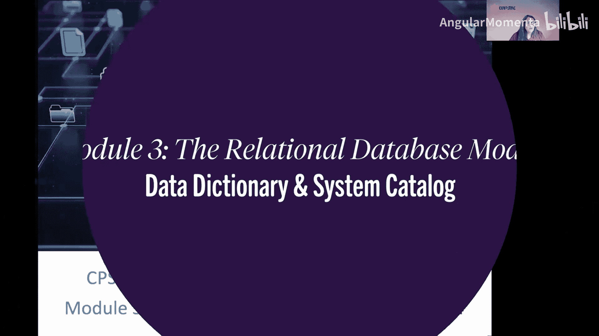
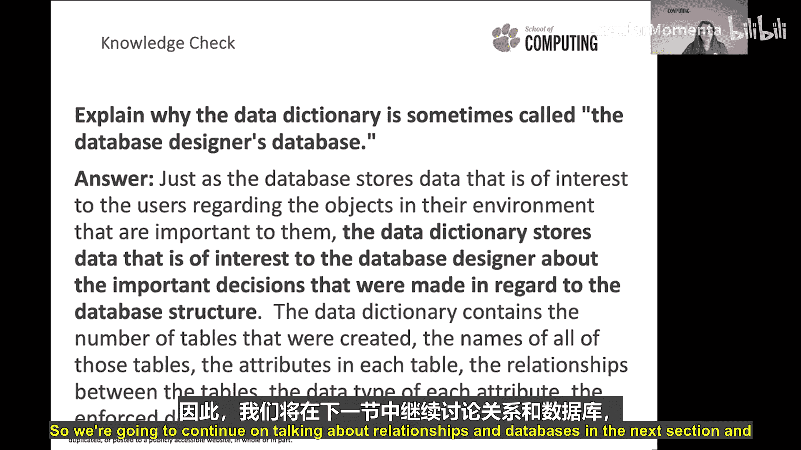

# 【克莱姆森大学】数据库管理系统 ｜ Database Management Systems p11 03_01_06_data-dictionary-system-catalog -BV1y6rzBXE34_p11-

Let's continue on talking about the relational database model。

 and specifically we're going to talk about the concept of the data dictionary and system catalog。

This is a pretty high level overview we'll get into more details on this in future modules。

So what is a data dictionary， the data dictionary is a description of all tables in the database created by the users and designers it has all information about。

The tables and structures in the database。Now there's also a concept of a system catalog。

Which is a system data dictionary that has everything in addition to what you created as a user and it also has。

The tables that the database uses， so there's a lot of things that are stored in the database that you did not create that is are managed by the relational database。

 so all of that is in the system catalog。Now。Because the system catalog has all the required data dictionary information。

 you'll hear these two terms used interchangeably and。In fact。

 when in my practice of using databases， most of the time we just said system catalog and there was only that was all that was provided by the DBMS because the data dictionary could be derived from the system catalog。

So another thing to think about when it comes to the data dictionary is we talked about the concept of metadata in the first lesson in that in the first module。

 and that is really what your data dictionary is providing to you， it is data about data。

And if you look at this example of a data dictionary。

 you'll see what I mean where I have the name of the table。The attribute names。

 what the contents are in that attribute， the types， the format is it required。

 you know do I whenever I enter a customer what values must I provide。

And which attributes are primary keys or foreign keys？

So you know that in our customer in agent tables we've been using in this module agent code was a foreign key in the customer table and it tells you that here and then here's all the information about the agent table so this is just illustrative that's not exactly what a data dictionary looks like or a system catalog but this is the type of information you'd be able to to derive and personally when I would use databases many times I didn't have any documentation I didn't know what was in the database and the first thing I go look at is the system catalog with the data dictionary information so I could understand what are all the tables what what is their contents and extremely useful later in the course we will look at real worldorld examples but for now just understanding。

What this is and why it's so important。And then just just thinking about why is the data dictionary sometimes called the database designer's database and like I said。

 it's the data about the data， so it has everything in there that a database designer has all their decisions that they made and how they set up the structure so it is the database that captures everything the database designer has done。

Okay， so we're going to continue on talking about relationships and databases in the next section and see you there。

