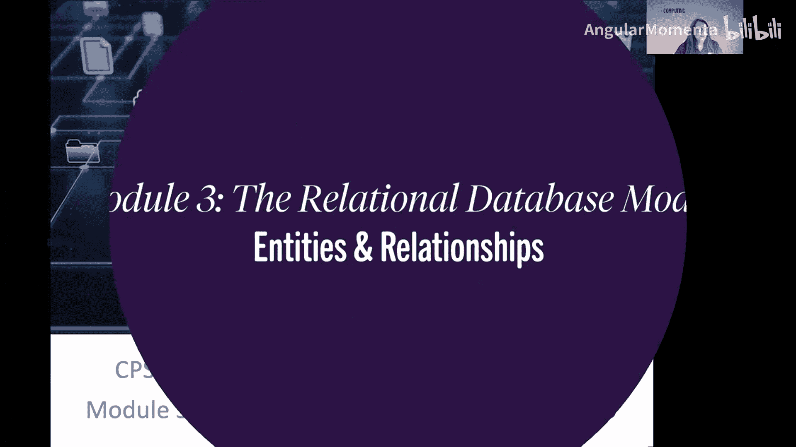
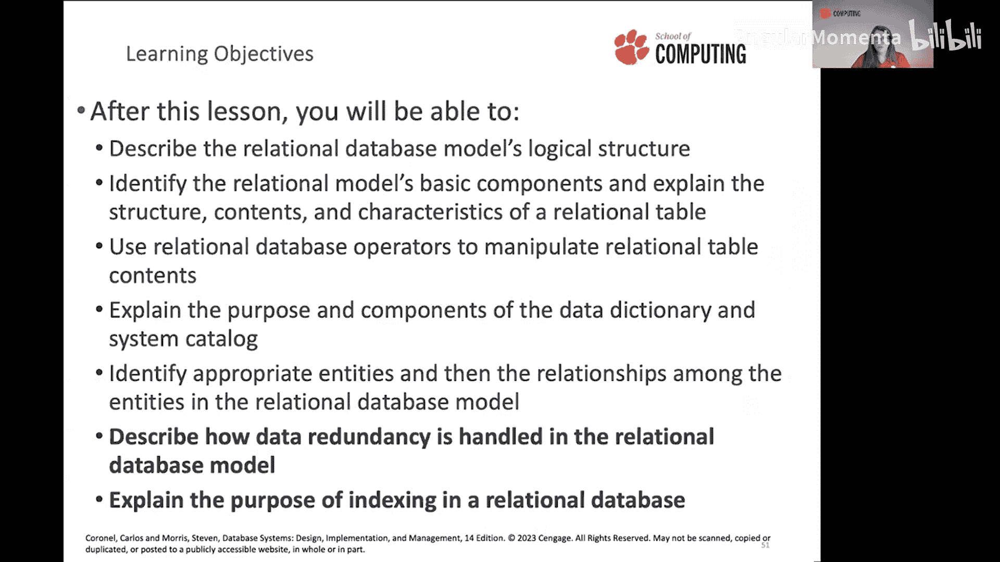

# 【克莱姆森大学】数据库管理系统 ｜ Database Management Systems p12 03_01_07_entities-relationships -BV1y6rzBXE34_p12-

Yeah。

We're going to now get into some of the details of tables and how tables are related to other tables。

Specifically， entities and relationships。So first， let's just talk about relationships。

When you have a relation or table and it's associated with another table。

 it can be a one to many relationship， a one to one， or many to many。

And when we talk about relational databases， most of the relationships between tables are one to many and in fact there are there's not a way in relational database to have many to many relationship between two tables。

 so you have to create。A linking entity between the too many to many tables and that entity can be called many different things。

 composite entity， bridge entity or Associative entity。

So in this case you have a course in a class and I know we haven't talked in detail about the symbols between you know we showed the crowsfoot but we're going to go into more detail on all the various lines and symbols and what they mean but when you have a many it's the crowfoot that you see next to class and so a course has many classes so for example CPSC 6620 at Clemson is a course but I offer this as a class。

 many semesters， sometimes many sections in a semester。

 so you can see that in these two tables where they have accounting classes when you're count courses and then the actual classes and the times they were offered the sections etc。

 so this is you know when you look at banner or you know you're looking to register。

You see class information and it has a foreign key to the course so that I have all the information about the course in the course table。

So this is a great example of a one to many relationship。

Thinking about professors or any faculty member in departments in this situation。

 it's you can have both a one to many and a one relationship， so how does that happen？

So in this condition， this case， you have a list of professors and they have employee numbers and they're in certain departments。

 that's their offices， et cetera。 Now a professor chairs a department。 So in that case。

 the department has that employee number in the table that tells me who is the chair。

 So the accounting department。Employee 114 is a is the chair so that is this particular faculty member now there's also a relationship where departments have many professors so if you look up at the professor table。

You see department code is a foreign key and you have faculty members that are in multiple departments。

 so that's how you get the relationship between department and professor。So。Relationships。

 you can have multiple relationships between two tables and also different kinds of relationships as I've shown you here。

Here's a many to many relationship between students in class。Just thinking about it intuitively。

 you know that there's many students in many classes。Now， if you look at these two tables。

And I have student table with student number， a student last name and a class code。

You can see the problem right here in my student table， I do not have a unique。Primary key。

 it's supposed to be unique， but 3，2，1，4，5，2 for student Bser is in there three times。

 so that is not a a。A viable。T in relational， you know。

 as defined in relational requirements with entity integrity。

But the only way I can capture the fact that a student's in many classes is to duplicate them this way。

And then you have the same problem in the class table。Where a class。

 if I wanted to show each student that was in the class， you end up with multiple class codes。

So that cannot be a valid primary key so what do you do and and you know just you can't manage these tables you have a lot of duplicate data it's just very messy and doesn't fit the requirements of relational database and what this is called is we've talked about before is redundant data duplicate data。

 multiple copies of data which can lead to all sorts of problems when you update or change data。

So what do we do？Well here's the right way to do this you create what we called again an associative table。

And or linking table between the two。 So you have student and class。

 Now I've created this new table called Enroll。And enroll has the primary keys of both student and class。

And together。Those two columns are a primary key for the enroll table it is remember the term we learn composite primary key。

 it's two columns so it is not just a single primary key。And also。

 these two columns are foreign keys。 so you can have。

A table that the primary key is also a foreign key。

So that's how you manage this this many to many relationships。

 creating this table that connects the two many to many。And if you notice in the diagram and the ERD。

 you have the student。To enroll is a one to many， and the class to enroll is another one to many。

So here is the final picture of our little relational database and it has a student。

It has enrolled class and course。So all of these relationships are one to many and across all of these it's not showing the professor and department in this picture。

 but in that case we had both a one to one and a one to many。Okay。

 we're going to in the next section talk about。Indexes and。And redundancy more。

 so we'll get to that in the next section。

