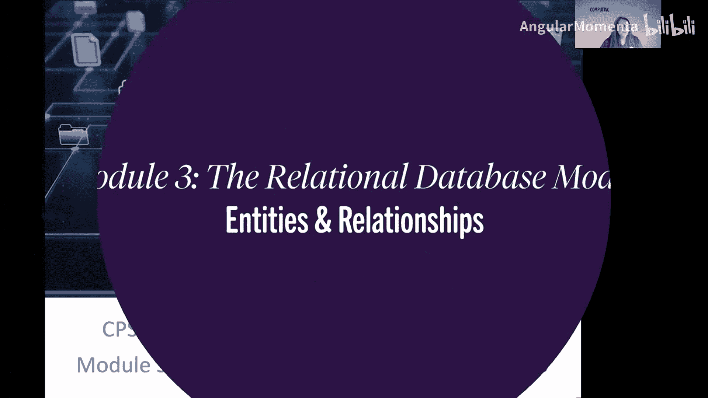
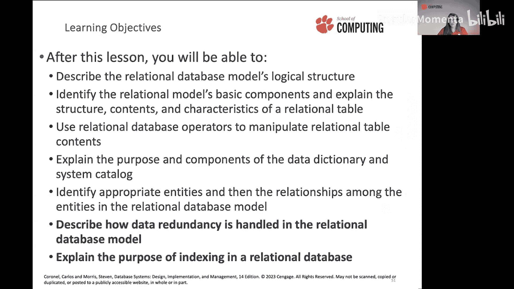

# 数据库管理系统：03_01_07：实体与关系 👥➡️📊




在本节课中，我们将学习数据库表之间关系的核心概念，包括一对一、一对多和多对多关系。我们将重点理解多对多关系的处理方式，以及如何通过创建关联表来维护数据的完整性和避免冗余。

---

## 关系类型

上一节我们介绍了数据库表的基本概念，本节中我们来看看表与表之间是如何关联的。表之间的关系主要分为三种类型。

以下是三种基本的关系类型：
*   **一对一关系**：一个表中的一条记录只对应另一个表中的一条记录。
*   **一对多关系**：一个表中的一条记录可以对应另一个表中的多条记录。这是关系型数据库中最常见的关系。
*   **多对多关系**：一个表中的多条记录可以对应另一个表中的多条记录。

在关系型数据库中，表之间无法直接建立多对多关系。为了处理这种情况，必须创建一个位于两个多对多表之间的**链接实体**。这个实体也可以被称为**复合实体**、**桥接实体**或**关联实体**。

---

## 一对多关系示例

让我们通过一个具体例子来理解一对多关系。考虑“课程”和“班级”这两个表。

*   **课程**表存储课程信息（例如：CPSC 6620）。
*   **班级**表存储该课程在不同学期、不同时间开设的具体班级信息。

一门课程可以对应多个班级。在“班级”表中，会有一个指向“课程”表的外键，这样就能知道每个班级属于哪门课程。这种设计避免了在“班级”表中重复存储课程信息，是典型的一对多关系。

---

## 多种关系并存

有时，两个表之间可以同时存在不同类型的关系。以“教授”表和“院系”表为例。

以下是它们之间可能存在的两种关系：
1.  **一对多关系**：一个院系可以拥有多名教授。在“教授”表中，会有一个“院系代码”作为外键，指向“院系”表。
2.  **一对一关系**：一名教授可以担任一个院系的系主任。在“院系”表中，可能会有一个“系主任工号”字段，指向“教授”表中的特定记录。

这个例子说明，两个表之间可以根据业务逻辑的需要，定义多种不同的关系。

---

## 多对多关系及其问题

现在，我们来探讨更具挑战性的多对多关系。考虑“学生”和“班级”之间的关系：一个学生可以选修多门课，一个班级也可以有多名学生。

如果试图直接在“学生”表中记录班级信息，会导致严重问题。例如，学生`Bser`选修了多个班级，其学号`321452`会在表中出现多次，这违反了**实体完整性**规则，因为主键必须唯一。

同样，在“班级”表中直接记录所有学生也会导致班级代码重复，无法作为主键。这种设计会产生大量**冗余数据**，在更新数据时极易引发不一致，不符合关系型数据库的设计规范。

---

## 解决多对多关系：关联表

为了解决多对多关系带来的问题，正确的方法是创建一个**关联表**（或称**链接表**）。

我们在“学生”表和“班级”表之间创建一个名为`Enroll`（选课）的新表。这个表的结构如下：

```sql
Enroll 表：
- student_id (外键，引用 Student 表)
- class_code (外键，引用 Class 表)
- (student_id, class_code) 共同构成复合主键
```

`Enroll`表的主键由`student_id`和`class_code`两列共同组成，这被称为**复合主键**。同时，这两列又分别是引用自“学生”表和“班级”表的外键。

通过这个设计，原来的多对多关系被拆解为两个一对多关系：
*   一个学生对应多条选课记录（一对多）。
*   一个班级对应多条选课记录（一对多）。

这样就完美地解决了数据冗余和完整性问题。

---

## 总结




本节课中我们一起学习了数据库表之间的核心关系。我们了解到，关系型数据库主要依靠一对多关系来组织数据，而多对多关系必须通过创建一个关联表来间接实现，该表使用复合主键来连接两个实体。我们还看到了两个表之间可以存在多种关系，并理解了避免数据冗余对于维护数据完整性的重要性。在下一节，我们将进一步探讨索引和冗余数据管理等相关主题。