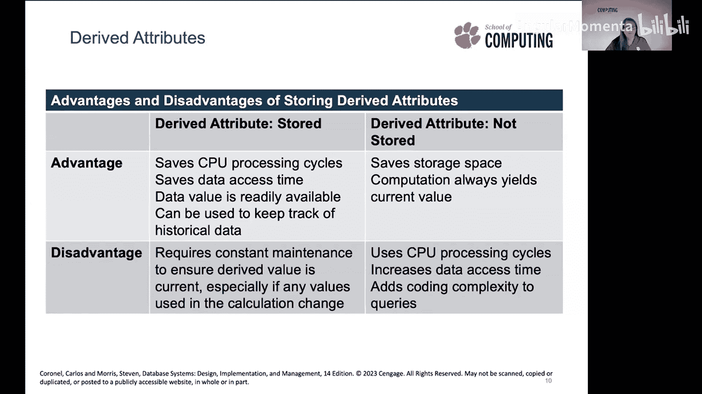

# 【克莱姆森大学】数据库管理系统 ｜ Database Management Systems p14 04_01_03_entity-relationship-overview -BV1y6rzBXE34_p14-

So we're ready now to move into entity relationship modeling。Which is module4。

And we'll start out talking about the main characteristics of an entity relational。Diagram。

 its main components。The relationships between entities。

How components affect design and actual implementation。

 and then we'll go through a real world example to understand some of the conflicting goals you have when building an ER diagram。

Note that this module corresponds to chapter four in our reading。

So the entity relationship model is used a lot of times interchangeably with an ERD。

 which is an entity relationship diagram。Personally。

 I've heard the two used interchangeably in industry with ERD being the more used term。

And the ERDs depict the main components of your database， which are the entities， the attributes。

 and the relationships。So an entity is an object of interest to the users。

 so if you've done object modeling before， it's very similar to when you think about object modeling。

Now， an entity in the model， when you think about the actual data in a table。

 it's the actual overall table itself， not a specific row and。

Each of the rows is an entity instance or entity occurrence。

 so similar to when you again if you've done object modeling objects versus classes。

And there's various notations that you can use when you build your entity relationship model or diagram。

 and the entity itself is usually a noun， often written in all capital letters。

 but not necessarily so。So let's go through all the various components that are in an entity and those are the attributes so that the naming itself can actually mean something when you see an entity relationship diagram and let me actually jump ahead here and these are two different models using one using Chen and the other using crsfoot and if you remember we're using crs foot and in the actual entity which is student you can see two attributes student last name and student first name and bold so what does that mean it means that is a required attribute I could not create a student in the table student without giving a last name and first name the database will actually take care of that and give you an error when you try to insert a row without those values。

So what are other key and keys and overuseed word again， key areas of attributes。

 so like I just said， required attributes are in bold。An optional attribute， so in this case。

 initial email and phone， you don't have to give a value。

 you could actually insert a row in your table student without that data。

The domain is the set of possible values for a given attribute。

 so last names being character values and you have a lot of liberty to have different names so certainly that domain would be pretty large。

 but sometimes you can have domains that may be fairly small like if you have an attribute that only has five possible values。

Primary key is as we discussed before the attribute that uniquely identifies each entity and you will see that in the ERD underlined。

 you can also have two or more attributes that make up your primary key and those are composite primary keys。

Sometimes you'll have an attribute that can be broken up into parts， so for example， in this case。

 suppose you just had student name。That attribute could be broken up and should be broken up into last name first name and initial。

 so initially that attribute of name would be considered a composite attribute。

 but it could be subdivided to give additional attributes last name first name and middle initial。

If you have an attribute that cannot not be further subdivided， it's considered a simple attribute。

A single valued attribute only has one single value。

 And I will talk more about that with some examples。

 as well as multi valued attributes that can have many values。

 So I will have examples of both of those， And then last but not least。

 there's a concept of derived attributes that we'll talk about later。

 which are those attributes that could be calculated。From other attributes。So again。

 here is our pro foot model showing student last name and first name and bold。

 meaning that they're required。Now let's talk a little bit about a multi valued attribute。

In the Chen model， there's actually a nomenclature there that you see between car and car color that shows it's a multivalued attribute being it can be white。

 blue， gold or blue， I guess they have two blues there so that sections can be different colors。

 So really the only three colors are white， blue and gold。And if you look at the crow foot model。

 there is really nothing indicating that car color is a multi valued attribute that's white， blue。

 or gold。And in fact， there's better ways to actually model and represent multi valued attributes in a database。

Because。It's better and typically to create either multiple attributes to represent so if you go back and what we really want to show is sections and their colors。

We could add three new attributes to the car table， car top color。

 car trim color and car body color and。Then we would have to put the colors into those three new attributes。

However， it may be that you don't know you could end up having additional attributes that need color。

 So in general， it's often preferred to create a new entity for multi valued attributes。

 So in this case， car color would be its own entity as a primary key。 It has the car in。

 and then a section。 So that would be whether it was the。The top body tremor interior。

 And then you would have the color。 So， again， why is this preferred because。In this case。

 you could easily add another section without having to update the card table or delete a section without having to change the card table。

 so it gives you more flexibility。Another concept that I mentioned before very briefly was derived and they're sometimes called computed attributes。

Again， in this case， prosefoot doesn't have a way to indicate a derived attribute。

 but what is a derived attribute， it is an attribute， so if you look at the employee。

Employee age is easily calculated using today's date and the employee's date of birth。

 the EM underscore DOB and it's required so you would always have that value。

 you can always get the system value of what the current date is so using the current day date of birth you could calculate or derive。

That attribute employee age。Now。There is also a consideration of do I store employee age actually have it in the table or do I have to calculate it every time I need it。

 and there's advantages and disadvantages of both Think for a moment what might be an advantage of storing the employee age。

Or disadvantage。 And then。Same， could you think of what some of the disadvantages and advantages of not storing would be？

So what are some of those， so let's talk about storing the derived attribute。If it's stored。

 then when I go look up an employee in this case， I'm looking up an employee。

 I have that value there as， you know immediately， there's no calculation。

 so I'm not doing any processing with the CPU。But the disadvantage is if I go to get that value tomorrow。

 I have to and their birthday is today or tomorrow， it has to be updated to the new value。

Which can be， you know， having a yearly birthday to update is not as much of a maintenance as maybe something that changes much more frequently。

So you're doing the processing， regardless， is just how frequent。 Now， with birthdays。

 you'd have to check every employee every day。 And again。

 that could that could be worse than just calculating it， which on the not storing it advantage。

 You don't have to store it。 So doesn't take any storage space。

 you're guaranteed to get that current value。A disadvantage。

 you may have to use that additional processing cycle that， you know， it may not be that expensive。

 but depends on what you're calculating。And you have to add that complexity into your queries to calculate that particular attribute。

Great， so I'm going to stop there and in the next section we'll get into some more details around entity modeling。

