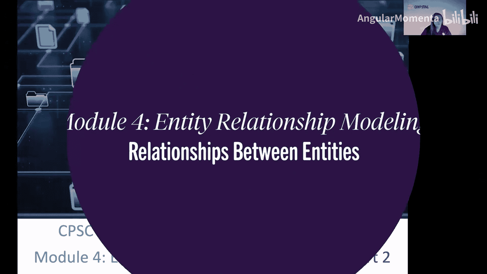
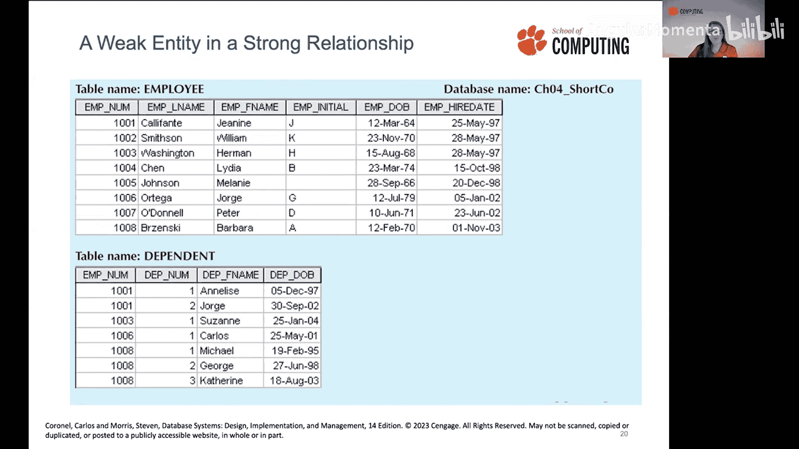

# 【克莱姆森大学】数据库管理系统 ｜ Database Management Systems p15 04_01_04_relationships-between-entities -BV1y6rzBXE34_p15-

🎼。

Let's continue with moduleule four and in part two。We're going to talk about relationships。

 so in part one of module4 we covered entities and various types of entities how they're represented in an ER diagram。

 now we're going to talk about relationships between the entities。So。

Entities that are in a relationship。That are connected are participants。

 and there's usually some type of name of active or passive verb that connects the two entities。

And relationships will go bi directionional， so there's this makes sometimes coming up with the verb that you're going to use between them a little difficult。

And another just as we get into more diagramming， you'll see that the verbs are there。

 but not I don't necessarily see them in the real world world very much， they just help you。

 they'll understand the connections。You can have three types of connectivity。

Between various entities， one to one， one to many， and many to many。

And then there's a concept of cardinality， which is the minimum and maximum number of entity occurrences associated with a related entity。

 it's usually indicated by Pars and then the X and Y with the first value being the minimum number of associated entities and the second being the maximum。

So just this helps make that point where you have an example where。

A professor is an entity as well as a class， the professor teaches many classes。

 and that's where the word teaches comes from that bur between the two entities。

 they're connected by the gross foot one， one and one and one or many。On each side。

So this being the one0 one and this being the one of many。And so there's one and only professor。

 and this is telling you even though that the diagram shows a many symbol by putting the cardinality of one to four。

 it indicates that there's a maximum of four classes that a professor can teach so this is really helpful in communicating。

You may get diagrams that don't have the cardinality， don't have the verb between the two entities。

 and it isn't as clear that there's a maximum number of classes and maybe you don't understand the relationship between the two entities。

 so having that verb gives you more clarity。There's another concept when you talk about relationships between two entities。

 which is around dependence and an entity is exist dependent。

 if it can only exist in the database when the other related entity also occurs。

 so the way that that is represented in the actual table and in the data is that it will have a mandatory foreign key for its related table。

And。If an entity can exist apart from all its related entities。

 its independent is existent independent， and it's a strong or regular entity in that case。So。

That is about entities being weak or strong， there's also relationships being weak or strong。

So a weak relationship exists if a primary key of a related entity does not contain the primary key of a parent。

And that is， in most cases， most relationships you'll see in a database。 and on the flip side。

 you'll have a strong relationship when that primary key is a primary key component of the parent。

 So let's look at this example。So in this example， I have a course and a class。

A course generates or you know is a source of classes， and this is a weak relationship。

And why is it weak because the primary key of class does not contain a primary key of its related entity course？

So in this case， it could stand alone and。This generates this relationship here is。

Identified as a weak relationship using the dotted line。

So if you've been drawing some diagrams and not clear on what do these lines solid and dotted mean。

 it's really about that relationship being weak or strong。Okay， now in a strong relationship。

 you see I move that horse code into the primary key of class。So if you look here， it's not their。

 of course， code is a foreign key。But here it is part of the primary key。And that indicates that。

That particular。Relationship is strong。 I must have the corresponding course。 so if you remember。

The definition of the relationship strength。Is a strong relationship exists when the primary key of the related entity contains a primary key component of the parent。

 so that's what we have right here。Okay， so let's move forward a little bit more about。

Weak and strong entities now that you understand what the relationship。嗯。Definitions are。

You can understand or it makes sense that two conditions of a weak entity would be one。

 its existence dependent。It exists in the database only when it is associated with another related。

Entity occurrence。And it has a strong relationship。

So that the primary key is partially or totally derived from the parent。

So this is a very obvious case where I have an employee and a dependent， so if you're at a company。

 you work somewhere and you have dependent children。

 those dependent children are not going to exist without the employee existing so right there you know that it is exist independent and then by adding the employee number into the primary key that is making it a strong relationship。

Now this is a design decision that， you know， you can。

 you can not have that employee number as part of the primary key， but it it is。

It is really up to the database designer how they want to represent that relationship。

One other point I want to bring up about these relationships， whether they are weak or strong。

 is in this case， the strong relationship as well as the weak。

The foreign key for course code in this case， if it was a required foreign key。

Then then it would require that I create a course before I create a class。

In most cases that is you know that makes sense right so I can't have classes out in my in my schedule that don't have a corresponding course created so I would be pretty sure this foreign key course code would be a required nonnllable foreign key so when you create your actual data you have to think about the order of creating the tables before I could create the class table with all of the class data I have to create the course table with the course codes that I would use in the class table。

So I just wanted to also show you that data for the employee in the dependent where I had the employee number as part of the primary key。

 so you have to have a composite primary key here， 101 and1 because of the uniqueness requirement。

 I can't have just employee number。And you can see that for employee number 1001 and they have two dependents and you can see their birth dates there。

 so that just makes it a little more clear and sometimes I actually draw out some example data to help me understand how two tables are interrelated and this is a good example for you to see the actual data that is between employee independent in this ER diagram。

So we'll stop there and we'll pick it up in the next part of moduleule four。

 talking about relationship participation。

