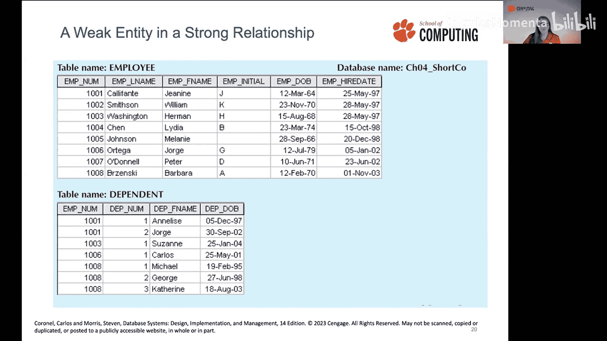

# 数据库管理系统：模块四：实体间的关系


在本节课中，我们将要学习实体关系（ER）模型中的核心概念之一：实体间的关系。我们将探讨关系的类型、连接性、基数以及关系的强度，并通过具体示例来理解这些概念如何在实际数据库设计中应用。

上一节我们介绍了实体及其在ER图中的表示方法。本节中我们来看看实体之间是如何相互关联的。

## 关系的参与者与表示

参与关系的实体被称为**参与者**。关系通常用一个主动或被动动词来连接两个实体，并具有双向性。有时，为关系选择合适的动词可能有些困难。在实际的ER图中，这些动词有助于理解连接，但在现实世界的数据库实现中，它们不一定被显式地表示出来。

## 关系的连接性

实体间可以存在三种类型的连接性。

以下是三种基本类型：
*   **一对一**：一个实体实例只与另一个实体实例相关联。
*   **一对多**：一个实体实例可以与多个另一个实体实例相关联。
*   **多对多**：多个实体实例可以与多个另一个实体实例相关联。

## 关系的基数

**基数**定义了与一个实体相关联的另一个实体实例的最小和最大数量。它通常用括号 `(X, Y)` 表示，其中第一个值 `X` 是最小关联数，第二个值 `Y` 是最大关联数。

例如，考虑“教授”和“课程”两个实体。教授可以教授多门课程。在ER图中，这种关系可以表示为 `(1, 4)`，这表示一位教授必须至少教授一门课程（最小为1），最多可以教授四门课程（最大为4）。明确标注基数和关系动词，能极大地提升ER图的清晰度和沟通效率。

## 关系的强度：弱关系与强关系

关系的强度取决于相关实体的主键构成。

**弱关系**是指相关实体的主键**不包含**其父实体的主键。这是数据库中最常见的关系类型。

**强关系**是指相关实体的主键**包含**其父实体的主键组件。

让我们通过一个例子来理解。假设有“课程”和“班级”两个实体。一门课程可以生成多个班级。如果“班级”表的主键是独立的（例如 `班级ID`），而不包含“课程”表的主键（`课程代码`），那么“生成”这个关系就是**弱关系**，在图中通常用虚线表示。

```sql
-- 弱关系示例：班级表的主键不包含课程表的主键
CREATE TABLE 班级 (
    班级ID INT PRIMARY KEY,
    课程代码 VARCHAR(10), -- 外键，但不是主键的一部分
    ... 其他字段 ...
    FOREIGN KEY (课程代码) REFERENCES 课程(课程代码)
);
```

现在，如果我们修改设计，将“课程代码”作为“班级”表**复合主键**的一部分，那么这个关系就变成了**强关系**，在图中用实线表示。

```sql
-- 强关系示例：班级表的复合主键包含了课程表的主键
CREATE TABLE 班级 (
    课程代码 VARCHAR(10),
    班级编号 INT,
    ... 其他字段 ...
    PRIMARY KEY (课程代码, 班级编号), -- 课程代码是主键的一部分
    FOREIGN KEY (课程代码) REFERENCES 课程(课程代码)
);
```

## 弱实体

理解了关系强度后，我们可以定义**弱实体**。一个实体要成为弱实体，需要满足两个条件：
1.  **存在依赖性**：它只有在与另一个相关实体（父实体）关联时才能存在于数据库中。
2.  **具有强关系**：它的主键部分或全部派生自父实体的主键。

一个典型的例子是“员工”和“家属”。家属信息的存在依赖于员工的存在。在设计上，通常会将“员工编号”作为“家属”表复合主键的一部分，从而建立强关系。

```sql
-- 弱实体（家属）示例
CREATE TABLE 家属 (
    员工编号 INT,
    家属序号 INT,
    姓名 VARCHAR(50),
    出生日期 DATE,
    PRIMARY KEY (员工编号, 家属序号), -- 包含父实体（员工）的主键
    FOREIGN KEY (员工编号) REFERENCES 员工(员工编号)
);
```

这种设计意味着，在向“家属”表插入数据前，必须先确保对应的“员工”记录已存在。这种外键约束通常是**非空且必需的**，这决定了创建数据库表和数据录入的顺序。

## 总结

本节课中我们一起学习了实体间的关系。我们明确了关系通过动词连接参与者，并具有三种连接性（一对一、一对多、多对多）。我们引入了**基数**的概念来描述关联实体的数量范围。最重要的是，我们区分了**弱关系**与**强关系**，其核心判断标准在于子实体的主键是否包含父实体的主键，这可以用公式 **`子实体主键 ⊇ 父实体主键`** 来概括。强关系与存在依赖性共同定义了**弱实体**。理解这些概念对于绘制准确的ER图和进行合理的数据库设计至关重要。




接下来，我们将在模块四的下一部分探讨**关系参与度**。