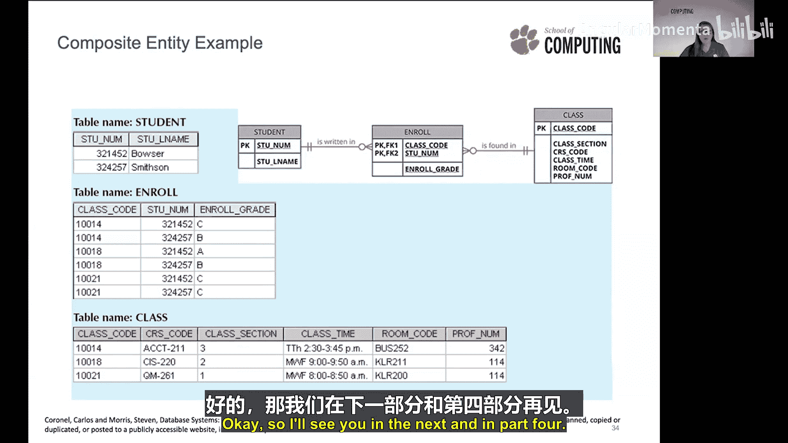

# 【克莱姆森大学】数据库管理系统 ｜ Database Management Systems p16 04_01_05_entity-participation-and-degrees-in-relationships -BV1y6rzBXE34_p16-

Let's begin part three of module4。Where we're going to continue on with describing relationships and in particular。

 we're going to talk about participation。And in relationships as well as relationship degrees。

So optional and mandatory participation indicate whether or not an entity has to have an occurrence of another entity in that relationship。

So if you need to have the other。Entity at all times， is it required then？It would not be optional。

 be mandatory。 Let's look at an example to make this a little more clear。

 And we talked about this in the last part as well。 So a course in a class， a course。Could exist。

 this happens， you know， if you look at Clemson's catalogs。

 we have many courses that aren't necessarily glasses in our various schedules。And you may want to。

 for example， create a brand new course that has no classes yet。

 so your relationship would need to be optional with class and that's where you see the0 to n in cardinality and this round looks like a zero in the symbol next to many。

 so this tells you for the course to class relationship I can have zero classes associated with the course and up to many as many as you need。

Now you could also， and here's the mandatory view of that relationship。

And this would possibly not make sense from a academic slash business perspective that you would have to have a class for every course and that just tells you that。

It is， you know， the design itself comes from the business that you're trying to support with that design。

So the good news is you can do either and you can make those design decisions as you're figuring out your database。

 but from a visual representation you see it as the the。Dash and the many here in the crow foot。

 which represents one to many。Another example of participation is again back to our professor has a class or teaches a class in this case。

 a professor could be a research professor so。And you know， they would have zero classes。

 but werere saying that they could have a maximum of three in this relationship if you look at the cardinality。

Here are the various symbols that you would use to show the various relationships and you've seen these in many of our diagrams probably wondering what are all those lines。

 what do they mean？We've learned them all now at this point with one to one， one to many。

 zero to many and zero to one， and you now know how to draw all of them and understand them in addition to the actual lines in between those being dotted or as a weak relationship or solid line strong。

The next concept we'll cover now is relationship degree。

And this indicates the number of entities that are in that relationship。

 so you could be unary or recursive to yourself。So only one entity is in that particular relationship it's related to itself binaries two that's what you see most commonly in ear diagrams and in database designs ternary relationships you have three and then more than that is pretty rare in。

In database relationships。And just showing you examples of these various types of relationships。

 we've been talking a lot about binary relationships like professor in class course in class。

 we'll talk more about the urinary relationship with some examples and then in this ternary relationship there's a three-way relationship between doctors。

 patients and drugs， you would actually represent that with a prescription bridge entity because this is a many to many relationship。

 and that prescription will actually give you the connection between all three in this view of the data itself helps with that understanding that those relationships。

And for example， in this prescription table， you do have three columns that make up your primary key because remember bridge entities typically have the primary keys of the connected tables that make up its primary key。

 so you have a doctor ID， a patient number and a drug code。

Now let's talk about recursive relationships。Recursive relationships come in many forms and let's talk about some real world examples and you can see them here so if you had an employee table。

That table may contain another employee number who is your spouse。

 so there are people that are married to other employees， not a lot of them， but it does happen。

So you need to make sure you can represent that in your if you're asked to represent that in your data。

 you would have an actual employee code right there in the database so it's。It's a relationship。

Between employee in itself。You could have also an employee ID for a manager， so again。

 this particular manager here is in the employee manager column。Or these other employees。

And another example they don't show the table here is course being a prerequisite to another course。

 so you could have the course table refer to itself。Okay。

 so we're going to talk again about many to many relationships in ER models。And remember。

 you have that composite or bridge entity that you put between the two many to many entities。

 that bridge entity is composed of the primary key attributes of each parent。

You can have other attributes in that bridge entity。

 but it typically will have those connected entities， primary keys as its composite primary key。

And there are a lot of terms that I probably brought this up before that people use for that。

Associating entity between the too many to many composite bridge associative linking I certainly in this class am okay if you use any of those when you answer questions for a quiz or a test you would get credit for all of those so it is a little confusing if you see the different terms。

And just in this example， the relationship that we have to we have a many to many is students in classes。

 so you have many students in many classes and。You can't easily represent that in a relational database so you do that with。

Your bridge entity。In this case being calledEnroll， which has class code。

 the primary key of class student number， the primary key of student as its primary key and it's also a foreign key remember because it's referring to the student number and class code in those other tables so it's both a primary key and a foreign key both each of those attributes and then within that you can add additional data like the grade for that student in that class is something you could put in the enroll table。

So we're done with part three， and in part four， we're going to move into actually walking through an example ER of an ER diagram。

 going through business， going through the actual business rules and translating that into an ER diagram or step by step。

And hopefully that'll be helpful because you have a few practice exercises and homeworks that are all building out these diagrams and they just get easier the more you do them there's also a level of subjectivity sometimes that can。

Certainly make discussion， you know， with you or business stakeholders important to make sure you are capturing the right things when you're creating these ZR diagrams。

Okay， so I'll see you in the next and in part four。

