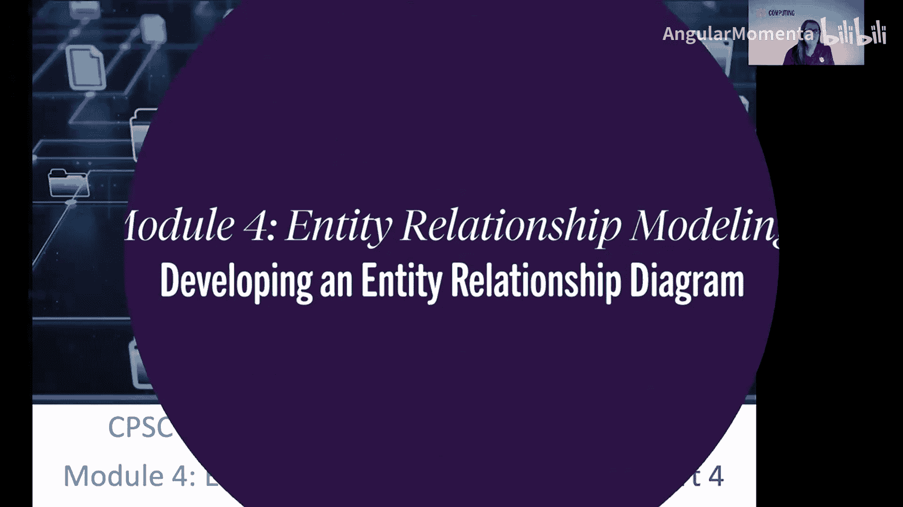
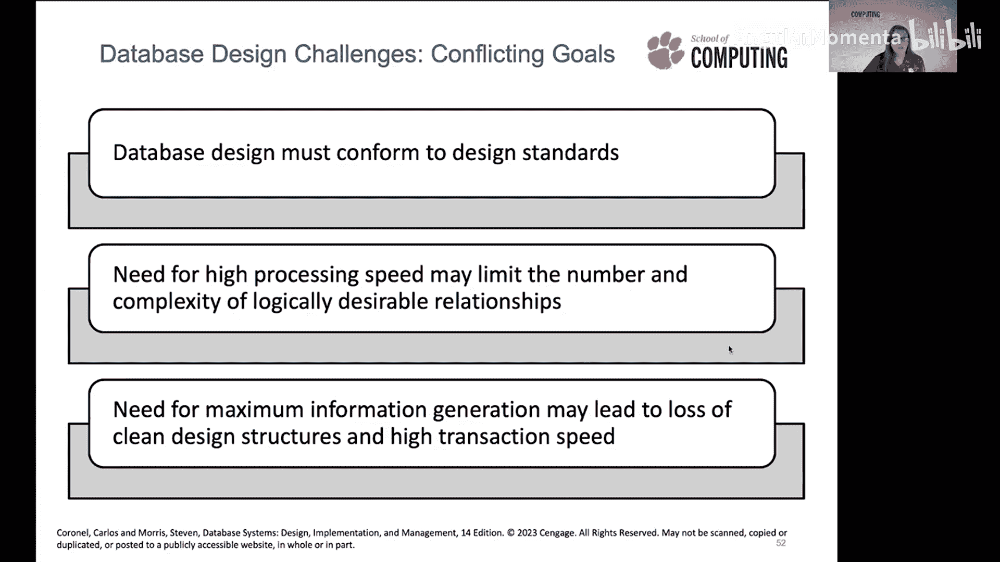

# 【克莱姆森大学】数据库管理系统 ｜ Database Management Systems p17 04_01_06_developing-an-er-diagram -BV1y6rzBXE34_p17-

In this part， we're going to go through an example。Building an ER model。

And you'll see some of the trade offs discussions， I'll try to bring those out because we're not interactive in this lesson which I typically get a lot of questions。

 so I'll try to reflect some of the questions that students bring up。

And walk you through this example。Now before I do that just some thoughts around building an ERD。

 you really need to have that understanding of what you're trying to build。

 what are those business roles， what are the interactions between the various entities in your business。

And build out those business rules now sometimes you don't have that luxury you're being asked to take an existing system and create a new database for it。

 so again just in that case you might have to go through and actually observe how it's used use the old system yourself to understand it and capture various information see if there's any documentation。

But it is you not an easy part getting these requirements right and you will miss some things so。

You just have to do the best you can with the information you have。

So you know to start out the process， once you have you know a kind of 80% of an understanding of those business rules。

 you would identify the main entities and relationships。

 you might want to document those in some kind of a spreadsheet or another you know way you would communicate those before you actually start diagraming and developing that initial ER RD then you would the next generation would be building out more attributes primary keys。

 what are the foreign keys that are needed in the relationships and' it's an iterative process you know you want to make sure you build in the reviews with the business stakeholders so they can look at what your diagrams are my experience in industry you know the ERD was the main communication tool that we would have with a lot of the business we keep it a pretty high level and conceptual as we talked in prior sections and so that the business could understand。

But I will tell you they， in a lot of cases， they will use those ERDs even after they have a system just to understand how it works。

So here is a description of a tiny college now some of these descriptions we have already talked about use this the kind of college example in various lessons so I'm going to highlight some of the key points here but I'm not going to read these to you but you can slow down your video and read them but the first you know relationship we want to talk about is the fact that there is various schools in a college just like Clemson we have you know various schools we have business we may call them departments but people call them different things in this case they're going to call them schools business arts。

Education and applied sciences and each of those has a dean who's also a professor and you can only be a dean of one school。

And you're not required to be a dean of his school if you're a professor you couldn't do that you wouldn't have if every professor had to be a dean you'd have to have a lot of schools so that's that relationship between professor and school。

You have one professor to one school， one to one relationship。But。From a cardinality， you would have。

One to one to the professor and01 next to the school because your school is not required for the professor。

 so if we look at the the actual diagram to just see how that's represented you have the professor is the dean of a school and in this case it's a weak relationship your you don't have any part of the primary key a professor in the school making it a strong relationship。

So the school has a foreign keyto to the professor。And the school name。Okay。

 we'll go back because there was one more business rule there we didn't talk through the fact that the schools comprised of several departments and the school business has accounting management economics。

And the number of departments operated by a school is one and the largest number。

 I mean the smallest number of departments is one and the largest is you many with it。

 you know there's not a set number， you know， each department belongs to only a single school though。

 you can't be a department with you know， across business and education。So。

That's a one to one parity so let's look at that in the drawing of picture speaks a thousand words for me for sure so the school remember these are things like business etctera。

 those have departments many departments and that the departments are you know you could have many you know they could keep growing you could keep adding departments so this is one segment。

Across professors， school and department。Okay， let's look at the next business role。

And you can have courses offered by each department now， for example。

 your management marketing can have courses like intro to management， principles of marketing， etc。

And this relationship is based on the way a tiny college operates， so for example。

 tiny college had some departments that were researched only， they would not offer any courses。

So if that is allowed， which it sounds like it is in tiny college。

That makes course optional to department they don't have to offer courses if they do they can offer one or many so you got to show them many。

 but they don't have to have any at all， so that is the relationship you see here。

Just a general rule if you know that I I always had in just to make sure when I was looking at the diagrams。

 what side do I put the money on and kind of check myself？

Your many symbol will always go on this side or almost always because most relationships are one to many on the many side of。

That relationship， so in this case， have a foreign key department code and the many goes on the side with the foreign key。

Okay。So that's just one kind of basic rule to help you with diagramming and not get confused about。

 oh which sidess the money and it makes sense because you're going to have a department code。

 you're going many department codes that are associated with courses。

 so that means for every department there'll be a whole lot。

 there'd be many courses that are associated with that department code。

Okay this one is long we've talked about this one a little bit between course and class so I won't read any of that。

 but just additionally you have a concept or an entity called a semester and a semester is defining what year in term that a class will be offered so before we just talked about you have a course in your classes but now now students want to actually roll in summer and fall terms。

So it's possible that the tiny college calendar is set with semester beginning and ending dates prior to the creation of the semester class schedule。

So what that means， and this is， again， real world， class would be optional to semester。So。You know。

 you would have the ability to set up a semester without any classes ahead of time with all the information you need。

Again， let's go on and look at the picture here。I have a course which has。

Zero or many classes because you may have courses that don't get taught or you have you brand new courses。

And a semester also would have class many classes， but I could set up that semester without without knowing what classes are in it。

So semester and course have no foreign keys。 The foreign keys are both in class。

 And so the many symbol， as I said， is on the side with the foreign key。

And it's a relationship between course and semester from class。

Next up in our ER diagram is the department should have one or more professors assigned to it。And。

One and only one of those professors chairs the department。

No professors required to accept the chair。 Therefore。

 department is optional to professor in the chairs。So， so a department employs many professors。

 So this is kind of a little different than others that we've seen that we have。

We have a one dimension many between department and professor and then a 10 one between professor and department。

And both those relationships are across the same entities。 Now， in this case。

 you see the foreign key over here department code。 So， you know， the the many on this side。As。

The department code， and on this side， I have a professor number foreigning key for this relationship。

But it could be that you have。You don't have a professor that's optional that's sharing。

Because they nobody wants to do it， I guess they'd have to go find someone else that's not a professor to be the chair。

The next relationship between professor and class， we've talked about this one a lot。

Profess may teach up to four classes， I thought it was three earlier and now we're back to four。

 don't know what's going on。And a professor may also be on a research contract and teach no classes at all。

So you see here you have the optional symbol。And they didn't show the cardinality with the three。

 it would be or four， be zero to four。And again， get that foreign key professor nu many on the foreign key side。

Okay。This is a long one， but this is telling you that。A student can enroll in many classes。

Each student may enroll in up to six classes and each class may have up to 35 students。

 so that's giving you some limits on your cardinality。

But there's still that end to end relationship between student and class。

So because a class can exist before the enrollment。It makes the without any students in it。

 students optional to class。And if you remember， we have。

To create a bridge entity between student and class because it's a many to many relationship。

So you can see that here， the enroll with class and student。

Connected by this bridge entity called inroll。They're both optional so I can have。

No students enrolled and no classes because I'm just initially setting things up and it's 0 to 35。

 the 35 being the maximum number of students enrolled in a class and a student can have a maximum of six classes。

 So that's what those two cardinalities mean。And in。

You see both the foreign key and primary keys from student and class and the relationship。

 the many side is on the side with the foreign key。

Next segment we're going to look at is between department and student。

 so each department has several or many students whose major is offered by that department。However。

 each student only has a single major and only associated with a single department so it's a very simple tiny college that's like a Clemson you can have multiple majors so the other key part here that's in this requirement is that at least for a while a student does not have to declare a major。

So department is optional to the student during that period of time。And remember that。

The relationships。Between any of the entities is all based on the business role。

 so even though in this case we don't agree that you can only have one major that's not a that's not a realistic college that's what this business role is telling us so we're going to model that。

So a department can have。Zero are many students。And a student。May not have， you know。

 may not be associated with a major so。That's why it's optional on。The department code。Okay。

This is a big diagram， this is actually it's a it seems big because we're on step 9 of 11。

 but I'll tell you this is still really small compared to stuff I've worked on。

 but it shows you one thing to reflect on here is how you need to break the problem up and then we'll see it all come together at the end。

Another relationship。In the tiny college is between a student and the professor and that relationship is around advising。

So in this tiny college， all the advisors or professors。

So each advisor is counseling several students。Now every advisor is a professor。

 but not all professors advise students， so you can have， you know， if you have 10 professors。

 maybe only three of them actually advise。So that would be， in this case。

 optional that a professor would advise a student and I have the professor number foreign key and student with the optional。

 like I said in the many is with that boring key。And the last is around。Classes and rooms。

 So now I'm going to have a class I need to actually schedule and have it located somewhere。

So what how do I represent that entity and relationship so a class has a room and so a room has many can have many classes。

 not at the same time， but the time within the class would indicate。

That they would be separate times， but then you also know that a building contains many rooms。

 so this tiny college has a building entity and that building would be represented in the room。So。

You have a relationship between building and room where you have。

Many rooms in the building and many classes in the room。

One other thing to note here is that your building it has optional rooms in this relationship。

 even though all buildings may have rooms in reality when it comes to tiny college the only rooms I care about are classrooms so I might have a building that's a storage building that I kept in my building table but it doesn't have any classrooms so it would be optional on the class on this。

Relationship to room。And just in summary of all the relationships and connectivity。

 this chart here gives you the entities and the relationship。As I said in the beginning of this part。

 you may actually want to do this first and put together a list of entities。

Think about the relationships， what's the connectivity to the other entity and then start drawing。

 in fact I'd highly recommend you do that。But here's a nice summary of all the entities and connectivity we just talked about。

And then all of that together in one picture is right here。

 and you can see that there's multiple relationships。Represented that we talked through one by one。

 but when you put it all in one picture it's it's a lot to take in so breaking it up into those pieces is certainly the best way to approach this type of problem。

And just in turn things to think about when you're doing database design you're going to have standards。

 you know， wherever you would work and do database design。

 they may have standards around naming of entities of attributes。

 certain requirements on how they want to have all， you know， relationships。嗯。

Need to be strong or you know， that might be more a of a preference that your designers may agree upon。

One thing we'll talk a lot more about when we get into database performance is the relationships and the entities may change because of the complexity and its impact to performance and I'll you know so you may come up with a design and this has happened to me and then you go test it in reality and it's too slow and you have to do some changes to your design so we'll talk more about that in a future module。

And。Yeah， and that can， you know， that also leads to a change in abandoning some of the， you know。

 ideal state of your design to be able to accommodate the performance you need。

So we're going to in the last part of module four is a review and I'll walk through we had a lot coming at us so I'll just cover a few of the topics with some questions and let you reflect and then share answers。

See you in the review。

