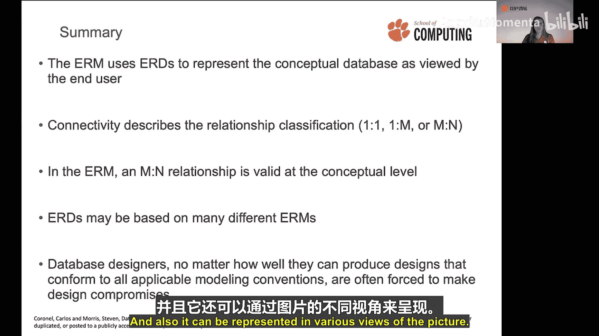

# 【克莱姆森大学】数据库管理系统 ｜ Database Management Systems p18 04_01_07_module-review -BV1y6rzBXE34_p18-

。

So in this module， we covered a lot of information that is necessary for entity relationship modeling。

Specifically， we looked at entities， weak and strong relationships， weak and strong entities。

And how they're depicted in an theR diagram， how attributes are depicted specifically to Crow'sfoot。

 and then we covered a lot with relationships and participation and cardinality。

And I thought it would be good for us to do a review of some of the key points so that just to keep it fresh and let's go through。

start with the concept of a derived attribute， if you remember。

 a derived or calculated attribute is something that can be created from other attributes in the table。

So we have a possibility of storing a derived attribute or calculating it every time you need it。

 so what are some of the advantages if you choose to store a derived attribute。Overall。

 storing a derived attribute will reduce the need to do actual processing when you get that attribute because it's already there for you。

 and that could reduce the time to get it。It's always there and available and then suppose you want to track it historically。

 you would have the ability to have that data stored to track it so when you update it you could keep a copy of the old version。

Just on the flip side， though。Disadvantages of storing it are that you you have to keep it up to date。

 so the case we had in our example earlier was having in an employee database their date of birth。

 so you could derive their age just by looking at the current date and their date of birth and calculate it。

嗯。If you store it， it's going to get， it'll be in a year if today was their birthday and a year it changes。

And if you have a table of many， many employees， they have many different birthdays。

So to be safe every day， you would have to go through the table， check。

Which employees have a birthday on that day and update their age in the stored version？

If you didn't store it， you just calculate it anytime you need it and you wouldn't have that overhead concern of having stored bad data。

The next question is around weak entities and what are the conditions that must be met for an entity to be classified as weak？

So the two criteria for a weak entity is that it must be existence dependent on its parent。

 so you can't have that entity without a without a parent entity existing and it must inherit at least part of its primary key from its parent so in this case with employee independent we have an employee number as part of the primary key or the dependent table。

And it's part of its primary key， it's also a foreign key and if you kind of step back and think about that in a company。

 if you had。Depenence that didn't have associated employees that doesn't make a lot of sense。

 you're not going to have a dependent child that doesn't have an employee so。So the actual。

Diagram matches， you know the business and what makes sense Another key note here is that the that a weak entities conditions are the same。

Conditions to have a strong relationship between an entity and parent， so if you have a weak entity。

 it will produce a strong relationship。So that's just something to remember in this case。

And to follow on that， sort of repeating what we just said， what is a strong relationship？

And how is it depicted in crrow'sfoot and？How is the existence dependence implemented in the database？

So if we had that strong relationship。What does that mean in your actual ERD and then in your actual creation of the table？

Okay。So a strong relationships exists， and we just said this when an entity is existence dependent on another inherits at least part of the primary key is depicted with the solid line。

 remember， weak relationships dotted， strong is solid。And you would actually implement this。

With a non nullable foreign key。 So think about that for a minute。

 So I would have to This is telling me， I cannot have a dependent。Without a existing。

Employee and I can't so that means I can't have an employee number or and key that is nullable。

Now that would also be part of the primary key in this case， so it couldn't be nullable。

 the database would not allow that。So let's think about in our employee database in our employee table that we just were looking at that we had in addition to the name and their date of birth。

 we had a column called degree and it stored all the degrees for a。Particular employee。

 And you see here， some have associates degrees， master's， Ph Ds。 So the number of degrees can vary。

 There might be even some that are no。What's the downside of storing like this， Is this okay。Well。

 I definitely do not think this is okay， think about trying to search for an employee if all the employees that have a master's degree。

You would have to search and parse out from the employee degree column， the MS from that column。

 so you would be querying and parsing very expensive to do。So what are some better alternatives？

Another alternative， let's create a degree column that has just one degree in it。

 and we'd have multiple columns for each of their degrees。What's the challenge with this one？Well。

 the problem here， there's a couple problems， one is。

You have to know how many degrees when you create the table initially。

 are you sure that there's only three degrees， Maybe you want to make it be seven just to be safe。

But how many people really have seven， if you had one employee with seven degrees and the rest have one。

 you have a lot of unused space in your tables that is is's wasted and really is also not the best writing query to get information from the employee table on degrees would be a little bit of a complex query and you don't we haven't gotten into SQL yet。

 but but trust me， it wouldn't be an ideal query。So。This is really what you're aiming for so this is。

A， you know， you're back to your employee table and you also have a degree table which has a foreign key of employee number。

 So in this case what。You know， having the foreign key lets you look up quickly what employees have a particular degree。

But one thing to note in this degree table， what do you think the primary key is here？Well。

 it can't be employee number and it can't be degree code。

 but it can be the two of them together so just keep that。

 you know make sure you see that because employee number is not unique this employee in there twice and but together an employees not going to have one two。

3 AA in there twice because they've already got that degree so。That would be， you know， in this case。

 that would be a safe bet for a primary key。Next question。

 what is the difference between a single valued attribute and a simple attribute and give an example？

So remember， well， I'm not going to give you the definition。

 but I'll let you think about it for a moment and then we'll look at the answer together。Okay。So。

Remember， a single value attribute is one that can only have one value， so for example。

 a person only has one first name and one Social security number。

Now a simple attribute is one that cannot be decomposed into its component pieces like size。

 you know， size medium， there's nothing you can do more than that or maybe area code。

Can't be decomposed。But important to know is that a single valued attribute is not necessarily simple。

So in this case， serial number。Has many parts。 It has a state， which is Tennessee T。 N。

 It has a plant number P 5。 It has shift。Which is S2。It eta has an actual date in there。

 so even though there's only one at one single value here。

 you may decide you want to break this up into multiple parts。

And just another note there you probably want to break it up into multiple parts。

 the decision would be do I need to look up a product by a piece of the serial number。

 do I need to look up all products in Tennessee， for example。

 it'd be much easier to have that as its own piece versus trying to parse this large serial number。

Okay， what are multi valued attributes and how are they handled in a relation relational database we talked about singled。

Valud attributes， but what about multi valued？Okay。

 multi valued attributes have many values and usually require。Some type of。

Multi valued attribute component or entity。 So remember that going back。

 we talked about the car and the car color and different ways you could handle the colors。

For the car and and where we ended up was this preferred mode here where you have its own entity。

 car color， which has the carve in in section as its primary key and then a color per section。

 be really easy to add more sections if you need it as opposed to having the top color trim color and body color and then if you've got rid of one of those are added。

 it's a lot easier to do it in the car color table。So cardinalities for this diagram。

 assuming that we don't have any other information， but this picture。

The cardinalities would look like this with 11，0 n， etctera。Remember that this。

 the case we had with professor。Having classes and there was a statement of they teach no more than。

4our or three， depending on the slide， that cardinality was clear it wasn't just n it was three or four in this case I don't have that information so I would just put n。

How do you handle many to many relationships between entities and the ERD？

And you can use one of these terms associative or composite or bridge entities。

So that's it for module4。Key takeaways are using ERDs to represent your database or you actually create it。

The actual database in a database system， you have various types of connectivity， one to one。

 one to many， many to many。You conceptually， we all understand many to many。

 but we would have to create a bridge entity in that case。

ERDs can be represented by different ERMs like we talked about the various models like prose foot。

 etc。🎼And also， it can be represented in various views of the picture。

