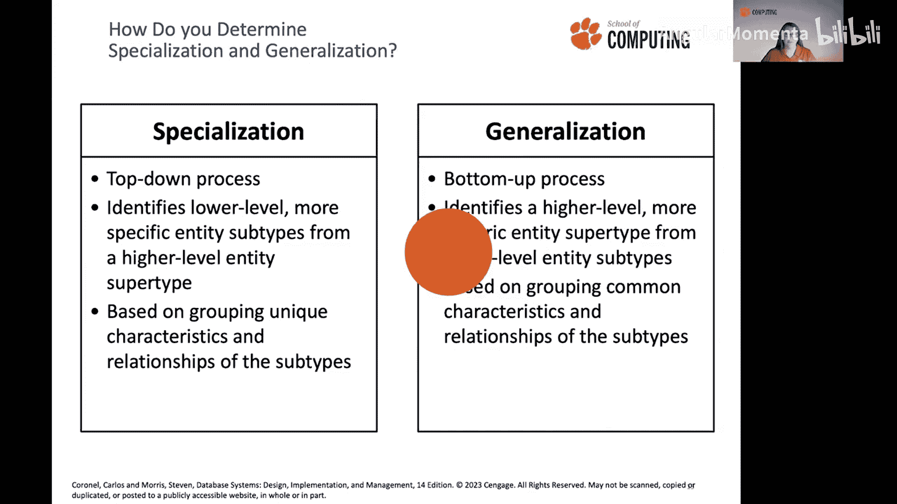

# 【克莱姆森大学】数据库管理系统 ｜ Database Management Systems p19 05_01_03_extended-entity-relationship-eer-model-constructs -BV1y6rzBXE34_p19-

Yeah。

So in this module， we're going to do some more data modeling and use some more advanced concepts building on what we learned in module4。

Specifically， this is called the extended entity relationship model。

And we will go through some examples of extended entity relationship modeling。

Also we're going to cover primary keys and how do you select good primary keys and then some kind of special case solutions for some more edge conditions around data modeling and I will talk about those。

All of these topics are covered in chapter5 of our beating。

So we'll start it out in this part with the extended entity relationship model。

And the extended entity relationship model， EEM is easier to say。

Is really adding more constructs to what we've learned in。

Module four so it's just building off of that and doing the diagramming is an EED extended entity relationship diagram。

Specifically， the main area we're going to cover is something called supertypes and subtypes and a supertype。

Is an entity that has。Subtypes or other entities that are built off of that supertype or have unique characteristics of that supertype。

 and it really is around very similar if you've done object modeling to the concept of inheritance。

 so you'll see that entities that are subtypes will inherit all the various attributes and relationships of their supertype。

And when you need to use these， well， if you have an entity that has various attributes or characteristics that are special to different types of that entity。

 that might be a time for you to consider using subtypes。Overall。

 you organize supertypes and subtypes into something called a specialization hierarchy and the supertypes in the subtypes。

 the subtypes are below and I will show you an example here in a moment。

 and those relationships are described as an is out relationship。

And a subtype only exists within that context of a supertype。

So let's go ahead and move into an example here we have an example of a supertype called employee。

With three subtypes， Ilet， mechanic and accountant。

And we're going to learn what all these new shapes and drawings here mean because there's a lot on this diagram we have not covered before。

 but what we have covered is the relationship between employee independent。

And there is a relationship there that is a one to many。 And in this case。

 the dependent has a primary key that is a composite of employee employed number and dependent number。

In this relationship。And the attributes within employee are all inherited by the pilot。

 mechanic and accountant。So what I'll do now is I'm going to go into more detail。

 I'll come back to this drawing several times to this diagram and but I'll reference this and go into the detail。

 what are all these various pieces and parts。So just as I mentioned previously。

 there is overall this property of inheritance， which enables that subtype to inherit all the attributes and all the relationships of the supertype。

So， in this case。A mechanic。Has the same attributes。 It has employee last name， first name。

 initial hire day and type， but in addition， it has these two。Attributes specific to the mechanic。

So you don't just， you don't need to copy these into this entity in this diagram because it is assumed that since it's a subtype。

 it inherits all those attributes， and then any mechanic will also have a relationship to the dependent table or a dependent entity because it inherited that relationship from employee。

And you can also go multilevel， which this example shows you a person that is either an employee or a student。

 and in this case an employee can be an administrator or a professor or a graduate and a student can be a graduate or an undergrad。

So you see a multi layered hierarchy here where the subtypes and super typess build off of each other。

You can also have relationships that are specific to one of those entities。

 so employee has a relationship to office that in this case a student doesn't have that relationship。

 so you would not want to put the office relationship right here。

 you would not want to put that as part of person because then student would have inherited that relationship。

Now there's a few things on this various diagrams that I'm going to talk about， as I mentioned。

Right here between a supertype and its subtypes， you see this name of the one attribute student type。

 and that attribute is called a subtype discriminator。

 So it tells you whether or not the student is a graduate or an undergraduate。

 So it's part of the student entity and dependent on the value of student type that's graduate then I will be in this I will have these additional attributes if I'm an undergraduate。

 I will have undergraduate hours。 So。In most cases。

 this will be inequality comparison to the student type you would say。

 does it equal graduate or does it equal undergraduate？

The other the other symbol you've seen on these hierarchy diagrams are the O and the D that are。

In between the supertype and the subtype。 and what this tells you is whether that the subtypes of the supertype are overlapping subtypes or disjoint。

So。What that specifically means， if you're overlapping。

 then an employee could be an admin or a professor。嗯。It could be both， but in this case。

It's an O I mean it's in this case it's a D for student so student it can only be this joint one or the other。

 so it can only be a graduate or an undergrad， so let's go back to this picture which is easier to see。

So overlapping means an employee can be an administrator。

 and they can be a professor that is allowed， they can overlap。If they're a student and in this case。

 it's disjoint D， so they can only be a graduate or an undergraduate， they cannot be both。

Now we know at Clemson we have a bachelor tograduate program which would kind of confuse this。

 but in this particular data model they're saying in this school a student can only be a graduate or an undergraduate and employees can be professors and administrator。

 so I'm a perfect example， I am both a professor of practice at Clemson。

 I'm also an associate director so I'm an administrator and a professor。

Another point with disjoint and overlapping constraints is regarding how you need to use the subtype discriminator。

Because on the student， you have a disjoint constraint。

 meaning that I can only be a graduate or an undergraduate。

 it's very clear your student type discriminator would only equal one or the other。Her employee。

If you said employee type is。Admin。If you just had an employee type and not is admin or is professor。

Then how would you distinguish both， You could say that my employee type would be admin。

 professor or both。But imagine if you had a lot more employee types。

How would you indicate each one of those both wouldn't be sufficient three saying three wouldn't know which three。

 So in that case， it might be best to have。A discriminator for each of the different types。

 so it'd be easy to determine am I an administrator professor or what other， you know。

 if you're a lecturer， etc。And down here at the bottom is just the various values for the subtype discriminator。

 professor， administrator， yes or no， and it'll tell you because you're overlapping that you could be both a professor and an administrator。

The other symbol you've seen in these EEDs is this line under the D or O。And what does that mean。

 well， that is called the completeness constraint。And it tells you whether or not the supertype of occurrences must also have at least one subtype。

If you have a single line， you're partially complete。

 so that tells you that not every super type occurrence is a member of a subtype。

Double line means that you must be a member of at least one subtype。

So going back to this example with the double line。

 the student must be a graduate or an undergraduate。

An employee does not have to be an administrator or a professor。 They can just be an employee。

So that gives you an example of how this completeness is used。

And if you take the disjoint and overlapping constraints and combine them with partial incompleteness。

Partial and total completeness constraints， you can think about the different combinations that you could have based on whether you are disjoint。

That means， for example， if you're disjoint and partial complete。

That means you could actually have no subtypes。If you are overlapping。And partial。Then again。

 you could have no subtypes。If you are disjoint in total completeness， you must be。

 at least you have to be a member of at least。Or only one subtype。As opposed to overlapping。

 because you could be both， you have to be a member of at least one when you have total completeness。

Now， how do you even know when I need to use this type of hierarchy。

 the specialization hierarchy and it really comes throughout the design process。

 you could do it from the top down， So let's say you were designing the college that had employees and students you may start with an entity that has all the various attributes that were indicated in this particular ED where you put all the grad thesis。

 undergraduate hours all into the student entity and then as you go through the process of design。

 you determinemm I think I better break these out into subtypes because for a lot of students they're going to have a lot of。

Of these attributes that don't make sense for them or null。

 and I'd rather just push those into the subtypes。So that's one approach that could happen as you do your design the other thing is you may know from the very beginning that you have students and or graduates and undergraduates you know that you have professors and administrators and as you start designing at the lowest level you see they have a lot of common attributes that maybe you should share in a supertype so it really there's no set way to discover these it really happens naturally throughout the design process as you iterate through the designs it'll become obvious whether or not you need to have a specialization hierarchy。

So as we get into the next part， we're going to talk more about primary keys。

