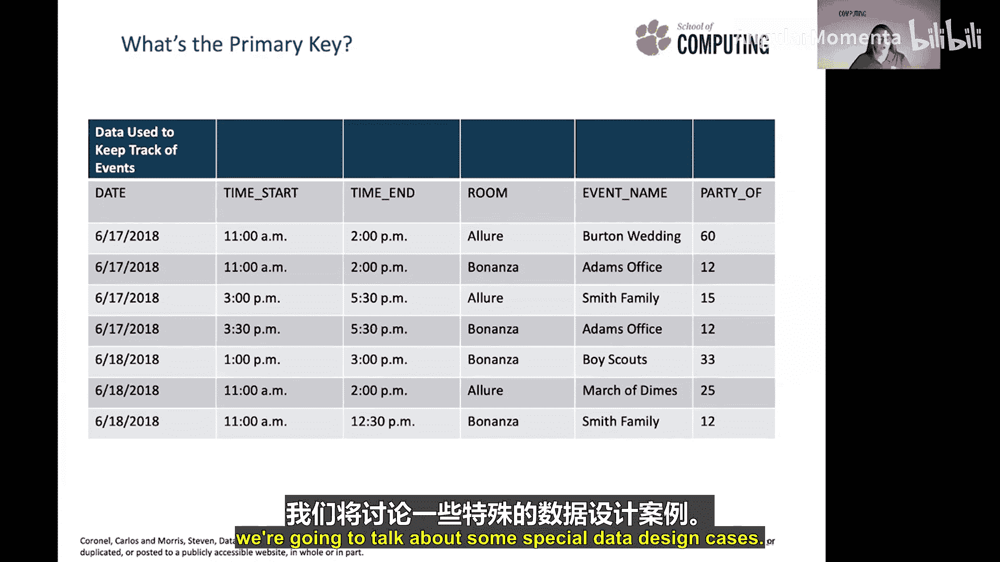

# 【克莱姆森大学】数据库管理系统 ｜ Database Management Systems p20 05_01_04_good-primary-keys -BV1y6rzBXE34_p20-

In part two of module5， we're going to cover some more details around picking a good primary key。

So how do you pick a primary key？Well we already know that our primary keys have to uniquely identify each entity instance。

 then that's how we ensure entity integrity， and the primary keys function is to guarantee that entity integrity。

Again， primary keys and foreign keys work together to implement the entity integrity and the relationship integrity and overall having a good primary key is really。

 really important because it ensures an effective implementation from a performance perspective and just overall from a communication with your constituents and you know especially as databases grow and you add more data。

 it's important to have a a well thought out primary key。

So there's sometimes in the data that you're looking at a natural key。

 so an identifier that is a real world identifier that uniquely identifies each of the instances of your entities for example。

 if you were to have a database of employees that all had Social security numbers。

That's a good primary key from the perspective it's unique。

 you don't have to worry about two employees having the same Social Security number， it's an integer。

 which is always better when it comes to doing queries and looking up data。So in that case。

 you know you could say， hey， that is a natural identifier。And I want to use that as my primary key。

Well， here's some characteristics， though， and if you think about the Social Security number。

The very last characteristic on this list of desirable primary key traits。

 security compliant is a reason you probably would not select Social Security number。

 it is sensitive data and believe it or not and this a an industry。

 people call entities by their primary key， they start to learn those numbers and you don't want your employees。

 you don't want to be making that Social Security number visible。

 so while Social Security number may look like a good candidate key， it's a natural key。

 it is not going to be a good key because of the security issues。

So what about other desirable characteristics of a primary key we already know it needs to be unique now what is nonintelligent we want that primary key not to be something you have to either determine some other value from it it has to be calculated in any way you want that to be constant so in a Social number example you don't want these things changing if you were to use somebody's last name as a primary key that could possibly change their first name could possibly change so not a good primary key you preferably want it to be one attribute and not a composite key except in a couple cases we'll talk about and ideally it is numeric so again that just helps you with quick lookup it's just faster to search for numerics than it is to search for character strings。

And then we already discussed how it's important you don't pick a primary key that is。

Going to have any security challenges now if you think about when I mentioned that how primary keys can become something we we use and talk about。

 even though they're not a natural key， perfect example would be our Clumps and user IDs。

I'm not i'm certain that somewhere that was originally a primary key for all Clemson students and employees and it's just stuck so while you you might know your CUID by heart I bet there's people in IT who when they talk about a data element and a problem with it they talk about the CUI so。

Again， it's numeric， it's unique。It's one attribute。

 so and it's not going to change so that's how they came up probably with CUID being a good primary key。

So I mentioned that you typically want a single key a not composite or a single attribute there's a couple cases where it could be useful again your design may say it's still better to have a single attribute。

 but the case cases where you may see them are in the example like when we have the many too many relationships and we create a bridge or composite entity so we want to make it very clear that this is a bridge entity and show that primary keys from the two entities that are being bridged。

And I'll show you that example next and another example is if you have weak entities where you want to show that you have that strong relationship with the parent。

 then in that case， you may want to put that parent primary key as part of the weak entities's primary key so you can make that very clear。

So here's the example of having a bridge entity between student and class and having that composite primary key class code and student number。

And you could have created another primary key called enroll number and kept both class code and student number as scoring keys。

 that would have been perfectly acceptable， it's really a database design decision if you want to keep both of those and have them as the primary key or create something like enroll number which is known as a surrogate key。

And a surrogate key just helps you simplify overall design by， you know。

 it's just a number that you assign to each element in an entity。

One of the biggest advantages of a surrogate key is it has no meaning it can be generated by the database so that you always have unique values and really it's useful when you have no natural key when you may have those security issues and you know like a social security number when a candidate keys too long。

So overall， I saw in my experience surrogate keys used extensively there when we get into more of the SQL database creation。

 you'll see how you create surrogate keys and as it says here。

 it just the DBMS will take care of managing those keys， every time you insert a new row。

 it'll give it a new unique value。And in this example， you know。

 this kind of shows you a good example of why you would need a surrogate key for this entity。

 So if you think about this entity being。A series of events that have a date。

 a start time and end time， a room event name， and a party of so how many people are at the event。

If you look at this， it's not really clear what my primary key would be it can't be the date。

 the time is not going to work。The rooms certainly don't work。The event names that may be unique。 Oh。

 well， there's。Looks like a couple there with the same name。

 So maybe they have recurring events and the same party。 So really。

 what you may conclude looking at this data， if you couldn't create a surrogate key， in this case。

 you'd have to use every single attribute or column as a。

To make the primary key so that'd be a primary key of six attributes。

 which really is not a good primary key， so it would it would be natural in this case to create a new。

Serrogate primary key called event ID is what I would probably call it and that would be you know starting at the first one is one。

 two， three， four event ID， one through seven in this case。

But they could keep going on and on as long as you add events。So in the next section of module5。

 and I believe it's our final section before we review。

 we're going to talk about some special data design cases。

