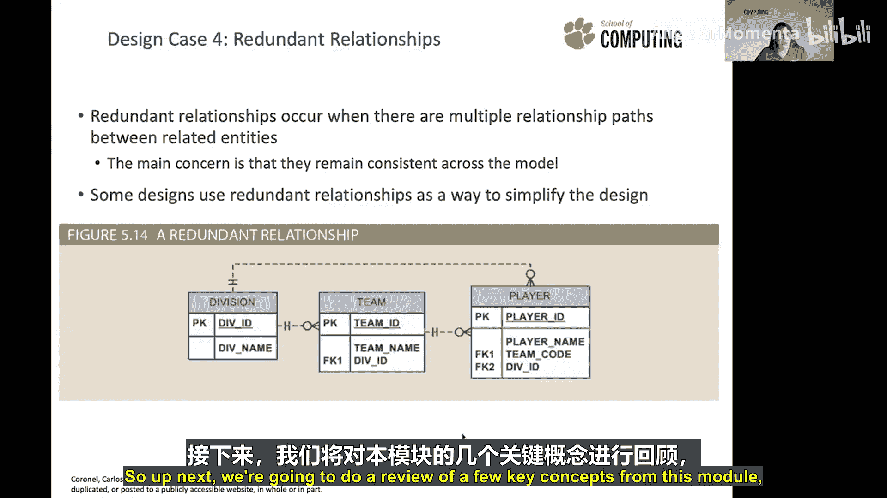

# 【克莱姆森大学】数据库管理系统 ｜ Database Management Systems p21 05_01_05_flexible-solutions -BV1y6rzBXE34_p21-

🎼。

So in this final part of module5， we're going to cover some special cases of data modeling and some solutions for those special cases。

The first we're going to talk about is one to one relationships now。

In most relationships within a relational database model， you will have one to many relationships。

 but there are some one to one， and you need to put a foreign key in those those entities to show that relationship。

 and sometimes it's not very obvious。 Where do you put that primary or that foreign key。

 which is the primary key of the other entity。So there's really three different ways to approach this。

 depending on first being if one of the two entities is mandatory in the relationship， it cannot。

 you always will have that particular entity。In that case， you'll place that entity。

 the mandatory entity's primary key as a foreign key in the optional side， of the optional entity。

 and that foreign key would be mandatory， it would not be nullable。Now both sides are optional。

 then you just have to think about a couple things。

 one is which of the sides will have the fewest null foreign keys。And which in which relationship。

In which of these two is the kind of relationship role played。

 so employee has a dependent or if that was a one to one。

 you would say the employee is the entity where the relationship role is played。Lastly。

 if both sides are mandatory。I would actually think about in that case。

 and we're going to talk about this in module 6。 Maybe those shouldn't be two separate entities。

 because if you think about it， that one to one， if you have one and you have the other and you have to have both。

 Perhaps all the elements belong together in one entity。And like I said， in module six。

 you'll have a lot more understanding and appreciation of how do you know when to split up entities and we'll cover that there。

The next design case is around time variant data now time variant data is extremely common in databases today。

 most of the data that you see you know in many different retailers， they keep history of sales。

 you'll keep history of financial records， there's so much that you keep your order history。

 you just have all sorts of data where you're keeping historical information and the way you model that in a relational databases through a one to many relationship。

So in this case， you can see an employee and that employee has salary history。

 so you want to keep track of when that employee gets a salary， you know most cases。

 let's hope it's an increase。So， you know， you don't want just the one employee salary and the employee table。

 you need to have multiple values that you can go back in time。

And look at and see your salary changes because in most cases people want to understand that it might even be for regulation reasons that you are required to keep that historical data。

And in this particular case， you can go beyond just the salary history。 you can also。

Look at manager history and this is going to depend on your business use you know and the scenarios in your company。

 whether you would want to have whether these relationships would even make sense so you know the salary history makes sense manager history makes a lot of sense as well and then you could introduce you know you have a department that each employee is part of and that department could also be related to your manager history because if you change departments you're going to change change managers。

So。Now， you know， so you can just see the complexity of managing all of this data and then you know。

 a cleaner way may be to have all of that job history in one time variant entity job history that keeps track of not only your salary changes。

 but any job changes that you have because that would also indicate your manager change。嗯。

The purpose of showing you this， you know， this isn't necessarily the right answer for a particular you know that you know every company is going to have their own relationships based on their business。

 but just for you to understand that there's so many different ways or different needs to keep historical data for all sorts of all sorts of scenarios like I said sales data。

 financial data here you have salary data， so over time you know things change and you know a lot of companies they want to keep track of the changes and not just see the current information。

So another type of design challenge is something called a fant trap。

Where you will model something and it looks correct to you based on the business rules。

 but if you think through it a little more closely。

 you get an association that creates something called a fan traprap。So。

Let's look at this example where I have a basketball league that has many division。

 a division has many players， and in each division has many teams。So in this case。You know。

 division is has a one to many relationship with team and a one to many relationship with player。

 And this is semantically correct。 They're not。That that is what you're reading and understanding。

But you don't have the proper identification because there's no way， if you look at this model。

 there's no way to identify which players belong to which team you just have the association with the division。

So how would you fix this， think about that for a minute。All right。

 before I show you how you fix this， notice the name fan traprap is because the relationships fan out from the division。

 so that's why it's called a fan trap。But here's how you eliminate that pant traprap。

 you have the one to many relationship with team now from division。

But in turn you have a one too many relationship between team and players。

 so now you can get if you have the division， you can find out all the division players and the team players both from this model and this design。

The last design case to cover here is the concept of redundant relationships。

 and that is just having represented relationships that you don't really need to show。

 So in this case， this is our fan traprap example with division team and player。

 And you see someone put in a one to many between division and player。 but it's really redundant。

 You don't need this because you already have established a one to many relationship with player。

Given you have that one de many with team and from team one de many to player。You just， you know。

 technically this is not wrong， but it's really not needed and for all practical purposes you can eliminate that without losing any information how。

By taking out that relationship。Great， so up next， we're going to do a review of a few key concepts from this module and that will wrap it up。

