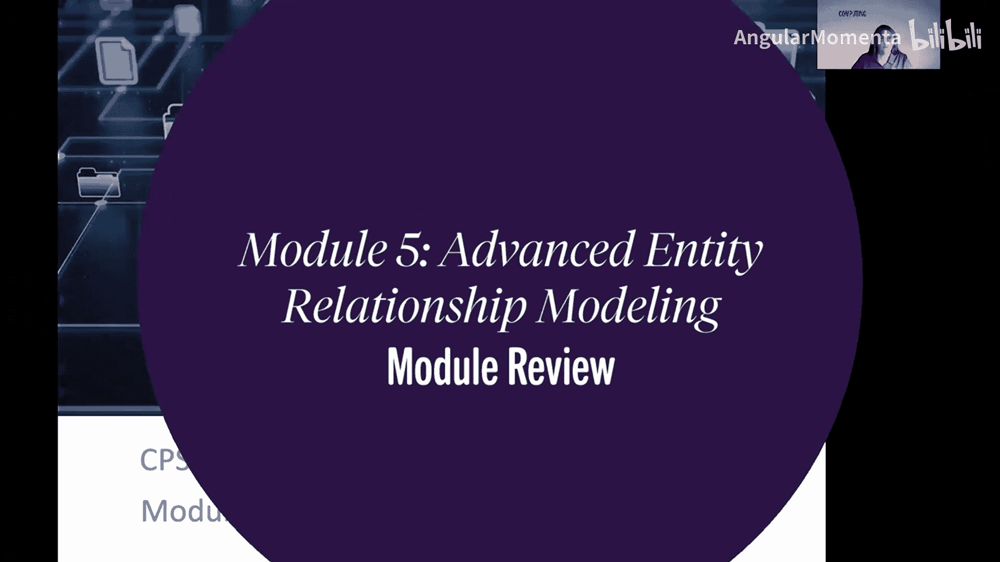
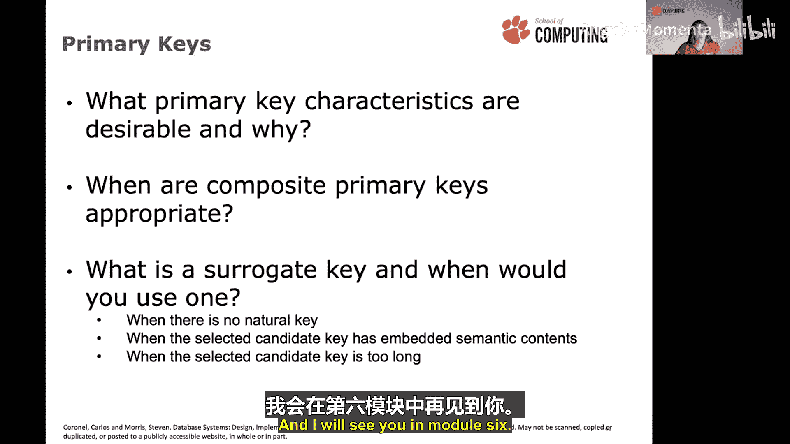

# 【克莱姆森大学】数据库管理系统 ｜ Database Management Systems p22 05_01_06_module-review -BV1y6rzBXE34_p22-

So we learned a lot of important concepts in this module and I wanted to do a brief review of some of those concepts。

One of the most important concepts we covered was the specialization hierarchy where you have supertype subtypes and you have the concept of a discriminator。

 subtype discriminator， you have partial and total completeness and overlapping and optional constraints。

Are a disjoint constraints。In this case， we have a disjoint constraint and we have total completeness。

With with a discriminator of product type and our product types can be a book， a C or a movie。

So the first question， what are the attributes of a movie？I'll let you think about that for a minute。

Okay， so。If you said movie rating and movie director and product number， you're partially right。

 Remember， a movie will have all those attributes。 plus the product attributes of release date。

 title， price and type， because it inherits all of its。Super typess， attributes。Next question。

 is it required that every instance of a product of the product table be associated with an entity instance in a CD table？

Why or why not？O。So。The answer is。This is。No， because。You have。A disjoint。Constraint。

Total completeness。 So I have to be if I'm a product， I have to be。A book， a C D or a movie， right？

So I don't have to be a C D if I'm a product， but I have to be one of these three because I have total completeness。

 the double lines。In addition， is it required。Oh， this is the same question。 Sorry about that。

 I did just wanted to show you again， this chart that shows you the disjoint and overlapping double line being total completeness。

 And so in this case， why don't I have to be see the if I'm a product， Because I'm disjoint。

 I just have to be one of these。The other key concept we covered was choosing good primary keys。

And three questions around this， what primary key characteristics are desirable and why？

When would you want to use composite primary keys？And what is a surrogate key and when would you use one？

So you want to have。Primary keys that are unique， non intelligent， don't change。

 you want them to be security compliant。Like I said， it's always better to be numeric。

 it leads to faster look up and preferably single attribute。But what about those。

Composite primary keys， when are those appropriate？I didn't write it down here。

 but the two cases I mentioned are for weak entities and the other case was when you have a bridge entity between a many to many。

Set of entities。And when do you use the sroica key？Well， first， what is a surrogate key。

 A surrogate key is something that is created by your DBMS S that is generated as a unique identifier。

 And you want to use it when there's clearly when there's no natural key。

 If you remember the event table I showed you that had no natural key。

Maybe you do have a key but it has too many embedded content。

 so it's just it has a lot of information that you don't want to pass around in a primary key or it's just too long it's you know it's you want your primary keys to be succinct possible。

So thanks for sticking around for。Module 5 in moduleule 6。

 we're going to get into another very important concept of normalization。

 and I will see you in module 6。

