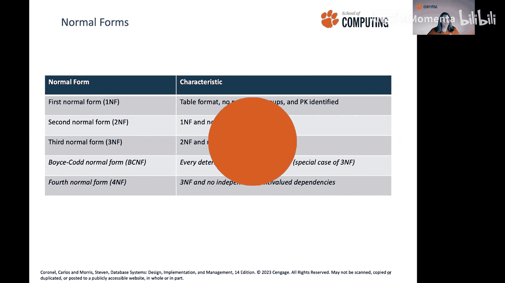

# 【克莱姆森大学】数据库管理系统 ｜ Database Management Systems p23 06_01_03_normalization -BV1y6rzBXE34_p23-

In module6， we're going to talk about normalization of database tables and why this is so important as you create relational database models。

So we'll go through the whole process of normalization from the various normal forms。

 one NF first normal form through the fourth。Talk about how you actually transform them from lower to higher normal forms。

 the various rules you use to figure out if you have your tables in the right normalization form。

There are situations that you will need to do something called deormalization and we'll talk about that and then we'll wrap up with a checklist to help you as you go through the modeling process。

So we'll start out talking about what is normalization and its role in design and go through。

 we'll actually start with the first through the third normal form。

So normalization is what you do to ensure you have the right table structures in your design Overall it's going to reduce the likelihood of data anomalies and it helps you determine which attributes go with what tables。

And you start at a first normal form typically， and you go through the third normal form。

And the higher the normal form。 So third is better than the lower normal form。

 And there are some higher normal forms like fourth normal form。

 but we will spend a little bit of time on that。 But for most purposes， in the business world。

 third normal form is sufficient。And then you can sometimes go backwards， like I said。

 you can denormalize and it's usually to help increase performance。Of your database。

So when do you need to think about normalization well really it's going to come up in sort of two different scenarios。

 one is your initial database design。So you're looking at the database。

 thinking about what your tables are going to be and you need to determine the right structure and you'll use normalization。

Another time is you could have an existing database and you want to look at that and improve that database using normalization in the various rules of normalization。

Again， the main goal is to eliminate data anomalies by eliminating unnecessary or unwanted redundancies and it'll become more obvious as we go through an actual example。

We're going to talk about the concept of dependencies。

 which is really important as you look at normalization， so when we go through normalization process。

 youll need to understand what are functional dependencies and we'll get into that in few slides or actually I think we're going to get to that in the next part。

Just to help you understand normalization， let's look at this table。

 which is a table of various aircrafts that you can rent and you have an aircraft number。

 which is this first column， an aircraft model， and aircraft charge for rental。

 how many seats the aircraft has， and then maybe the total time that it's been rented。

And this is not a very good table， so just spend a moment thinking about why this isn't a good table。

So the main reason this is a bad table is because you have the redundant data。

 you have the Cssna model。Sihawk in there several times and you notice it always has the same charge in the same seats that just doesn't seem like a good model it's also easy to make a mistake so if I was updating one Cssna C172 I could make a mistake and not update all the others in this table so that would become a data anomaly。

So a better way to organize this data would be to have the models of the various aircraft as in a separate table。

 so you have a model code， a model manufacturer， the seats in the charge。

 and then you can actually have separate rentals that just reference through a foreign key。

 the model code that's in the model table。So that is an example of how we just did a normalization process now it was sort of obvious that we needed to do this。

 but there is actually a step by step way you accomplish。

Breaking up the tables into better normal forms。And what you're trying to do through normalization is if you remember in previous lessons。

 everything， a table is really a relation and so you're trying to make sure you have a wellform relation that each table represents a single subject。

That each row and column of that table has one value and not a group of values。

That you don't have any unnecessarily stored data in more than one table。

 so you're not having redundant of the same。Same data。

All non primary attributes in the table are dependent on the primary key。

And each table has no anomalies through insertion， update or delete。

 like I showed you in the aircraft example。So to ensure that you have a well formed relation。

 you want to be in at least third no form。You really are not going to find a need to go above their normal form in most cases。

 we will talk about fourth normal form in a brief overview， but again。

 you typically won't run into the need to go to the fourth normal form。

And you're going to go through the process of normalization， one relation at a time。

 one table at a time， breaking up the tables into the separate relations and or separate tables。So。

Last up。Is just an overview of the normal forms。And again。

 we'll talk about the fourth normal form in a future part of this module， but we'll start with first。

 second and third normal form， the characteristics listed here we will get into the details so you understand what these mean。

