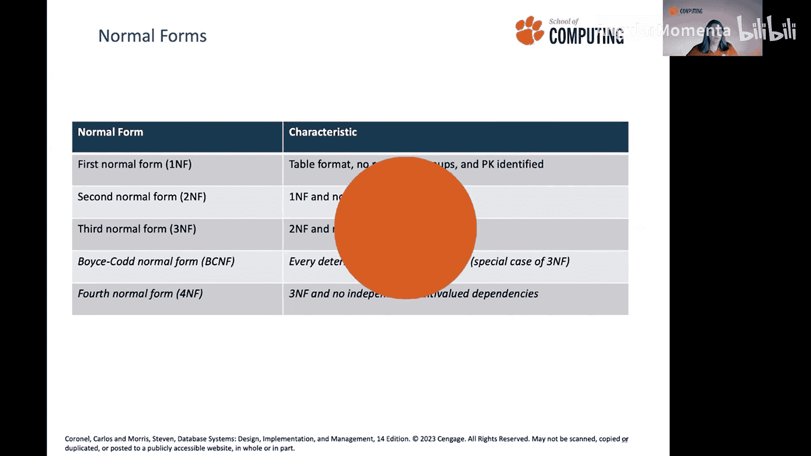

# 数据库管理系统：模块6：数据库表规范化

在本节课中，我们将要学习数据库表的规范化，以及为什么在创建关系型数据库模型时，规范化如此重要。我们将从第一范式到第四范式，完整地介绍规范化的过程，讲解如何将表从低级范式转换为高级范式，以及用于判断表是否处于正确范式的各种规则。我们还会讨论在某些情况下需要进行反规范化，并在最后提供一个检查清单，以帮助你在建模过程中应用这些知识。

## 什么是规范化及其在设计中的作用

上一节我们介绍了课程概述，本节中我们来看看规范化的基本概念及其在设计中的角色。

规范化是你在设计过程中为确保拥有正确的表结构而采取的措施。总体而言，它能**减少数据异常的可能性**，并帮助你确定哪些属性应该归属于哪些表。

你通常从第一范式开始，逐步推进到第三范式。范式级别越高越好，例如第三范式优于低级范式。虽然存在像第四范式这样的更高级范式，我们也会稍作介绍，但对于大多数商业应用场景而言，**第三范式通常已经足够**。

有时，为了提升数据库性能，你可能需要反向操作，即进行**反规范化**。

## 何时需要考虑规范化

接下来，我们探讨在什么情况下需要考虑规范化。

规范化主要在两种场景下出现：
1.  **初始数据库设计**：当你开始设计数据库，思考表结构时，需要使用规范化来确定正确的结构。
2.  **优化现有数据库**：你可以通过应用规范化的各种规则来审视和改进现有的数据库。

规范化的主要目标是**通过消除不必要或多余的冗余来避免数据异常**。随着我们深入实际例子，这一点将变得更加明显。

## 理解依赖关系

在进入规范化过程之前，理解依赖关系的概念至关重要。

当我们进行规范化时，你需要理解什么是**函数依赖**。我们将在接下来的部分详细讨论这个概念。

## 一个规范化示例

为了帮助你理解规范化，让我们来看下面这个表。这是一个可供租赁的飞机信息表，包含飞机编号、飞机型号、租赁费用、座位数以及总租赁时长等信息。

| 飞机编号 | 飞机型号 | 租赁费用 | 座位数 | 总租赁时长 |
| :--- | :--- | :--- | :--- | :--- |
| 101 | Cessna 172 | $120 | 4 | 1250 |
| 102 | Cessna 172 | $120 | 4 | 850 |
| 103 | Piper Archer | $150 | 4 | 600 |
| 104 | Cessna 172 | $120 | 4 | 1100 |
| 105 | Beechcraft Baron | $350 | 6 | 2000 |

这个表的设计并不理想。花点时间思考一下为什么它不是一个好表。

这个表的主要问题在于存在**冗余数据**。例如，“Cessna 172”这个型号出现了多次，并且每次都有相同的费用和座位数。这看起来不是一个好的模型，而且容易导致错误。例如，如果我更新了一行中“Cessna 172”的信息，可能会犯错而没有更新表中所有其他相同的行，从而导致数据异常。

更好的数据组织方式是将各种飞机的型号信息放在一个单独的表中。

以下是优化后的设计思路：
*   **型号表**：包含`型号代码`、`制造商`、`座位数`、`租赁费用`。
*   **租赁记录表**：包含`飞机编号`、`型号代码`（外键，指向型号表）、`总租赁时长`。

这样，我们就完成了一个简单的规范化过程。虽然在这个例子中需求比较明显，但实际上存在一个系统性的、分步骤的方法来将表分解为更好的范式。

## 规范化的目标

通过规范化，你试图达到以下目标（如果你还记得之前的课程，一个表实际上就是一个关系）：
1.  确保每个表都是一个**良构的关系**，代表一个单一的主题。
2.  确保该表的每一行和每一列都只有一个值，而不是一组值。
3.  确保相同的数据不会不必要地存储在多个表中，即避免**数据冗余**。
4.  确保表中所有非主键属性都**依赖于主键**。
5.  确保每个表在插入、更新或删除操作时**不会产生异常**，就像飞机例子中展示的那样。

为了确保你拥有一个良构的关系，你希望表至少处于**第三范式**。在大多数情况下，你不需要超越这个范式。我们会对第四范式做一个简要概述，但通常你不需要达到第四范式。

规范化的过程是**一次处理一个关系（表）**，将表分解为独立的关系或独立的表。

## 各范式概述

最后，我们对各个范式进行一个概述。我们将在本模块的后续部分讨论第四范式，现在先从第一、第二和第三范式开始。这里列出的特性我们将在后续详细讲解，以便你理解它们的含义。

以下是各范式的核心特征：
*   **第一范式**：表中每个单元格只包含一个值，没有重复的组。
*   **第二范式**：满足第一范式，并且所有非主键属性都完全依赖于整个主键（针对复合主键的情况）。
*   **第三范式**：满足第二范式，并且所有非主键属性之间没有传递依赖（即只依赖于主键，而不依赖于其他非主键属性）。

---

本节课中我们一起学习了数据库规范化的基本概念、目的和时机。我们通过一个具体的例子看到了非规范化表的问题，并了解了规范化如何通过消除冗余和依赖关系来创建结构更优、更不易出错的数据库表。我们还简要介绍了规范化的目标以及第一、第二、第三范式的核心思想，为后续深入学习具体的规范化步骤打下了基础。