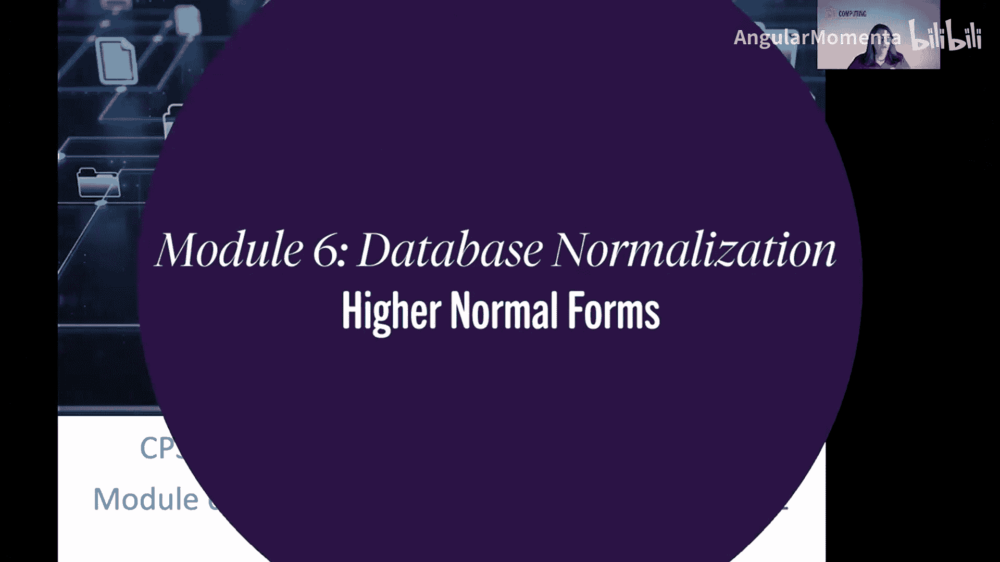
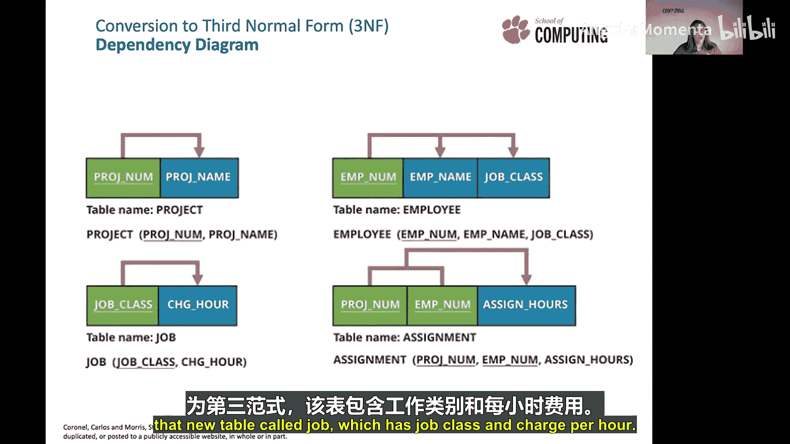

# 【克莱姆森大学】数据库管理系统 ｜ Database Management Systems p24 06_01_04_higher-normal-forms -BV1y6rzBXE34_p24-

🎼。

So in this part of module 6， normalization of database tables。

We're going to actually step through the process of normalization and transform from lower to higher forms。

A table。So it's a three step procedure to go。To a first normal form。

So youll have some table and you want to make sure that table does not have repeating groups。

So that we'll have multiple entries of the same type。And just hold one moment。

 because I know this may not be obvious。 So I will show you an example。

We're going to identify the primary key。Of our table and all dependencies。

 And we're going to identify dependencies using a dependency diagram。

 which is a visualization that shows all the dependencies within that initial table structure。

So what is a dependency， there's two types of dependencies that you're going to be considering first is a partial dependency。

First off， you have to have a primary key that's a composite primary key。

 so not just one attribute in your key。And what it says is that other attributes are determined only by a part of the primary key。

 so don' I would be able to say that this attribute only needs to know one of the parts of your primary key。

So partial dependencies are usually pretty straightforward to identify。

 The second type of dependency is transitive dependency。

 So this is when an attribute is dependent on another attribute that's not part of the primary key。

 They're a bit more difficult to identify and。This is only again happening between non primary key attributes。

Again， just I wanted to go through these definitions because we're going to refer to them。

 but when we go through the example， it should become more clear to you what these functional dependencies are。

So let's take this table and。That's something you might have sitting out in a Excel spreadsheet today。

 maybe not this exact data， but something very similar where you would have maybe project information。

 you have the project numbers， project names and you don't fill in these other columns or because on these other rows of data because it's just a repeat。

 you know everything below this is evergreen， everything below this is Amber Wa。

 everything below here is 22。And you have employees， employee name， job class。

 charge for hour and hours。So this is a table I want to go through and normalize so we're going to first start with the first normal form you go from lower to higher。

 as I mentioned before。So the first step in the first normal form is eliminate。Repeating groups。

So all you're doing is taking the repeating。Columns and putting them in every row。

 so back on this view。They were blanks， I need to fill them in。

So that all data is filled in with no nulls。And has the appropriate value。 So that's it。

 That's eliminate repeating groups。 You may not have to do this。

 Your data may already look like this， but in a lot of cases。

 especially when you go from spreadsheets。This other format is pretty typical。Okay。

 so the next step is to identify your primary key， so let's。

Look at this data for a moment and what do you think is the primary key？Well remember。

 your primary key has to be unique。So we know we have a repeat of project number so that can't be a primary key project name。

We have a repeat of employee number， we have， for example， employee let's see if I can find one。

Let's see 1，1，4， Angelise， she's in here twice。 I'm sure there's others as well， Annaise so。

Employee name， job class， but I'm pretty sure my project and my employee number are going to always be unique。

Cause I won't have the same employee on the same project more than once。So that is your primary key。

 so remember first normal form。Eliminate repeating groups， identify the primary key。Which we've done。

The last step of the first normal form is to identify all dependencies。Again。

 a partial dependency exists when there's dependence。

From one of the attributes on only part of the primary key。

And a transitive dependency exists when the attribute is dependent on another attribute that's not part of the primary key。

All we have to do in the first normal form is actually identify any of these dependencies。

 and we're going to use a dependency diagram， as we mentioned。Back on the steps of first normal form。

So here is a dependency diagram of the data we just looked at。In a dependency diagram。

You identify your primary keys by underlining them in this case we said it was project number and employee number。

And all of our attributes are dependent on the primary key on the top。Everything。

 all the arrows on the top are the dependencies you want to have。

You use the bottom to identify the dependencies that。You don't want to have。

 and those would be partial dependencies and transitive dependencies。

So we have a composite primary key in this table with project number and employee number。

 so we can have partial dependencies project number。

And project name is a partial dependency if I know the project number。

Then I will know the project name。So anytime I have a project name。

 it's always going to be with the same project number。

Same with employee number has a partial dependency on my employee name， my job class。And。

Could even have a dependence on my charge。 So it this in this case。

 we're saying this employee charges this much an hour。 So my employee。

 let's look at the data for a minute， if you forgot。What this data looks like。

 this is my charge per hour。 This is what my job classes， my job description， and this is my name。

So if I have an employee in the case we pointed at 114， Anna Eise， she's an applications designer。

 $48。10 an hour。And same on this instance down here on the other project star flightlight。

Employee number 114， Annanalisease。Applications designer 48，10 an hour， so that anytime I have a 114。

 I'm going to have these three attributes mapped to it。So that's another transitive dependency。

You could all， I mean， a partial dependency。 Sorry， then you also would say， hey。

 a transitive dependency between job class in charge per hour。 Why is that the case， well。

If I'm a database designer， I'm always $105 an hour。In any case。

 it doesn't matter what employee I am， database designer， 105 an hour。Datase designer，105 an hour。

 so you can look at this data and know that if I know the job class， I can know my charge per hour。

Therefore。That's a transitive dependency。Job class is not part of the primary key。

So it is not a partial dependency， it is a transitive dependency。

So the dependency diagram you're looking at is one way to identify all of these dependencies。

And the other is to put a relational description here。

 and I want to make sure you all see what this is as well。

 because when we're doing assignments and some of the tests I have you use this format below rather than draw a diagram so you basically say the first normal form of this table is project number。

 employee number with underlined primary keys and these other attributes。

 the partial dependencies are project number to project name employee number to employee name job class and charge hour。

 and then I also have a transitive dependency of job class to charge per hour。Okay。So。

When you're done with first normal form， you know all your primary keys。

 there's no repeating groups and all your attributes are dependent on the primary key。

Or it could be a composite primary key that's first normal form， that's it。

You didn't change anything necessarily except added those additional attributes so you didn't have repeating groups。

Now you still have partial dependencies， you still have transitive dependencies。And guess what。

 second normal form is eliminating your partial dependencies。

That's this step from first normal form to second normal form， just eliminate partial dependencies。

So we were at the first normal form。On our project table， which had。Two partial dependencies。

 project number to project name， and employee number to employee name。

 job class and charge per hour in one transit dependency， job class to charge per hour。So remember。

 first normal form， all you need to have。Is identify your primary keys， remove any repeating groups。

And identify the dependencies you don't have to eliminate them。

But now we're going to move into second normal form。

 which is going to require us to remove the partial dependencies。 we need to remove this。

Project number， project name dependency and the employee number to employee name to job class to job to charge per hour。

 Those are the two partial dependencies。Now， when I remove those。

 I have to have a table that brings those two together because they have a relation together。 They。

 they have a。You know an employee is on many projects and a project may have many employees。

 so knowing that as part of my data model means I can't just create two tables without having something that's going to bring those two together。

So for the second normal form， I'm going to have this as my。

ANew structure the project table and the employee table now have all the attributes are dependent on that primary key。

 so project name is dependent on project number employee number name class in charge per hour are all dependent are all。

Depenent on the primary key employee number， but I have to also have the assignment that is identifying the hours that each employee works on the project。

However。With this second normal form， we did not eliminate our transitive dependency。

The transitive dependency is what we eliminate to get to the third normal form。So。

Third normal form is making。New tables to eliminate that transitive dependency。

And any dependent attributes that we need to move to other tables？We have to take care of that。Again。

 a table's in third normal form when it's in second normal form。

 and if there was no transitive dependencies， you're done。But in this case。

 we had the transitive dependency between the job class and the charge per hour。

And we have to break that out as its own table， we already had the project table。

 we already had the employee table， but I pulled out this job class。

So I have to keep the foreign key that depend that is， you know。

 a referential integrity issue that I need to have job class referred to。And then lastly。

 I have my assignments。So now I am in third normal form。Or the initial。Table that we looked at。

Which looked like this。We took this table to burst normal form。By identifying primary keys。

 project number， employee number， and then identifying the partial dependencies and the transitive dependencies。

Second normal form， you eliminate partial dependencies。Remember。

 you don't need to do anything in second normal form unless you have a composite key。

 which we have with project number and employee number。So to get to second normal form。

 we eliminated。The partial dependencies。And broke out into three tables where project number。

 project table， employee， and then the assignment bringing those two tables together。And then lastly。

 we still have the transitive dependency。 So therefore， we have to。

Convert to the third normal form by eliminating the transitive dependency and creating that new table called job。

Which has job class and charge per hour。

