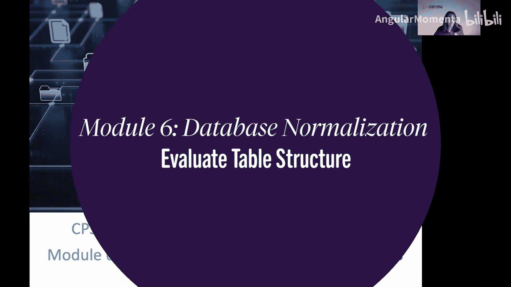
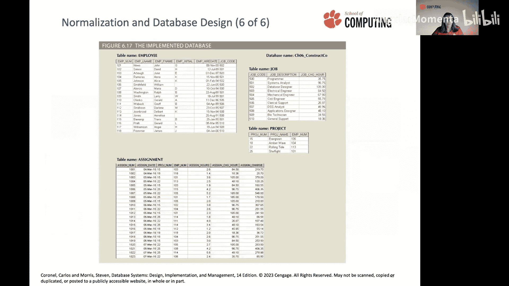

# 【克莱姆森大学】数据库管理系统 ｜ Database Management Systems p25 06_01_05_evaluate-table-structure -BV1y6rzBXE34_p25-

In the last part of module6， we talked about and explained normalization from first normal form to third normal form and went through an example。

And we completed it with having these four tables。Project， job， employee and assignment。

And this was third normal form。So we could say， hey， we're done。

But there are other things we can do to improve this design。

 so I'll walk through those in this section of module 6。So how can we improve this design？

There's various types of issues that you need to address。

 You need to make sure your naming conventions are correct。

 you need to make sure your atomicity is correct， so make sure that your attributes cannot be further subdivided。

 and I'll give examples of this。Any new attributes you think you might need， any new relationships。

 maybe you need to even break up some of the detail for your primary keys。

Do you need to store historical data or any of your attributes？

And perhaps you have derived attributes that you can not you don't need to store them as we discussed in a prior module that you may not want to store all these derived attributes。

Let's start with。Evaluating your primary keys and naming your primary keys。

We had different naming for。Your job table that may not have been as descriptive。

 So let's look what we had before。We had job class and charge per hour。

Now we are going to add a job code， so this looks like a surrogate key and not use the description as the primary key。

Because if you remember， carriage based primary keys are not ideal。 So job code。

Is a better primary key as an integer？We're going to call job class job description。

 It's a better name， and then job charge per hour。 These are just better names。

 Explain what the table and the attributes mean much more intuitively。Next up。

We're going to look at the project table。So。In this table。

 there was one thing that we didn't point out when we looked at the original data。

I'm going to go back to that original data。These stars right here on Alice and Delber and John。

Indicate that this employee is a manager。 But if you remember in our table structure。

 we didn't have anything to identify managers。So knowing that information as you would go through your design process。

You need to make sure your project has an employee number that would be the manager of that project。

This will be a foreign key to the employee table。Now， personally。

 I would probably name this column manager number or name this attribute manager number。

 not just employee number so it was really clear that this is the manager of this project。

But in any case， you need to put this in the table because your data is requiring an identification of a manager which in your Excel spreadsheet was just a star。

 but that's not sufficient in relational databases， you can't just put a star on some data。

 you need to have it as an attribute in your table。

So let's also now look at any new attributes or data atomicity that you need to think about and in this case we're going to break up the employee name into last name first name and initial much better for searching for employees just you know just a better way to store employee names we added their higher date as well and the higher date gives us good information something that you may have just determined as you talk to your business and came up with your various business rules that you want to have that higher date information this would be just pretty typical on an employee table。

In addition to。To the breaking up of your data， you also want to think about。

 do I have the right amount of data for my？Primary keys， are they identified properly？So。

 in this case。嗯。In the assignment table。You have the assign hours attribute representing the hours worked by a given employee on a given project。

However， are those， you know， are those values recorded at their lowest level of granularity。

 In other words， does a hours represent the hourly total， the daily total， weekly， monthly or yearly。

Clearly， you need to have better definition there so in this case。

The relevant question be as follows for what time frame， hour， day， week， month and so on。

 do you want to record those assigned hours？And if you assume the combination of employee number and project number is an acceptable composite primary key in the assignment table。

That is useful in representing only the total number of hours。

An employee worked on a project since its start。Using a surrogate primary key so remember we originally had the employee number and project number as the primary key。

 but using a surrogate assignment number provides lower granularity and more flexibility in particular。

 assume that employee number and project number combination is used as the primary key。

And then an employee makes two hours worked entries in the assignment table the this violates the entity of integrity。

 even if you have the assigned date as part of the composite key。What if they do it on the same day？

So there's just a problem having that composite primary key。

 it's much easier to control the data that you are storing by having the surrogate key assigned number。

You also want to consider in the same we're looking at the same data here。

 what about historical data so。The assignment charge per hour。

Attribute appears to have the same value as the job charge per hour remember we have that in the job table。

 but this is only true if the job charge per hour is always the same forever it's reasonable to assume that the job charge per hour will change over time so I need to keep an assignment charge that will provide the historical information I need if I need to go back and look。

At what was charged for this particular project。And that's very important if you're doing anything with the financial audits。

 et cetera， they want to know exactly how you came up with your calculations。In another case。

 you may want to also。Think about deriving the charges by just having the hours and the assignment charge and not storing assignment charge。

let me say the other way， the assignment hours and the assignment charge per hours and you wouldn't need to store the assignment charge because that could be seen as a derived attribute and you wouldn't need to store it it's really design decision you can store it we went through the pros and cons of storing versus not storing a derived attribute。

 but that's just something to consider yet another element of database design。So overall。

 if you look at normalization in a database design， normalization is just part of the process。

You're iterating throughout your design， you're thinking about normalization。

Sometimes it's just intuitive， you may not go through and create a dependency diagram， for example。

 it's important to know that that how to do that process and you need to understand it。

 but overall it becomes more intuitive and you can look at the data and see those dependencies and break them up。

But if you have really large data sets， really complex designs。

 sometimes the best way is to go through the formal normalization steps and to use a dependency diagram。

And I'm just going to step through quickly if the actual ERD for this table that we started with。

And originally， it looked like this and now let's look at the actual ERD。

So we had an employee in a project。We know that each employee will have jobs。

And we have the job code， the job description and the job charge per hour。

Job code is a foreign key in the employee table。We have a。Relationship between employee and project。

 so you have many employees and on a project， but you also have a manager in the project table。

And then with the relationship between many employees to many projects， you have an assignment table。

And we added some additional detail by putting a surrogate key of assignment number。

 the foreign keys our project number and employee number。

And we keep historical charge information in this table because the job charge per hour and the job table could change。

And then here is the final view of the tables themselves with data in them representing this ERD。

Right here。

