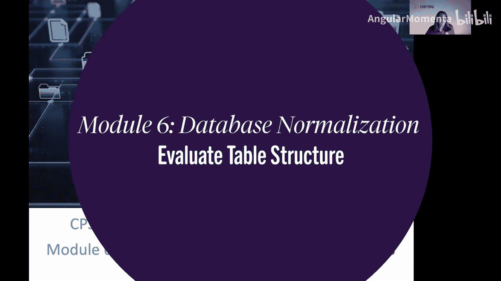
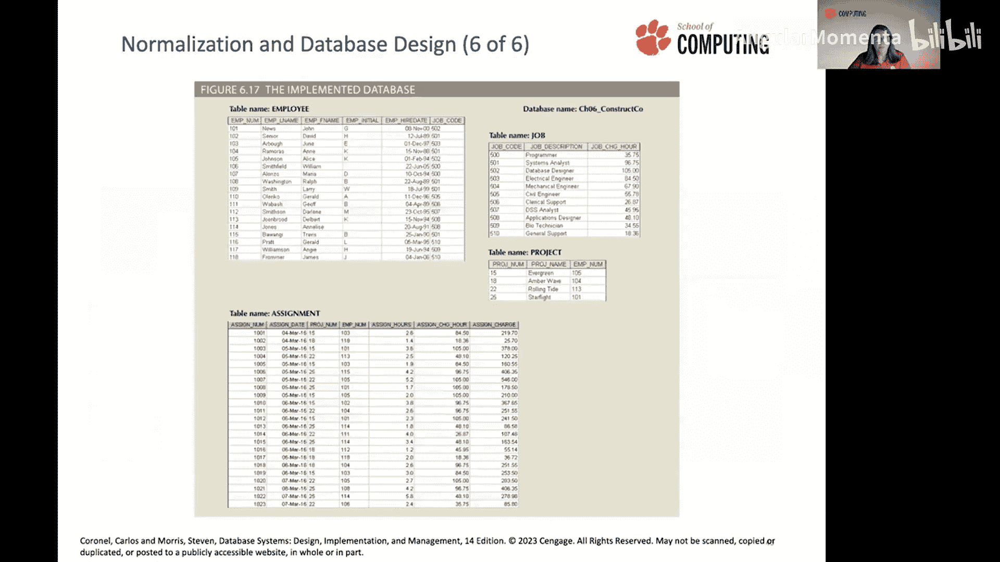

# 数据库管理系统：模块6：评估与优化表结构 🔧

在本节课程中，我们将学习在完成数据库规范化（达到第三范式）后，如何进一步评估和优化表结构设计。规范化是设计过程的一部分，但一个优秀的数据库设计还需要考虑命名规范、数据原子性、历史数据存储等多个方面。

---

在上一节中，我们讨论并解释了从第一范式到第三范式的规范化过程，并通过一个示例完成了四个表（项目、职位、员工和分配）的设计，使其达到了第三范式。虽然这已经是一个规范化的设计，但我们仍可以通过一些方法对其进行改进。

本节中，我们将探讨如何改进这个设计。

## 评估与改进设计

以下是评估和优化数据库设计时需要考虑的几个关键方面。

### 1. 主键与命名规范

首先，我们需要确保主键的命名和选择是恰当的。回顾之前的职位表，其主键和属性名称可能不够直观。

**改进前：**
*   `job_class`
*   `charge_per_hour`

**改进后：**
*   `job_code` (主键，整数类型，代理键)
*   `job_description` (原 `job_class`)
*   `job_charge_per_hour` (原 `charge_per_hour`)

使用 `job_code` 作为整数代理主键比使用基于文本的 `job_class` 更理想。同时，将属性名改为 `job_description` 和 `job_charge_per_hour` 能更直观地描述其含义。

### 2. 识别缺失属性

接下来，我们检查项目表。在原始数据中，某些员工姓名旁有星号（*）表示他们是项目经理。但在我们之前的表结构中，并未体现这一信息。

因此，需要在项目表中添加一个属性来标识项目经理。这个属性将作为指向员工表的外键。

**建议：**
*   在 `project` 表中添加 `manager_number` 属性（或 `employee_number`，但前者更清晰）。
*   此属性作为外键，引用 `employee` 表中的 `employee_number`。

### 3. 数据原子性与新属性

现在，我们来看看数据原子性和可能需要添加的新属性。以员工表为例，我们可以将员工姓名进一步拆分，并添加雇佣日期等信息。

**改进：**
*   将 `employee_name` 拆分为 `last_name`、`first_name` 和 `initial`。这有利于按姓氏或名字进行搜索。
*   添加 `hire_date` 属性。这是在业务规则分析中可能确定需要存储的信息。

### 4. 主键粒度与历史数据

然后，我们需要思考主键的粒度和历史数据的存储问题。以分配表为例。

**问题：** `assign_hours` 属性表示员工在项目上工作的小时数。但这个“小时数”的粒度是什么？是每日总计、每周总计，还是项目开始以来的总小时数？

**解决方案：** 需要明确定义记录小时数的时间范围（如按天、按周）。

**关于主键：** 最初，我们使用 `(employee_number, project_number)` 作为复合主键。但这仅适用于记录员工在项目上的**总**小时数。

**潜在问题：** 如果同一员工在同一项目上需要记录多条不同日期的工作时长记录，即使将 `assign_date` 加入复合主键，也可能在**同一天**产生多条记录，从而违反实体完整性。

**更好的方案：** 使用代理主键 `assignment_number`。这提供了更低的粒度（可以记录每一条具体的工作记录）和更大的灵活性。

**关于历史数据：** `assignment` 表中的 `assignment_charge_per_hour` 属性，其值似乎与 `job` 表中的 `job_charge_per_hour` 相同。但职位的小时费率可能会随时间变化。

**重要：** 为了保留历史信息（例如，用于财务审计），必须在 `assignment` 表中存储每次分配时实际使用的费率（`assignment_charge_per_hour`），而不是每次都去引用可能已改变的 `job_charge_per_hour`。

**衍生属性考量：** 有了 `assign_hours` 和 `assignment_charge_per_hour`，总费用（`assignment_charge`）可以通过计算得出（`assign_hours * assignment_charge_per_hour`）。是否将其作为衍生属性存储在表中，是一个设计决策，各有优缺点，需要根据具体需求权衡。

---

## 规范化在设计中的角色

总体来看，规范化是数据库设计过程中的一个重要环节。在设计时，你需要不断迭代思考。

*   对于简单的设计，规范化过程可能很直观，你甚至不需要绘制详细的函数依赖图。
*   然而，对于大型或复杂的数据集，遵循正式的规范化步骤并使用函数依赖图进行分析，通常是最可靠的方法。

理解规范化的原理和步骤至关重要，随着经验积累，识别数据依赖关系会变得更加自然。

---

## 最终实体关系图与表结构

最后，让我们看一下优化后的实体关系图和表结构。

最初的ERD比较简单。优化后的ERD清晰地展示了以下关系：

1.  **员工与职位**：一名员工拥有一个职位（通过 `job_code` 外键关联）。
2.  **项目与经理**：一个项目由一名员工（经理）管理（通过 `manager_number` 外键关联）。
3.  **员工与项目（多对多）**：通过 `assignment` 表实现。该表拥有自己的代理主键 `assignment_number`，并包含 `project_number` 和 `employee_number` 作为外键。
4.  **历史数据**：`assignment` 表存储了 `assignment_charge_per_hour`，用于记录历史费率信息。

下图展示了最终的表结构及其示例数据，它们完整地体现了上述ERD设计。

---

在本节课中，我们一起学习了在完成基础规范化后，如何从多个维度（如主键设计、命名规范、数据原子性、历史数据存储等）评估和优化数据库表结构。记住，规范化是设计的基石，但一个健壮、可维护的数据库还需要综合考虑实际业务需求和数据完整性。