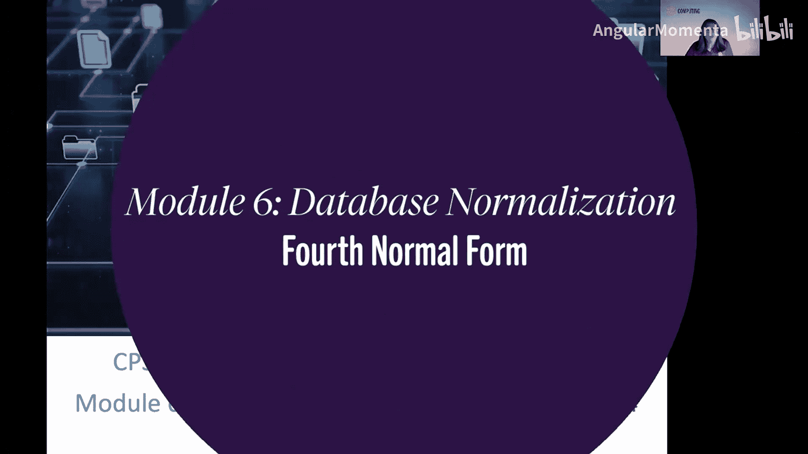
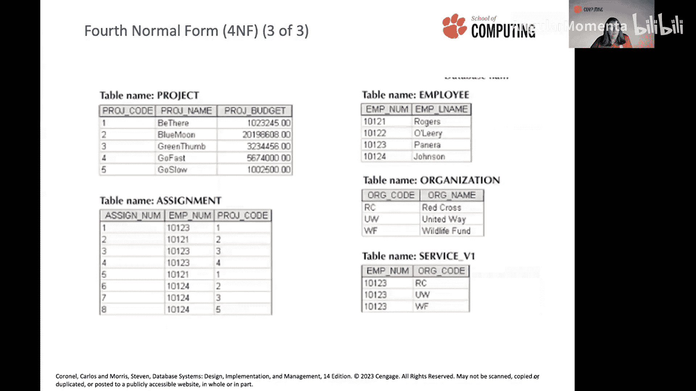

# 【克莱姆森大学】数据库管理系统 ｜ Database Management Systems p26 06_01_06_fourth-normal-form -BV1y6rzBXE34_p26-

Continuing on with normalization， we're going to move into fourth normal form。

Ororthnaal form is not a common occurrence。But I want to make sure you all understand what it means to convert to fourth normal form and when you would need to。

So in particular， a table is in fourth normal form。

When it's in third normal form and has no multi value dependencies。

 which is going to be most of the time。 So you can say your。

 your tables are in third normal form or fourth normal form。

If you're confident you have no multi valued dependencies。Okay， what is a multi valued dependency。

 let's look at that。So for example， consider the possibility that an employee can have multiple assignments and can also be involved in multiple service organizations。

 so you have an employee 10123。That volunteers for the Red Cross in United Way and they also assigned to work on three projects。

So this slide has three different。Ways to represent that relationship between an employee and the organizations that they are part of or volunteer and then also their project assignments。

And if you look at this。What this situation has is the attributes being or code an assign number having many different values。

In normalization terminology， this is referred to as a multi value dependency which occurs when one key determines。

 so the key being employee number determines multiple values of two other attributes and those attributes are independent of each other。

 so or code and and assignment number have nothing to do with each other。Therefore， you know。

 you can have an employee number determine multiple values of org code and multiple values of assigned number and they can again。

 or code and assignment number are totally independent of each other。

The presence of a multivalue dependency means that if a table， if you had table versions one。

 version one or version two， they're going to have a lot of nulls， you can see a few here。

 but if you had a lot of data you would have a lot of nulls and in fact the tables that you see version one and version two。

Don't even have really a viable primary key or candidate primary key the employee number values are repeated so that can't be the primary key there's really no combination of attributes that could be you know you can come up with a primary key so。

Version three at least has a primary key， but it's all the attributes。

 and it has a lot of redundancies so you're can have all these different combinations in every row。

So what do you do， what do you do when you hit this situation？Well。

 you eliminate the problems by creating new tables for the components of the multi value dependency。

So in this example， the multi value dependency is resolved and eliminated by creating the assignment and the service V1 table depicted here。

あ。So now you have something that's called fourth normal format。Again， you have a project。

 you have an assignment table， an employee table， an organization table， and a service table。

And the project table。あ。Tells you what the 1，2，3 format。

 the assignment is the actual assignment from an employee to a project。 Yeah， so。

 so that eliminated your overall。Multi value dependency。

So4 enough is typically largely academic if you make sure that you have that dependency on the primary key that we talked about in third normal form。

And then not having those multi valued facts about an entity。

And I think it would become pretty obvious pretty quickly as you started modeling that you would get in a situation and you'd need to eliminate it because you would end up with some strange looking tables like these。

The next section， we will talk about denormalization and when you need to do that。

