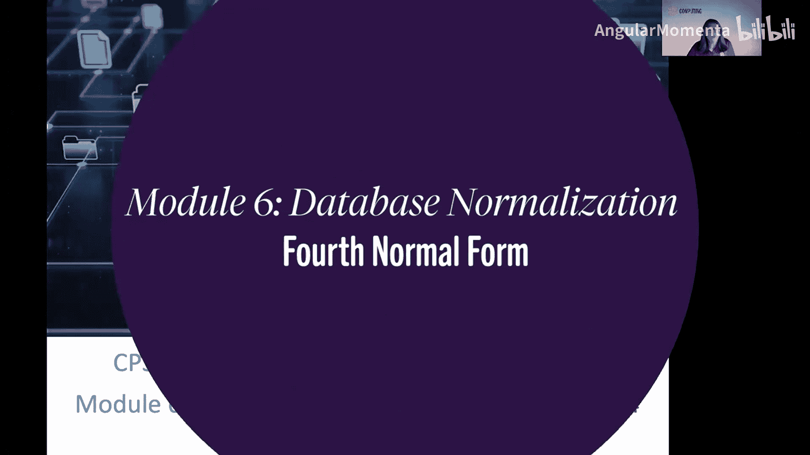
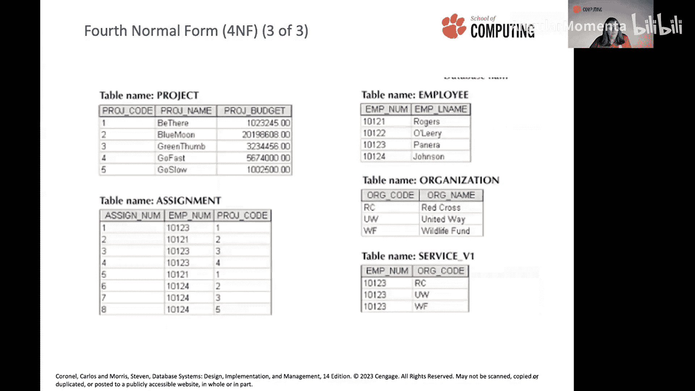

# 数据库管理系统：06：第四范式 (4NF) 🧩




在本节课中，我们将继续学习数据库规范化，并探讨一个相对少见但重要的概念——第四范式。我们将了解什么是多值依赖，以及如何通过规范化来消除它，从而确保数据库设计的严谨性。

---

## 第四范式的定义

上一节我们详细讨论了第三范式。本节中，我们来看看第四范式。

一个表满足第四范式，必须同时满足以下两个条件：
1.  它已经处于**第三范式**。
2.  它没有**多值依赖**。

在大多数情况下，满足第三范式的表通常也满足第四范式。因此，如果你能确信表中不存在多值依赖，那么你的表就可以被认为是达到了第四范式。

---

## 什么是多值依赖？🔍

要理解第四范式，首先需要理解多值依赖。让我们通过一个例子来具体看看。

考虑这样一种情况：一名员工可以参与**多个项目**，同时也可以加入**多个服务组织**（例如红十字会、联合劝募会）。

假设员工 `10123` 参与了三个项目，并加入了两个服务组织。这种关系可以用多种方式表示。以下是三种不同的表结构设计：

**版本一**：将项目和组织的所有可能组合都列在一行中，这会导致大量 `NULL` 值。
**版本二**：为每个项目和组织组合创建单独的行，这会导致员工编号重复，且难以确定主键。
**版本三**：将所有属性（员工、项目、组织）组合作为一行，这虽然有了一个复合主键（所有列），但存在严重的数据冗余。

这些设计的问题根源在于存在**多值依赖**。具体来说：
*   员工编号 (`Employee_Number`) 决定了多个**项目编号** (`Assigned_Number`) 的值。
*   同一个员工编号也决定了多个**组织代码** (`Org_Code`) 的值。
*   而**项目**和**组织**这两个属性是彼此完全独立的。

用公式化的语言描述，当 `A ->-> B` 且 `A ->-> C` 成立，且 `B` 和 `C` 相互独立时，就存在多值依赖。在我们的例子中，`A` 是员工编号，`B` 是项目，`C` 是组织。

---

## 如何解决多值依赖？🛠️

当遇到多值依赖时，我们应该如何解决呢？

解决方法是：为多值依赖中的每个独立组件创建新的表，从而消除原表中的依赖关系。

针对上面的例子，我们可以进行如下规范化设计，创建四个表：

1.  **员工表 (`EMPLOYEE`)**：存储员工基本信息。
    ```sql
    EMPLOYEE (Employee_Number, ...其他员工属性)
    ```
2.  **项目表 (`PROJECT`)**：存储项目信息。
    ```sql
    PROJECT (Project_Number, ...其他项目属性)
    ```
3.  **任务分配表 (`ASSIGNMENT`)**：建立员工与项目的多对多关系。
    ```sql
    ASSIGNMENT (Employee_Number, Project_Number)
    ```
4.  **服务关系表 (`SERVICE`)**：建立员工与组织的多对多关系。
    ```sql
    SERVICE (Employee_Number, Org_Code)
    ```

通过这种设计，我们彻底消除了多值依赖。原表中关于员工、项目和组织的复杂、冗余关系，被拆分成了清晰、独立的实体和关系表。此时，数据库模式就符合了**第四范式**。

---

## 总结与回顾

本节课中，我们一起学习了第四范式。

*   我们了解到，**第四范式**在第三范式的基础上，进一步要求消除**多值依赖**。
*   多值依赖发生在当一个属性决定另外**多个独立属性**的多个值时。
*   解决多值依赖的方法是**分解表结构**，为每个独立的“多值”组件创建单独的表，并通过外键关联。

第四范式在实践中的应用虽不如前几个范式普遍，但理解它有助于我们在设计数据库时，能识别并避免那些会导致数据冗余和更新异常的不合理结构。当你开始数据建模时，如果发现一个实体的某些属性是独立且多值的，就会很快意识到需要按照第四范式的原则进行分解。




在下一节，我们将讨论一个相反但有时必要的实践——**反规范化**，以及何时需要使用它。