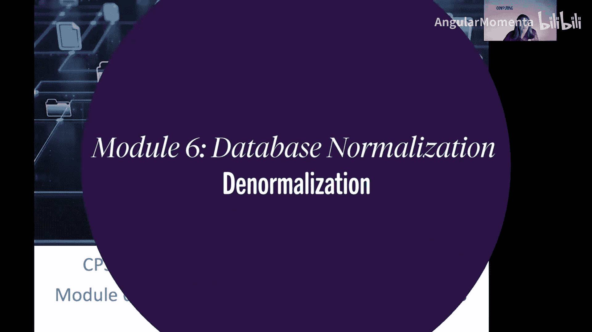
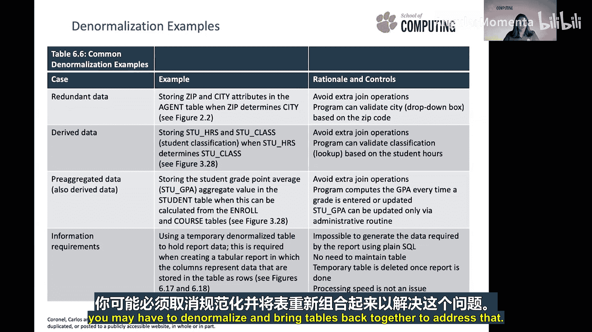

# 【克莱姆森大学】数据库管理系统 ｜ Database Management Systems p27 06_01_07_denormalization -BV1y6rzBXE34_p27-

。

So in this part of module6 normalization of database tables。

 we're going to talk about the opposite of normalization， which is deormalization。

And when do you need to do that？So we talked a lot about needing to have normalization to have well formed relations to ensure that you don't have redundant data。

However， by creating what you're doing， as you saw is you're breaking up tables into more and more tables。

So when you actually do operations that require data across multiple tables。

It can have an impact on performance because it has to do a lot of operations。

 input output operations， and could ultimately reduce your system speed。

This is certainly more true with really large databases and I've seen this in the real world。

 I actually went through a whole exercise of doing performance testing on a very deormalized database and then gradually put pieces and parts back together into a deormalized table structure and compare performance and it was much faster and when you have you know high transaction large data sets you maybe have no choice but to a deormalized so what does it mean it basically would be putting data back together in the tables。

嗯。The effects of doing that you may have some issues with the table now it's going to be really wide。

 really large all the columns are together and that can slow certain。Types of processing， you know。

 like updates that can get slower， indexing can be more cumbersome。

And creating views can sometimes be more difficult。Ultimately it's a trade off。

 it's that trade off between design having your design more in an ideal state to reduce the risk of data anomalies versus high performance and you're always going to see those trade offs in many areas in building software solutions。

That use databases。So。Some examples of denormalization。For example， you may have city and zip。

In an agent table and you have to go to， you know， a city you have to go to a different table to look up parts of an address。

Maybe just put it all together in the agent table so if you're constantly going and looking up certain attributes rather than do a look up in some kind of special table that has address information。

 you just put it right there with an agent。You know that that's in general。

 all of these examples here are sort of saying the same thing。

 So if I have to go to another table to get data that I'm looking at very regularly。

I would rather than keep it in that separate table， I just make a copy of it in my table。

So it's just avoiding those joint operations， if you can see on the rationale is in almost all cases。

 avoiding extra join operations is the reason to do this。

So we're going to have a future lesson on database performance and you'll understand more why these joint operations cause performance challenges。

 but the important takeaway here is just to know that getting into that ideal high normal form can lead to performance degradation depending on the situation and that you may have to be in you may have to dennormalize and bring tables back together to address that。

