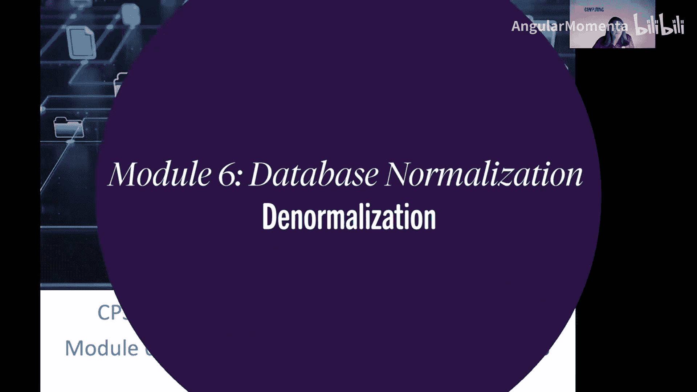
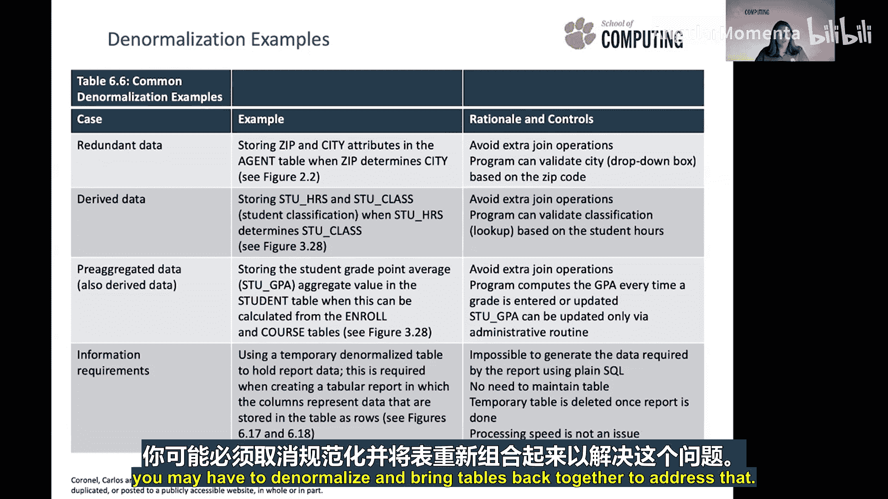

# 数据库管理系统：模块6：反规范化 🧩




在本节课程中，我们将探讨数据库规范化过程的对立面——反规范化。我们将了解其定义、适用场景、潜在影响，并通过具体例子说明为何有时需要牺牲部分设计理想性以换取更高的系统性能。

## 概述

上一节我们深入探讨了数据库规范化，其核心目标是消除数据冗余，确保关系结构良好。然而，将数据拆分到多个表中，在执行涉及多表的查询操作时，可能会引发性能问题。本节中，我们来看看**反规范化**，即为了提升性能而有意地将数据重新组合在一起的技术。

## 什么是反规范化？

反规范化是**将已规范化的表重新合并或引入冗余数据**的过程。其根本目的是**减少表连接（JOIN）操作**，从而提升查询性能，尤其是在处理海量数据和高并发事务的场景下。

## 为何需要反规范化？

规范化设计通过拆分表来避免数据异常，但这意味着查询经常需要连接多个表。每次连接操作都涉及大量的输入/输出（I/O）操作，在数据量巨大时可能成为系统瓶颈。

**核心权衡公式**可以概括为：
`系统性能 ≈ 查询效率 - (连接操作开销 + 数据冗余维护成本)`

因此，反规范化是在**数据一致性风险**与**系统性能需求**之间做出的权衡。

## 反规范化的潜在影响

实施反规范化并非没有代价。以下是需要考虑的一些方面：

*   **表结构变化**：反规范化后的表可能变得非常宽（列很多）或非常大，这本身可能影响某些操作的效率。
*   **更新操作**：更新冗余数据时，需要在多个位置进行，可能更慢且容易出错，增加了维护数据一致性的复杂度。
*   **索引管理**：对宽表建立和维护索引可能更加复杂。
*   **视图创建**：基于反规范化表创建视图有时会更困难。

## 反规范化实例

以下是一些常见的反规范化场景，其核心思路都是避免频繁的连接查询：

1.  **合并地址信息**：在“代理商（Agent）”表中，除了代理商ID和姓名，经常需要查询其所在城市和邮编。如果城市和邮编信息存放在单独的“地址（Address）”表中，每次查询都需要连接。反规范化做法是**直接将城市和邮编字段复制到“代理商”表中**。
    *   **规范化示例（需要连接）**：
        ```sql
        SELECT Agent.Name, Address.City, Address.ZipCode
        FROM Agent
        JOIN Address ON Agent.AddressID = Address.ID;
        ```
    *   **反规范化后（无需连接）**：
        ```sql
        SELECT Name, City, ZipCode FROM Agent;
        ```

2.  **复制高频查询属性**：如果某个属性（如产品分类名称）需要从另一张表频繁获取，可以将其副本直接加入主表（如“订单明细”表），以避免连接“产品”表。

## 总结




本节课我们一起学习了反规范化的概念。我们了解到，虽然规范化是数据库设计的理想目标，但在实际的大型、高性能应用系统中，过度规范化可能导致查询性能下降。反规范化作为一种优化策略，通过有控制地引入数据冗余来减少表连接操作，从而提升查询速度。关键在于理解这是一个**权衡**：在数据完整性、维护成本与系统性能之间找到适合特定业务场景的最佳平衡点。在后续关于数据库性能的课程中，我们将更深入地探讨连接操作对性能的具体影响。