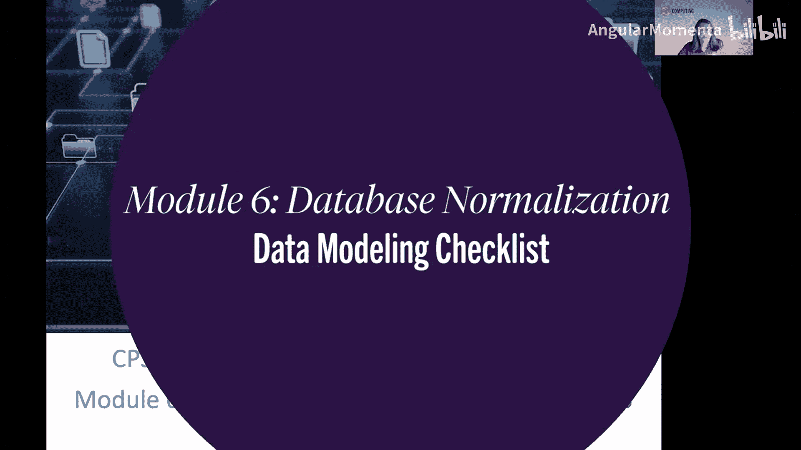
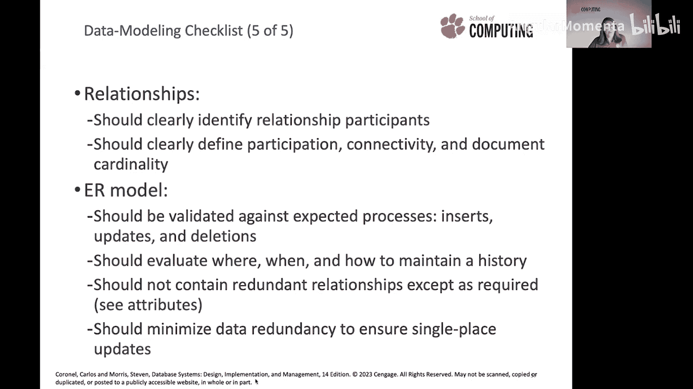

# 【克莱姆森大学】数据库管理系统 ｜ Database Management Systems p28 06_01_08_data-modeling-checklist -BV1y6rzBXE34_p28-

This last part of the module six is looking through a checklist of steps when you're going through a design of a database Now these steps are iterative。

You don't necessarily do them once and not come back。

But if you understand all the various aspects and make sure you are considering all these various items in the checklist。

 you will have a better design。First thing， ultimately， you need to understand the business rules。

 what is it you're trying to build。Sometimes the business rules you can actually get from people and document them。

 sometimes you have to look at existing data， look at Excel spreadsheets， figure out what is this。

 you know the way the data is stored today and and understanding how it's going to be accessed in the future and you would have to write those things down or you work depending on the company you're at。

 they could have a business analyst that helps you document all this information。

Then you as you do your data modeling， make sure you use good data naming conventions that。

 you know you don't want really really long names， but at the same time they should be somewhat descriptive so that the business。

 you know I've worked with companies that had ERDs on their walls of databases that I had built。

 they understand and use the databases and want to make sure that they you don't have column names that are you know too obscure and don't really help them understand what it means。

You want to make sure all of your entities represent a single subject。

 so you know those are going to be your tables。You want to be in third normal form or higher？

And if you aren't in third normal form， you have to justify it。

 So the reality of what happens is you always start it in the highest normal form you， you know。

 typically third normal form。You go through that exercise。 And then as you start implementing。

 you may find some performance hang ups， and you have to deormalize。 So at that point。

 you would be able to justify that you did this because you've bound。

That these additional joint operations slowed down your transaction processing too much。

You might want to make sure you have the granularity。Clearly defined of each entity。

 do you have all the right information you need， do you have good primary keys and you can support your primary key choices。

Speaking of primary keys， let me go back to that。I've had some places that every primary key was a surrogate key。

And depending on， you know， standards that your company， you know。

 whatever you're working have around databases， you may end up having surrogate keys for every entity and it's a pretty clear decision what you do。

Make sure your attributes are you know at the lowest level of granularity atomic data。

 so we use the name example a lot breaking it up into last name， first name middle initial。

 what about constraints， default values。Make sure you identify what's a derived attribute even in。

Rosefoot， there's not a good way to identify that， but you could put it in a note。And again。

 you don't want redundant data unless there's a reason for it。

 usually around performance or you're maintaining historical data。

Just as long as you can justify that。And all of your non key attributes should be fully dependent on the primary key。

Again， if you're normalizing， you'll have that as part of your normalization process。

Make sure you understand relationships， connectivity， the cardinality。You know。

 validatealidate your ER model。How are you maintaining history， you know。

 you don't want redundant relationships and。Overall， again， you're validating what。

You're going to be doing with that data model， so think about how you're inserting data。

 updating data， deleting data into your model support that。

🎼。

