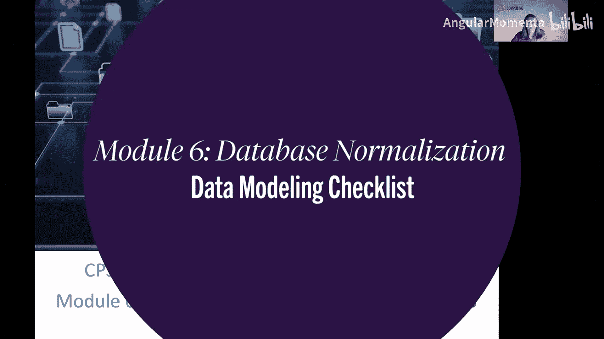
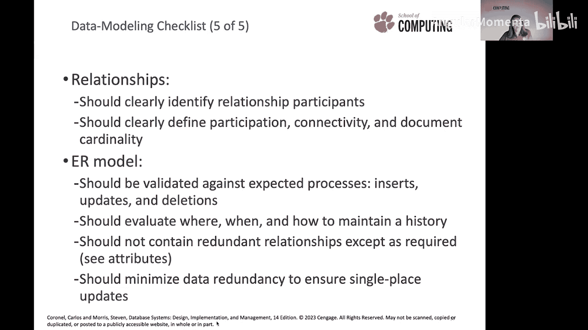

# 数据库管理系统：模块六：数据建模检查清单 🧾

在本节课中，我们将学习数据库设计过程中的一个关键环节：数据建模检查清单。这个清单包含了一系列迭代的步骤，帮助你确保数据库设计的完整性、高效性和可维护性。我们将逐一探讨这些要点，从理解业务规则到验证最终的数据模型。

## 理解业务规则 📋

首先，也是最重要的一点，你需要彻底理解业务规则。这指的是你试图构建的系统需要满足的具体需求和约束。

以下是理解业务规则的几种方法：
*   从相关人员那里获取信息并形成文档。
*   分析现有数据，例如查看Excel表格，了解当前数据的存储方式。
*   明确数据在未来将如何被访问和使用。
*   将这些信息记录下来。在一些公司，可能会有业务分析师协助你完成这项文档工作。

## 命名规范与实体设计 📝

在数据建模过程中，确保使用良好的数据命名规范至关重要。同时，每个实体都应代表一个单一的主题，这些实体最终将成为数据库中的表。

以下是关于命名和实体设计的要点：
*   **命名规范**：名称不应过长，但应具备描述性，以便业务人员理解。避免使用过于晦涩的列名。
*   **实体单一性**：确保每个实体（表）只代表一个明确的主题。
*   **规范化**：设计应力求达到**第三范式**或更高。如果未能达到，必须有充分的理由（例如，出于性能考虑而进行的反规范化）。
*   **设计流程**：通常从第三范式开始设计，在实施过程中若遇到性能瓶颈，再考虑有依据地进行反规范化。

## 键、属性与约束 🔑

上一节我们介绍了实体设计的基本原则，本节中我们来看看构成实体的具体元素：键、属性和约束。这些是定义数据结构和完整性的核心。

以下是关于键、属性和约束的检查要点：
*   **主键**：确保为每个实体定义了合适的主键，并能支持你的选择。在一些标准下，可能每个实体都使用**代理键**（如自增ID）。
*   **属性粒度**：属性应处于最低的粒度级别，即**原子数据**。例如，将“姓名”拆分为“姓氏”、“名字”和“中间名首字母”。
*   **约束与默认值**：明确标识出约束条件和属性的默认值。
*   **派生属性**：识别出那些由其他属性计算得出的派生属性（在ER图中可用注释标明）。
*   **数据冗余**：除非有充分理由（如提升性能或维护历史数据），否则应避免数据冗余。
*   **完全函数依赖**：所有非键属性都应完全依赖于主键，这是规范化过程的一部分。

## 关系与模型验证 🔗

在定义了实体及其属性后，我们需要关注实体之间的关系，并对整个模型进行验证。这是确保数据模型能准确反映现实世界业务逻辑的关键步骤。

以下是关于关系和模型验证的要点：
*   **关系定义**：清晰理解并定义实体间的**关系**、**连通性**和**基数**。
*   **历史数据维护**：规划如何维护历史数据。
*   **冗余关系**：检查并避免冗余的关系。
*   **整体验证**：从数据操作的角度验证模型。思考如何在该模型中进行数据的**插入**、**更新**和**删除**操作，并确保模型支持这些操作。

---

本节课中我们一起学习了数据库设计的检查清单。我们首先强调了理解业务规则是设计的基础，然后探讨了命名规范、实体设计、规范化原则。接着，我们深入研究了主键选择、属性粒度、约束设置以及避免数据冗余的重要性。最后，我们关注了定义实体间关系和对整个模型进行操作性验证的必要性。遵循这个迭代的检查清单，将有助于你创建出更健壮、高效且易于理解的数据库设计。