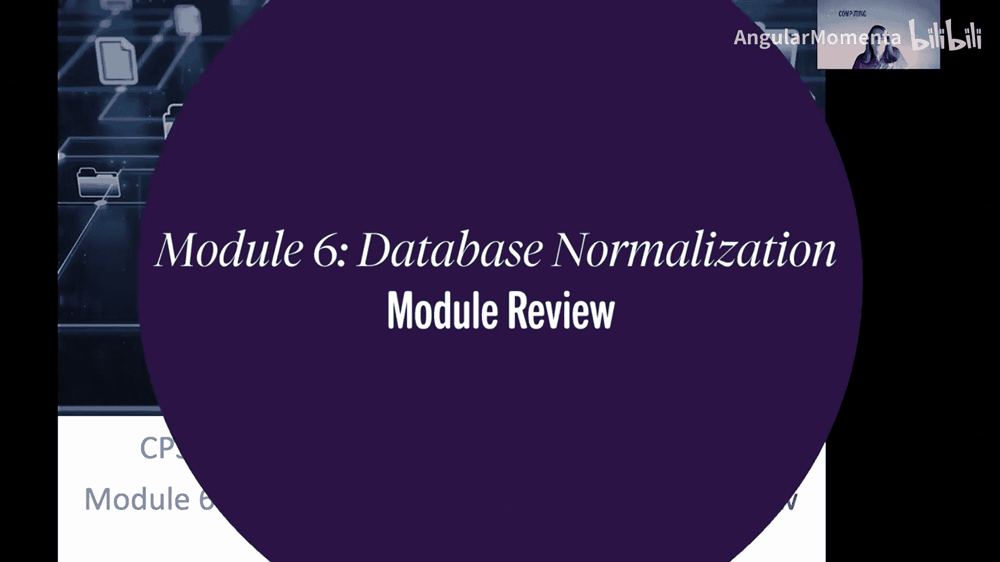
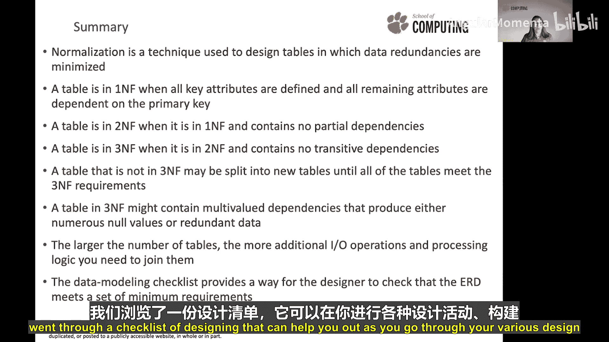

# 【克莱姆森大学】数据库管理系统 ｜ Database Management Systems p29 06_01_09_module-review -BV1y6rzBXE34_p29-

So we're going to go through a review of module6 and normalization。

And we'll start out using a dependency diagram with pretty abstract attribute names and make sure you can read this dependency diagram and answer the following questions。

What is the primary key， what are the proper dependencies？

Partial dependencies and transitive dependencies。 So I'll let you think about that for a moment。Okay。

So the primary key in this case， if you remember I said they underline your primary key。

 so it's C1 and C3。Proper dependencies are always identified at the top。

 So it's showing you that all the columns or attributes， C 2。

 C 4 and C 5 are dependent on C 1 and C 3。The partial dependency that you see here。

Is always between a primary key and an attribute， one of the primary key。

And because we have a composite primary key， C1 and C3， we can have partial dependencies。

If I only had one attribute in my primary key， then I would not be able to have partial dependencies。

Lastly， the transitive dependencies here are。Depenencies。Between attributes that are not。

Primary keys so。C4 and C5 is a transitive dependency。Saying that C5 is dependent on C4。So。

This diagram in this information tells me I'm in first normal form because remember first normal form。

You've identified your primary keys and you've identified your partial and transitive dependencies。

 which we have here。So what would second normal form look like if this was。Your儿。

Depenency diagram that you were given。So second normal form。At the top， I have the original picture。

So I need to break out the partial dependency。In this case， it was C1 to C2 as its own。Table。

And if you look at that table， it has no transitive dependencies， so it is in third normal form。

The second table you have is still your original。Table that had C1 and C3。

 but now you've pulled out the C2 column， so you still have C4 and C5。

But they have a transitive dependency still。 So this this table is in second normal form because it has the transitive dependency between C 4 and C5。

So think about what is third normal form。Third normal form removes the transitive dependency。

And the transitive dependency was between C4 and C5。I have now broken up into table three。

 the C4 and C5 entity。Which has a primary key of C4。It is in third normal form。I have a foreign key。

C four to table three。On my table two and a C1 to table one。

So now I started out with one table that you see at the top。Now broken into three。

 and this is in third normal form。Next up。Let's look at this dependency diagram。

We want to create a database whose tables are in third normal form。Using this is our starting point。

So see if you can do this， take some time。And look at using this dependency diagram come up with。

The third normal form。All right， so before we do this。

Make sure you understand again what this diagram is telling us。 So in this case。

 we have a composite primary key， which is ISBN an author number。

And that will tell you right there that you can have a partial dependency。

 so you need to get to second normal form eliminating partial dependencies and third normal form eliminating transitive dependencies。

So， my。Partial dependencies。Exist。Between author number and last name。And then between ISBN。

Has a partial dependency with book title publisher in addition。

And then I have a transitive dependency between book title and publisher。

So breaking this in a third normal form will give you these four tables。So overall。

 this module focused on normalization， getting from first normal form all the way to third。

 and then sometimes having a fourth normal form needed if you have those multi valued facets in your data。

And a table。Having those multi value dependencies。Those need to be eliminated。

And that'll get you back to third normal form。We also talked about deormalization that the larger number of tables you have。

 the more IO operations， so you may need to denormalize。And lastly。

 went through a checklist of designing that can help you out as you go through your various design activities。

 building a new database。

