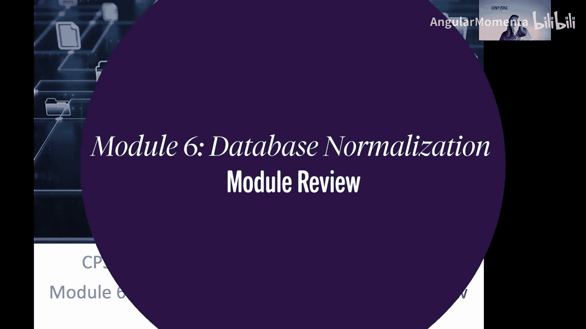
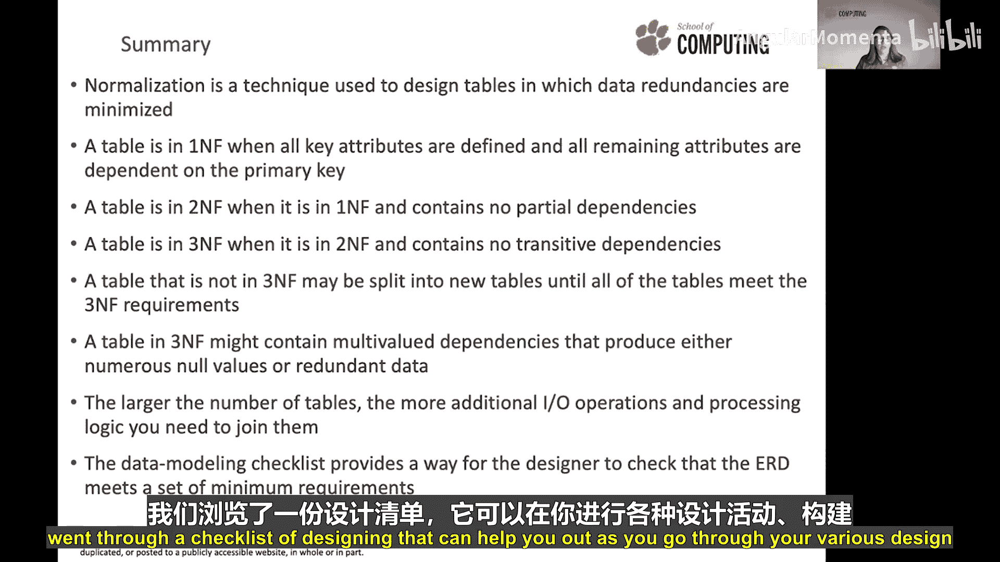

# 数据库管理系统：模块6：规范化复习 🧩

在本节课中，我们将复习模块6的核心内容——数据库规范化。我们将学习如何解读依赖图，识别其中的主键、完全依赖、部分依赖和传递依赖，并理解如何将一个表逐步规范化至第三范式。

---

## 依赖图解读 🔍

上一节我们介绍了规范化的基本概念，本节中我们来看看如何解读一个依赖图。下图展示了一个抽象属性的依赖关系。

以下是基于此图需要回答的问题及其答案：

*   **主键是什么？**
    主键是图中带有下划线的属性。在此例中，主键是 **C1** 和 **C3** 的组合。
*   **什么是完全依赖？**
    完全依赖总是显示在图的顶部。它表示所有非主键属性都依赖于整个主键。在此图中，属性 **C2**、**C4**、**C5** 完全依赖于主键 **C1** 和 **C3**。
*   **什么是部分依赖？**
    部分依赖存在于主键（或主键的一部分）与非主键属性之间。由于我们有一个复合主键（C1, C3），因此可能存在部分依赖。图中显示，属性 **C2** 仅依赖于主键的一部分 **C1**，这构成了一个部分依赖。
*   **什么是传递依赖？**
    传递依赖存在于两个非主键属性之间。图中显示，属性 **C5** 依赖于属性 **C4**，而 **C4** 又依赖于主键，这构成了一个传递依赖。

此图及其信息表明该表目前处于**第一范式**，因为我们已识别出主键、部分依赖和传递依赖。

---

## 达到第二范式 📈

现在，我们来看看如何将上图所示的表规范化至第二范式。第二范式要求消除所有部分依赖。

以下是分解步骤：

1.  **分离部分依赖**：将部分依赖 **C1 -> C2** 提取出来，形成独立的表（表1）。该表以 **C1** 为主键，包含属性 **C2**。由于没有传递依赖，它已处于第三范式。
2.  **保留剩余部分**：原始表中剩余的部分构成新表（表2），其主键仍为 **C1** 和 **C3**，但移除了 **C2**，保留了 **C4** 和 **C5**。然而，**C4** 和 **C5** 之间仍存在传递依赖，因此该表目前处于第二范式。

---

## 达到第三范式 🏆

上一节我们得到了第二范式的表，本节中我们通过消除传递依赖来达到第三范式。第三范式要求消除所有传递依赖。

以下是最终分解步骤：

1.  **分离传递依赖**：将传递依赖 **C4 -> C5** 提取出来，形成独立的表（表3）。该表以 **C4** 为主键，包含属性 **C5**，并处于第三范式。
2.  **建立外键关联**：在表2中，属性 **C4** 作为外键，关联到表3的主键 **C4**。同时，表2中的 **C1** 作为外键，关联到表1的主键 **C1**。

最终，我们从最初的一个表（第一范式），通过消除部分依赖和传递依赖，分解成了三个符合第三范式的表。

---

## 综合练习：图书数据库示例 📚

接下来，让我们应用所学知识，处理一个更具体的例子。以下是一个图书信息的依赖图，我们的目标是设计一个所有表都符合第三范式的数据库。

在开始设计之前，请先花时间分析此图：
*   复合主键是 **ISBN** 和 **AuthorNum**。
*   存在部分依赖：`AuthorNum -> LastName` 以及 `ISBN -> BookTitle, Publisher`。
*   存在传递依赖：`BookTitle -> Publisher`。

根据第三范式的规则进行分解后，我们将得到以下四个表：

1.  **作者表**：包含 `AuthorNum` (主键) 和 `LastName`。
2.  **图书表**：包含 `ISBN` (主键)、`BookTitle` 和 `Publisher`。（注意：此处 `BookTitle -> Publisher` 的传递依赖在实际规范设计中通常仍需处理，但根据图示分解，它被暂时保留在此表中，需进一步分解才能完全满足3NF。原视频示例可能在此处简化。）
3.  **图书-作者关系表**：包含 `ISBN` (外键) 和 `AuthorNum` (外键)，共同作为复合主键。此表用于解决多对多关系。
4.  **(如果需要消除传递依赖) 出版社表**：将 `Publisher` 独立成表，并为其分配一个唯一的主键（如PublisherID），然后在图书表中引用此外键。这是达到完全第三范式所需的步骤。

---

## 总结与拓展 💡

本节课中我们一起学习了数据库规范化的核心过程。

*   **规范化过程**：本模块重点讲解了从第一范式到第三范式的规范化过程。有时，如果数据中存在多值依赖，可能需要进一步达到第四范式以消除它们，最终再回到第三范式。
*   **反规范化**：我们也讨论了反规范化。规范化会产生更多的表，可能导致更多的I/O操作。因此，在某些基于性能考虑的场合，可能会有意地进行反规范化。
*   **设计清单**：最后，我们回顾了一个数据库设计清单，它可以在你进行各种数据库设计活动时提供帮助。

通过理解依赖、识别范式违规并应用分解规则，你可以设计出结构清晰、数据冗余少且易于维护的数据库。