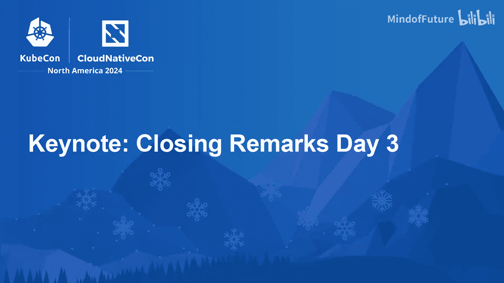
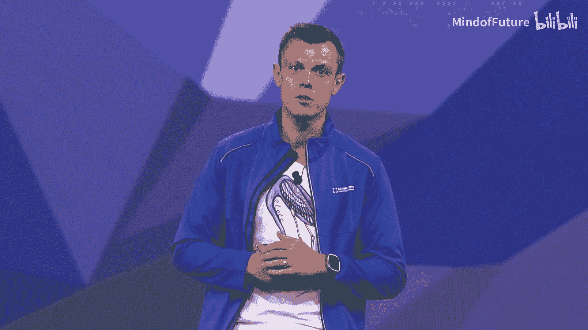
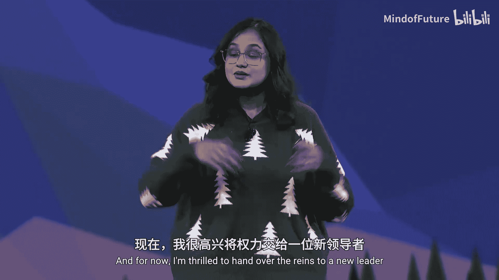
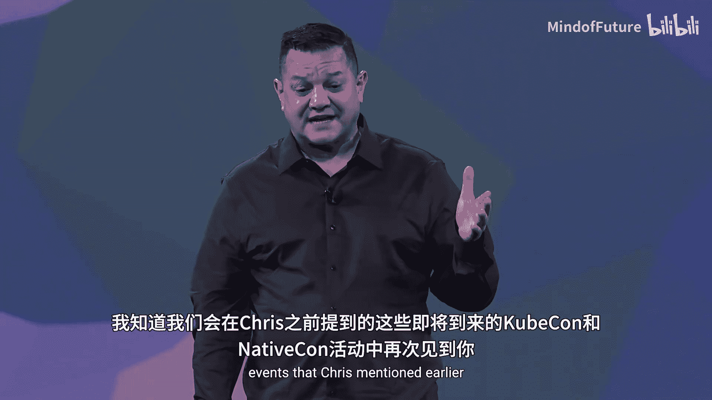

# 【CloudNative】KubeCon+云原生峰会2024-p02-P02-Closing-Remarks--BV1E9wPegEH6_p2-

🎼All right， Thank you so much。 Before we resume the breakouts that I live in。

 I want to remind everyone that the solution showcase will be close this afternoon at 2，30。

 So be sure to visit our sponsors before it's too late and get your free Tshirt at the Cloud native Corner store。

😊。

I would also like to extend my heartfelt appreciation to all of you。 But first。

 I want to take a moment to acknowledge my esteemed coach， Nikkita。😊。

This marks her final time as a co chair for Cuecon cloud Ninated con。

 And I want to give her a well deserveed round of applause for her invaluable contributions to this event。

😊，Thanks， everyone。 thank you so much for this wonderful opportunity。

 I had a really great time serving in this role。 And I'm sure I'll continue seeing you all at the future Cubecons plus cloud nativeative cons。

 And for now， Im thrilled to hand over the reins to a new leader and continue to cheer from the sidelines this time。

😊。

Thank you， Nikkita， I've really enjoyed working with you and you've been such an amazing influence to the community。

 Casper and I will both miss you and I look forward to working with our next co chair at all these amazing events that we love。

I know that we'll see you again at one of our upcoming CubeCon NCon events that Chris mentioned earlier。

 see you all at one of these events once again， we truly appreciate you all joining us for keynotes and thank you once again to all our speakers and sponsors who have make that event happen have a great final day of the conference and we look forward to seeing you next time Thank you everyone。

 Thank you everyone。😡。

