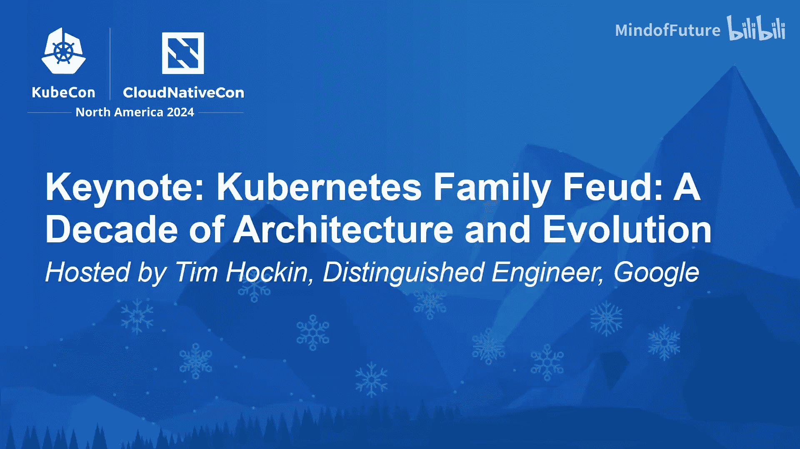

# 【CloudNative】KubeCon+云原生峰会2024-p03-P03-Kubernetes-Family-Feud--A-Decade-of-Architecture-and-Evolution---Hosted-by-T--BV1E9wPegEH6_p3-

は。

🎼，welcome to Kcon Family feud celebrating 10 years of Kubernetes I'm your host Tim Hoen this is referee Rag Srinos We don't get a whole lot of time on the stage today so let's get started。

Starting on my left， we have team Yaml。We have Surria。

 Si theraman Surria is a principal software engineer working on Openshift networking at Red Hat and a contributor to Sig Network。

 Let's give it up for Surria。Next up is Muhammad Ali。

 Muhammamed is a senior DevOs engineer a thousand Eye by Cisco and is a Kubernetes and K native maintainer。

🎼Next up is Bridget Cromhow。 Bridget works in upstream Open source at Microsoft Azure。

 She's a cochair of Sig cloud provider and a fan of snow bicycles and cats。

 And last up is Justin Santa Barbara。 Justin was one of our first independent contributors on Kubernetes。

 now works for Google on GK and hopes not to be demoted to independent contributor again。 Team Yamel。

 who's gonna to be your team Captain。 Mohamd。😊，Next up， on my right， we have team Jasonson。Starting。

 we have a Lucy Su。 Lucy is an engineer from Denmark who enjoys flying planes and pretending to know how Kubernetes works。

Next up is Madav Gibrajai， Madav is a technical lead for SIG Cons。

 a contributor to SIG's API machinery and SCD， and a grad student at UIUC。Next up is TesFM。

 Tess is a senior software engineer in the inference platform at Bloomberg and an active contributor on the Kerve project。

 and last but not least， Ricardo Cats， Ricardo is a contributor on Sig Network。

 a maintainer of the Ingressss EngineG X project， he loves Lego and hates make files。Team Jason。

 who's your captain？Maov， congratulations， let's do a quick breakdown of the rules。

We've surveyed our community for their opinions on some very important Kubernetes topics。

 Our game today is to guess their answers。 Each round。

 I will ask our contestants one of those questions。

 The first team to buzz in gets a shot at guessing the answer。

 If you guess wrong or you take too long， you'll hear this sound raggged。😊。

Whichever team's answer scores higher gets control of the board。 If they strike out three times。

 the other team gets a chance to steal all the points。

Whichever team has the most points at the end of our game wins the right to call themselves champions of Cuecon family feud。

 Got all that。 Let's go teamss， a reminder。 Don't buzz in until I finished reading the questions。

 Otherwise， I'm gonna blow the whistle。 Oh， don't blow the whistle。 Are we ready。 All right。

 let's get our team captains。 Come on down。 Rag start round one。😊，All right。

 on the board are the top four answers to this question。Name and error you might see in Kubernetes。

Rags， who want a buzz off。 I got Muhammad at 35 milliseconds。 Oh man。 All right， Kaash loop back off。

 Crash loop back off。 It's a good one。 Rags， show me crashash loop back off。😊，Number one answer。

 correct。 Our B off is done。 Team Yael wins the day。Suria。

 tell me an error you might see in Kubernetes。 I flew back off。Image pull back off。

 raggs show me image Oh， look at that 20 points。Ridt。Tell me an error you might see in Kubernetes。

Lots of pressure， so much pressure， let's say。呃。Bock is running？I love memory errors I memory， rag。

 show me OO。Oh， look at you guys cleaning the board。 Justin， don't screw it up。

 What is an error you might get from Kubernetes。 No node available。 No nodes available。 Ras。

 show me no nodes。嗯。lost your button。L。Yeah。No ref available。No good， all right。

 let's go back Muhammad。With one strike on the board， give me an error you might see in Kubernetes。

Missing cong Maa secrets， missing config map or secrets。 Show me config map or secrets。🎼No， no good。

 Sur， last chance， no pressure。 Give me an error you might see in Kubernetes。Rele is not found。 Re。

 not found。 raggs。 show me resource， not found。No， you blew it。

 Teamam Jason has a chance to steal one chance confer amongst yourselves。Pressure， pleasure。

 pleasure。Unschedulable pods。 unschedulable pods， rag。 Show me unschedulable。No。

 what was the final answer， eggsgs？Context deadline exceeded Greg's team Yamel gets all those points。

 Let's move on to round two。 who gets the point team Yamel So you right then we did was not able to answer All right。

 round two， Surria and Lucy come on up。😊，Are you ready？Hands on the buzzer。

 don't buzz until I finish the question。On the board are the top five answers to the following question。

 What is the biggest risk to Kubernetes and cloud native。Who won our buzz off？

 We got Suria at 81 milliseconds。 Suria wins for Tammo could be a risk to Kubernetes or cloud native。

An earthquakequa and sunnyville， an earth。An earthquake in Sunnyvale takes out a number of tech companies。

 Greg show me earthquakes， what was it earthquakes，s， an earthquake？Show me earthquake， okay。Oh。

 I'm sorry， Lucy， how gut down complex it is complexity rags show me complexity。Yes， that wins。

 And team Jason takes the round。 Let's go。 All right， I'm going to start with Tessa。 Tell me。

 what is the biggest risk to Kubernetes and Cloud native。GPU shortage GPU shortage， Greg。

 show me GPU shortages， GPU shortage。no， that did not make our board Rickcardo。

 what is the biggest risk to Kubernetes and Cloud native CEs Su， very good answer。 CEs， rigs。

 show me security or CEs。嗯。Oh， no good。Out of your chance。

 what is the biggest risk to Kubernetes in Cloud native？Lack of agility， lack of agility。 Reg。

 show me agility or lack of innovation。 La of innovation。 I was gonna go There we go。

 Numb one answer on the board。 Lack of innovation。 Great。 Lucy， you're up。 lackck of maintenance。

 Lack of maintainers。 Good answer， good answer。😊，Correct， it is at eight points。Tessa。

 what is the biggest risk to Kubernetes and cloud native， You guys are running the board。

But you have two strikes。No pressure。Quick， quick， quick。Lack of。Visibility， lack of visibility。

 rags show me visibility。 Lack of visibility。 They are team yama， right， S。🎼了。Oh no good。

't we have two strikes on team Oh they're been very。Sorry， guys。

 the other team gets a chance to steal。 All right， guys， Confer amongst yourelve。

 you have three seconds。 What is the biggest risk to Kubernetes and cloud native。

Co burning costs stick costss Show me costs and they are teamam。 They are teamam。🎼No， that's no good。

 Teamam Jason gets all the points for this round。 Congratulations。 Show me number3。 That's。

 All right， The number three answer from our community was。😊，W。なか。

We happy't Oh you went to the next round， It's fine。

 numberumb three was cloud providers O in number four was AI and we got all the rest right， Yes。

 all right， next round three， Tessa Bridget， come on down。

On the board are the top four answers to the following question。

How do you pronounce the name of the Kubernetes command line tool。😀あはははは。😊。

You coming Bridge Bridget won again。 All right， should I just kind of move It's she won leg square。

 How do you pronounce the name of the command line tool The correct answer is Kbecto Showmibeto I don't know。

😀Yeah。😊，Oh， I'm sorry。 Quebec is not on the board。 Tessa。

 how do you pronounce the name of the Kubernetes command line tool， K cuddle Kub Kub or Cu。

Cubub cuttle。 Show me k cuttle。 I go。Ce Cuddling is up on the board， correct。

 although Chief Jason wins the round， moving forward。

 Who's up Ricardo Ricardo How do you pronounce the Kubernetes command tool The only right way to pronounce its cube CTL CTL。

Ricardo， get off my stage。Oh， it is in fact the top answer。See。

 we have to guess what our community would say， Not the correct answer。 Madam。

 how do you pronounce the name of the Kubernetes command line tool， There are at least four answers。

😊，Hoever。Okay。Cube cutter really fast。 Cue cutttle。 Yeah， All right。

 show me cube cut cube cut We messed it up before。 Let's go。 Show me cube cut。

 So since I messed it up， I'm gonna give you this。 There we go。 husband。

 You got the point Good Last chance， Lucy。😊，How do you pronounce the name of the command。

 about all the model cuddle cuddle cuddle and cuddle we merged together。呃。Cubbe， CT TL， Cobe CT TL。

 Show me Cube CT TL。That's team Jason。 That's team Jason。No， no， no， no。 Cass he gets another shot。

 There's only one answer， one answer left。 How do you pronounce the name of the command line tool。

Good control。 cube control， rags， show me control。Yes， in fact。

 team Jason wins all the points for this round。 Congratulations to team Jason。

 Look at that score dominating the board。 round 4。 I don't know how much time we have left So。

 we're just going keep going。 round 4， Justin and Ricardo。😊，Buzzs ready。

On the board are the top six answers to the following question。

What is the best feature in Kubernetes。Wow， Justin got it in 29 milliseconds。

 Ricardo was right behind。 Alright， Justin， first shot， what is the best feature in Kubernetes。

 I'm gonna with watch， watch， watch the watch API。 Show me watch API。 Okay。

 and they are team Yama Oh， that is not on the board。 Ricardo。 best feature of Kubernetes。 Obviously。

 Ingress controllers。 Ingress is the best feature of Kubernetes。 Show me Ingress。😊，Well。

Team Jasonson， right， no no strikes here。We don't need to accumulate these。This is just the strike。

 the regular strike。Thank you。 There we go。 Back to Justin。 The best feature of Kubernetes。 Come on。

 cluster autoscaler， cluster， autoscaler or auto scaling。 Regs， show me something about auto scaling。

😊，Yes， in fact， five points。 All right。 Justin Tim Yamel takes the control。

 We're starting off at Muhammad now。 What is the best feature in Kubernetes C Ds CD's custom resource definitions。

 Regg show me custom resource definitions， Yes，19 points， Syria。

 what is the best feature in Kubernetes pods， pods。Show me pods or eggs as basic as that。

 as simple as that pods， is it on the board？Yes， it is on the board， congratulations， Bridget。

 no pressure。What is the best feature in Kubernetes。Services services， I disagree。

 but let's go with it services。No， I'm sorry。 Services did not make the list。 Justin。

 what is the best feature in Kubernetes。 I've had a reference so far。

 I'm going to go with the community， the community。I did not feed him that answer。

 and it his impact on the。Congratulations。Now stop back to Muhammad， Mohammad， another chance。

 What is the best feature in Kubernetes。Maybe the control plane， the control plane。 All right。

 Show me control plane。 Hes a genius。 Oh， I think he's peeking at my cards。

Suria last last answer on the board， what is the best feature in Kubernetes？Restar self healing。

 auto healing， self healing， Declarative configuration controllers。 Where are you going with this。

All of of things。😀Yeah。はは。This is not who wants to be a millionaire， but thank you。

We'll save that for next year。Quick， quick and answer， Auto healing rag show the auto healing。没有。No。

 I'm sorry。 So close。 Bridget， The last answer， Oh， you got three strikes， three strikes。Oh。

 it's a chance for team Jason to steal the board。 Who is up next as much as you guys confer just one last answer load balancing。

 Oh， load balancing。 Good answer。 All right。 Show me load balancing。😊，Yeah。shrugggs。

 show me number three。The final answer was controllers and declared if I tried to feed it to you。

 but you invite so nobody gets the point No team Yaml gets all the points because the steel failed That's right。

All right， round 5， this may be our last round。 Let's start again。 Muhammad and Madav， come down。

All right， ready， I'm not ready one again。Low it up， ready。On the board。

 the top  five answers to the following question name a barrier of adoption to Kubernetes that has largely been overcome。

 go。Who I got， I got mother mother of。Barrier to adoption that has been overcome。Oh， stability。

 stability， Reg， show me stability， reliability。Yes， in fact， liities on the board。

 Muhammamed tried to beat 10 points， AI AI。And that's。🎼No， no， no AI。 sorry。

 We'll take it over to team Jason。 All right， Lucy。

 name a barrier to adoption that has been overcome。 Lack of features， lack of features。

 feature completeness。Show me features。No， no， in fact， we have plenty of features， thanks， Tessa。

 a barrier to adoption that has been overcome。Complexity， complexityities， rags， show me complexity。

 Have we overcome complexity， have V overcome。あ。Our community says no， unfortunately。嗯。

Name a barrier to adoption that has been overcome。Networking， networking， networking。

 show me networking。🎼No。no good。 this。 Oh sorry， we was a steal right。 I blew。 No， I know。

 that's fine。 but oh no， we're still playing still playing I got confused。 But you are networking。

 And yes， I'm sorry， networking either was not a problem or has not been overcome。

 Either interpretation is valid。M of。Show me a barrier of adoption that has been overcome。嗯。

Infra being the bottleneck infrastructure。 What you sure， show me infrastructure。And the board。Okay。

 I'm going to go with this cloud provider support。 Cloud provider support。 Yes。

 I will take that answer。 Very good。 Do we really have three plus strikes。 I've lost count。😊，Okay。

 one more then。Lucy， give me a barrier to adoption that has been overcome。

Documentation and shout out with my six dots people。 You're great。

 documentationcu with a big shout out to S docs。😊，Documentation， yes， correct。 All right， Tessa。

 next chance， barrier to adoption that has been overcome。Security security， rag， show me。

 that security。No， security。 So if we gave them four strikes。 Oh， yes， that strikes。 You're done。

 You're done。 You're cooked。 scalability。 Scalability。 Your answer is scalability。

 rags show me scalability。😊，No， I'm sorry。 team。 Bason wins those points。

 And I think we're getting the get the heck off the stage signal。 So we're going to wrap it up。

Oh sorry， yes， let's show you the answer， what is number one？No， what did you do？Number one。

 number one， cluster life cycle has been largely overcome。 Congratulations to those folks， number3。😊。

Hiring。Congratulations， we are getting kicked off the stage。 so our winners today， team JO。

 congratulations to Team JO， you get to call yourselves the Qcon Family feud Champions for anybody who wants to play our game at home。

 They're going put up a slide right here。 you can go to this URL and you can set up your own game and you can play。

 We have a short version and a long version have fun。 Don't crash my server。

I hope you all had a great time today， let's give a special round of applause to our contestants and referee rags up here doing all the hard work。

I'd also like to give a special shout out thanks to Josh Cod who wrote the application that we're using today。

 He helped us out tremendously even wrote features for us。

 and he published it on GiHub with a helm chart。 Today's game is in fact。

 running on a Kubernetes 131 cluster because of course it is。 Thank you everybody。

 Have an awesome Last day of C gun。😊。