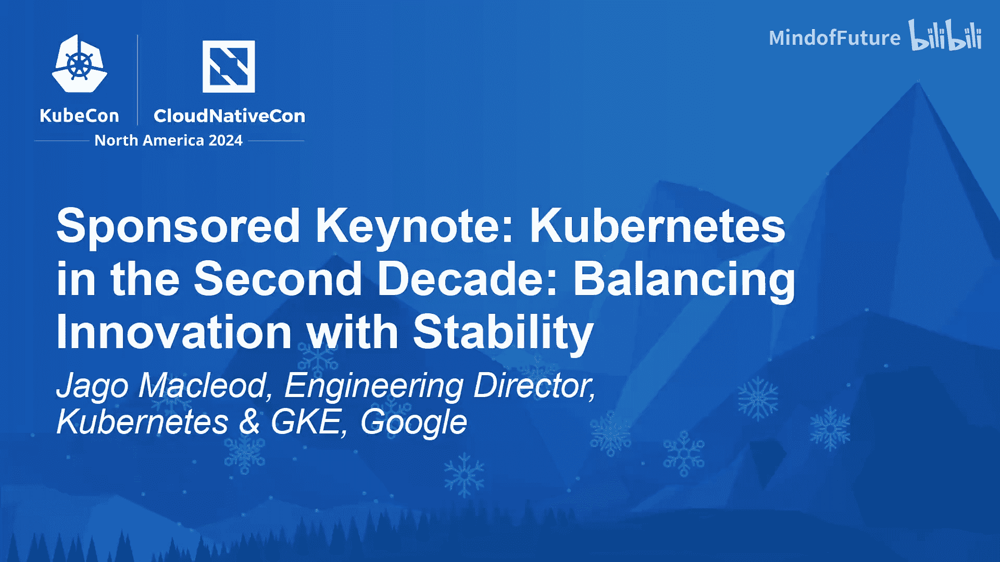
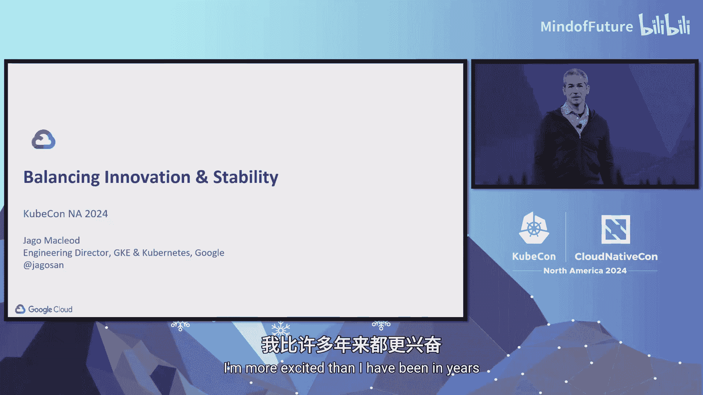

# 【CloudNative】KubeCon+云原生峰会2024-p05-P05-Kubernetes-in-the-Second-Decade--Balancing-Innovation-with-Stabil...-Jago-Ma--BV1E9wPegEH6_p5-

Hi everybody， I have the greatest job in the world。

I get a lead open source Kubernetes at Google， and it's been super fun this year。

 I'm more excited than I have been in years。😊。

So。Until about a year and a half ago， we thought that Kubernetes was following this sort of very normal innovation。

Aoption curve。You got the early adopters that Kelsey talked about being out of their minds。

 running Kubernetes in production， and then more and more people started to run more and more mission critical workloads。

 and we settled into a rhythm of getting more secure and more stable over time。

The consumption curve doesn't match the adoption curve。

 So you get more consumption as you move across the curve。 And then， of course。

 it was the plot twist of a couple years ago and chat GBT and the Gen AI moment。😊。

And this was really quite shocking to us。 All of our models about consumption were off。

And so we noticed we have these two distinct and stacking adoption curves。

 and these probably aren't to scale because the second one is much steeper。

And so we've been trying to figure out how do we match these two kinds of users。

 You've probably seen it here at the conference if day one was about AI， day two was about security。

 so we have this tension。And you remember that， adopt that consumption curve。Well。

 it just got a whole lot steeper。So we came up with a mission。

 and Our mission is essentially to ensure the future of open source Kubernetes in this ecosystem。

 And that part's really important。For the next decade。

By meeting the needs of the next trillion core hours。

 And that number is interesting because it's about the majority of global compute。

We came up with these three stories to rally around。 The first one， most fundamentally。

 is about stability。And really， we have to balance the stability with the innovation of the other two。

 The other two are about reinventing the Kubernetes relationship with the underlying hardware。

 Originally， it was just CPU and memory in nodes。 You could have more。 You could have less。

 but basically a node as a node as a node。 And now there's highly specialized hardware that might not be available in the region you're in。

And finally， about becoming a framework orchestrator instead of just a workload or a container orchestrator。

So across those scale。Reliability at scale is really critical。And you might have noticed this week。

 we announced support for 65000 nodes in a single Kubernetes can cluster。I said。Enormous jump。

The next is about upgrade reliability。 All of this innovation only matters if we can bring along the installed base and fragmentation is a real problem in a lot of projects。

 It's critical that we allow customers to upgrade safely and reliably and even roll back。😊。

Story number two is about redefining the relationship with the hardware。And so we've had， you know。

 folks are succeeding in spite of Kubernetes a year and a half ago。

 And a lot of the work we've been talking about the last few days at the conference about DRA and working with underlying accelerators is to make that much more dynamic and consistent across different hardware types。

And finally， about this framework orchestration。And so on the left， you'll see Charlie。

 our platform administrator profile。And is a little confused about these data scientists and data engineers using frameworks like Slom and Ray on new kinds of workloads。

 Fortunately， Kubernetes has evolved to support all kinds of workloads over the years。

 and we're working hard with open source communities to make sure that Kubernetes supports these new kinds of frameworks。

And the big idea behind all of this is to create a consistent operational model so that frameworks can be adopted by end users。

Across all of their business units and provide that consistent operational experience。

And a consistent way to use underlying hardware that comes and becomes available over time。

This is something that Kubernetes has done really well over time。

And we're looking forward to the next phase。So again， those overlapping， stacking opportunities。

 you don't get many chances like this in a career。 And this is we talk a lot about respecting the opportunity at Google。

 And this is one we're certainly respecting and jumping into。

 We're really doubling down on Kubernetes。 And we think you should， too。

Can't wait to see what we do in the next decade。 Take care， thanks。😊。

