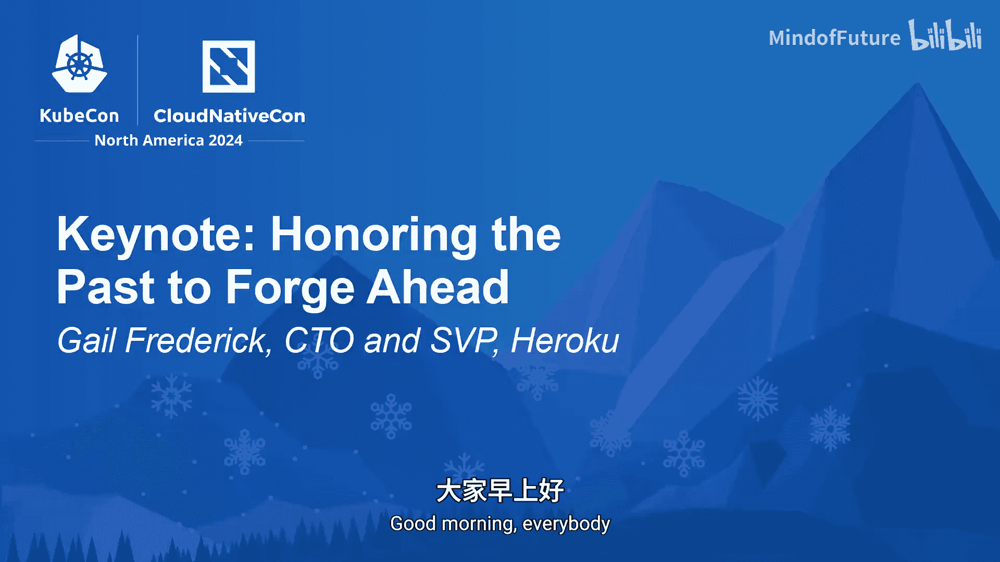

# 【CloudNative】KubeCon+云原生峰会2024-p06-P06-Honoring-the-Past-to-Forge-Ahead---Gail-Frederick,-CTO-and-SVP,-Heroku--BV1E9wPegEH6_p6-

Good morning， everybody。

I am so excited to be here， helping to close out this incredible week of technology and community。

 You know， at Heroku， we're builders， we're developers， we're engineers。

 and our job is to look to the future。😊，But sometimes I find it helpful to look back and reflect on the path。

 the path to help us chart our path forward。So let me tell you a story。

Once upon a time in the early 2000s， there were no containers。 There was no Kubernetes。

 and this community did not exist yet。😔，It was the very early days of cloud。

 And we were all just figuring out how to get there。

 Never mind how to best deliver apps scale into the cloud。

And Adam Wiggins and the founders of Heroku wrote a manifesto。 That manifesto is the 12 factor app。

This manifesto defines the ideal practices for app development in the cloud to minimize fragility。

 to grow maintainably and to reduce friction。😊，And with the manifesto's clear。

 actionable recommendations，12 factor became a shared vocabulary for our industry for discussing best practices。

 And I'm surprised at how durable 12 factor has been over 13 years。

Here are those 12 factors。 Now， if you fast forward to today， so much has changed。 since 2011。

 Heroku has deployed and run millions of apps in the cloud。Cloud is the default mode for apps。

 Cloud native is a massive movement， as evidenced by all of you here today。

 The cloud is built on open source， and Kubernetes is the operating system for the cloud。😊。

So what does that mean for these original ideas for 12 factor。Well， it's time to modernize 12 factor。

 And here at Heroku， we know there is no better way to do that than with you in open source。

 So this week at Kubbecon， we are announcing that 12 factor is now an open source project。

We aim to have a thought， I guess I'm so excited。I'm here today to invite you to participate with us in this project。

 We aim for a thoughtful update of 12 factor with all of you involved。

Here are the first maintainers of the 12 factor open source project。

 Thank you so much to AWS to Google Cloud， IBM and Intuit for joining Heroku and Salesforce on this journey。

😊，And 12 factor needs all of you， your builders and your operators。

 you have experience running apps at scale， and we want to hear where the 12 factors are still relevant and where they need updating。

We really need to refine these best practices together。

So why is now the right time to update 12 factor？ Well， since 2011。

 the technology landscape has changed dramatically and how we write code has so different。

 even in the past two years with the rise of generative AI。And as developers。

 we know that we're deploying entire systems of apps to the cloud， never just one app anymore。

Here's where we're going to start in 12 factor。First。

 the manifesto makes no mention of telemetry beyond logging。

We know that modern applications need a robust telemetry story。Secretets。

 especially credentials in Config is a security nightmare。

 So we know we want to introduce standards for service identity。And nobody deploys just one app。

 as I said。 So application teams need best practices for how to manage groups of 12 factor applications and need guidance for when to split one application into many。

So please join us here's the link to the repo on GiHub and that's a QR code so you can join our Discord community。

 I'm so excited that 12 factor is open sourced as of this week， thank you and have a great coupon。

