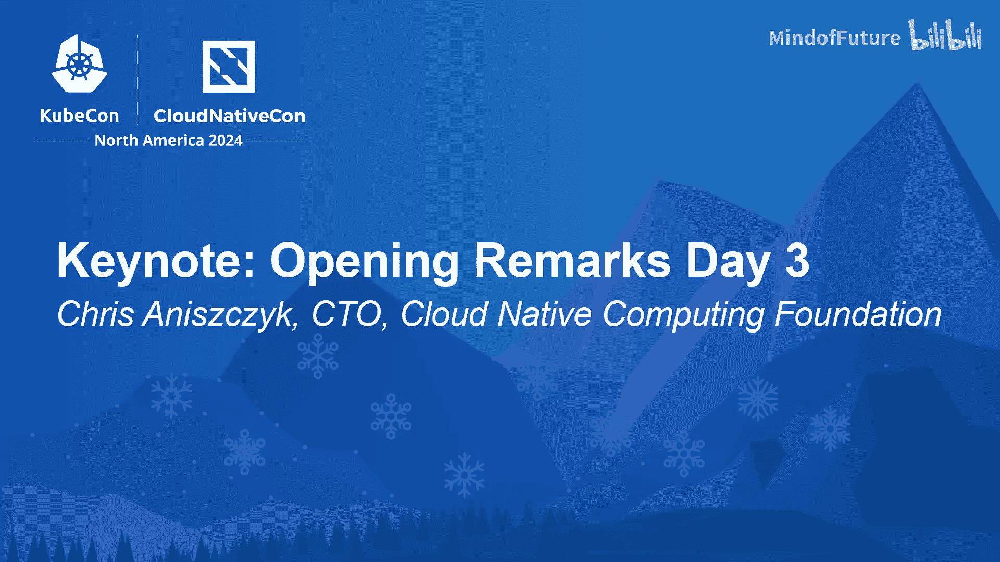

# 【CloudNative】KubeCon+云原生峰会2024-p07-P07-Opening-Remarks---Chris-Aniszczyk,-CTO,-Cloud-Native-Computing-Foundation--BV1E9wPegEH6_p7-

Alrighty， how's everyone doing？

Everyone's excited for last day at Cubecon。Hopefully we didn't stay out too late last night。

 I know some of you are having a little too much fun。

But some good little parties last night so you know as you're aware。

 we've been doing kind of a themed day thing for Qcon this year。

 So today's the last day and this kind of community oriented is kind of the theme you know reflecting and celebrating some moments it's been 10 years of Kubernetes we have a lot of fun things to talk about today about our communities so to kind of you know kick things off is we've been super。

😊，Fortunate as a community have a lot of organizations out there contribute people and resources to ensure that our projects could run in a variety of different environments。

 you know different clouds on on-prem systems， etc ceter。

 so today we're going to start off with a new organization contributing something special to CNCF to ensure that our projects have more resources on it。

 so to kind of kick things off， I'm going to go hand it over to Ari from Akamai to talk about what they're doing。

Hey， Chris， yep。Good morning， everybody。That's a little bit better。 Thank you。 Well， listen。

 over the last decade， developersers have been forced to choose between two evils。

 either accept big cloud complexity， costs and lock in or struggle and lose precious time by building everything from scratch。

😊，Like code itself， it was a binary decision until this week when we made a choice and we made an announcement that would allow us to choose a different path with the Akami App platform。

 we created a platform that balances the simplicity of the cloud and the control of open source。

 and we built it on Kubernetes。Sorry， it ensures genuine portability for workloads at scale。

 giving businesses the freedom to move applications between cloud environments。

 and with that freedom comes increased cost efficiency and protection against vendor locket。

The App platform makes deployments easy using open source to accelerate time to value and ensure flexibility with a click of a button。

 developers can deploy preconfigured upstream CNCF projects from CICD to observability to security。

 and a catalog of Golden Pa templates streamline how developers build and deploy their applications。

It's an example of Akaai's commitment to open source and the CNCF community。

 We're proud that our employees participate as tag cochairs and our developers actively contribute to projects that help businesses and developers scale their applications。

😊，We've also pledged a million dollars to help projects scale their operations。

 this includes projects like Flcar， Akamai has made upstream contributions to the Flcar community and are investing to qualify Flcar as an officially sponsored platform on the Akamai Cloud。

 and now that Hyperlite has been announced by Microsoft。

 we're super excited to give it a try on our platform and see what the community thinks。

If you haven't used the Akamai Cloud or if you knew about Leode before and you want to see how Akamai has been investing to expand our cloud platform with exciting new products like the App platform。

 then I encourage you to sign up for a free account and give it a try， but to hear more about FlA。

 I want to bring Anda。Great， thanks， thanks， Ari。 And thanks very much to Akaai as well for that amazing donation of resources to the community and to the Flcar project。

 And it really is great to hear about Akaai's use of Flcar。 And they're not the only ones。 today。

 Flagcar is supported practically every cloud and non-prem platform。😊。

And we're thrilled that the community momentum behind Flcar has been recognized by acceptance into the CCF at incubating level。

😊，For the community， this means that for the first time。

 we can deploy a complete production environment。Including the operating system。

 using all CCF technologies。Thank you。Fckcar is a natural fit with the CCF because it's designed specifically for containers and embraces cloud native principles。

 like immutability and declarative config。But the world isn't standing still。 and neither are we。

 we're evolving Flcar to enable users to customize it and adapt it to the next generation of workloads。

You remember the Burger King， have it your way campaign。Well。

 that's the approach that we're taking with that car。With system extensions。

 you can build your own choice of layers on top of the base O S image to simplify cluster API worker image creation or enable deployment of new workload types。

 such as Webassembly。I'll now hand over to Rita Zhang to tell us a little bit more about those kind of workloads。

Thank you。E and And， you are absolutely right。 We want to run Web assemblymbly and many other new technologies in our cloud native work。

 while still ensuring that they run securely。Virtual machines have long been the cornerstone of cloud native infrastructure。

 widely trusted to securely separate host and gas environments。But for event driven scenarios。

 light serverless， traditional V Ms are simply too slow to spin up。

 So how can we reduce this latency while we run our application securely。Introducing hyperlite。

 a rust library built to allow developers to leverage。

KVM or Hy V to run untrusted code in a micro Vm without loading a full operating system。

And these VMs can be created in microseconds。Here， in this demo。

We have an app making sequential calls from the VM to the host。

 then returning values from the host back to the guests。

 Hyperlyite creates a new micro Vm for each call。😊，And averaging just 900 microseconds。Per request。

 Now， that's microseconds，1 less than 1 milliseconds。Finally。

 I'm thrilled to announce that today we've just pushed a poll request to donate hyperlitete as a sandbox project to CNCF。

😊，We invite everyone to check it out， explore it。 And I can't wait to see the innovative ways that you will leverage hyperLte in your own project。

 Thank you。😊，Thank you， Rita。So。😊，You know， one interesting thing about our community is you know。

 it's very， very large， right， you know， Kubernetes is turning， you know， essentially 10 this year。

 It is really the second highest open source velocity project behind Linux， which is 33 years old。

 It's got has a little more age on us。 but you know it's truly evolved very， very you know quickly。

 And our community is extremely vast and global， right know。

 we do a bunch of Q cons all over the world and meet people all over the world and try to get them trained and up to speed on K native technology。

😊，You know， as part of this， we have a great report that we've put together kind of celebrating Kubernetes turning 10 and talking to both users。

 you know， maintainers and so on and kind of sharing how they've benefited from Kubernetes during the last decade or so so you could take a look at this you could take out this you know wonderful report that we put together。

 take that little QR code to kind of get full full details。You know， as I mentioned， you know。

 truly one of the largest global open source communities out there spanning 1 you know。

93 countries over a quarter million contributors， and I've had this you know job basically since the beginning of CNCF and I've have traveled。

All different parts of the， you know， world and。YouOne of my kind of favorite trips I've had was up in Lagos in Nigeria and meeting some of the African community that we had out there and it was definitely a fun experience meeting some of our ambassadors out there learning what's happening out there and you know I was definitely inspired and thought that we could do a lot more out there with all the passion that I stole。

 so I'm happy to introduce a new partnership that we're launching and I want to introduce Ross next from Angella to talk about a little bit what we're doing to ensure that cloud Native continues to be global。

Here go。Thank you， Chris。Okay， Africa is a young continent with the fastest growing marketplace。

 Many have a desire to be certified in Kubernetes and other cloud native technologies。

 but it has been a cost prohibit prohibitive。On other， on the other side of the marketplace。

 when clients submit a job role to us， the desire for someone in Kubernetes skills are 90% of those requests。

 The demand for Kubernetes is strong。So we have reached out to CNCF to see if they would like to partner partner with us on a learning program。

 We are thrilled to announce that CCF and Anddela would be providing K， C NA and C。

 KD training and certification to 20000 to 30000 African developers kicking off in 2025。

 This will expand the reach of Kubernetes and other cloud native technologies。😊，Thank you Ross。

 I'm truly excited， it's super fun as I mentioned before。

 we have a growing community that is in Africa， we actually have a KCD Ghana coming up。

 but we have about 800 community members out there and things are kind of continuing to grow so I encourage folks out there take advantage of this program and continue to make cognitive global。

Go to make a couple more announcements before we kind of kick things further off today so a big investment you know in CNCF has been trying to train more and more developers to get up to speed on Cative and historically you obviously we had a large focus on Kubernetes because that was our first project that's kind of where a lot of the initial resources went but as CNCF has grown to over 200 projects we have other very very large communities out there such as Prometheus。

 envoy， open teletry and so on so recently we've been investing a lot to bring new training and certification out there to kind of meet the demand of folks that are wanting to learn skills outside of purely Kubernetes too so I'm happy to announce that we have a few new certifications that are coming out today we have backstage which is a lovely world's I think largest open source IDP so we have a new backstage associate exam we have an open telemetry certified exam which is the second largest project behind Kubernetes in CNCF and we have chiverno。

As that's available in beta。 So we're continuing kind of developing things to kind of make sure that folks get skilled out there。

 And I'm very， very excited that we're doing this。😊，Thanks。We have some new cloud native programs。

 too， so I'm sure many of you are aware， you know day one， there is a big platform engineering theme。

 so we're working to work with the community together because you know I find platform engineering a bit of a nebulous topic depending on which company or person you talk to may have a bit of a different opinion of what that means。

 So what do we do best in CNncCf， we con people together and work on things and improve things。

 So we're all going to work together on creating a new certified cloud platform associated think to help kind of define what essentially platform engineering is from a cloud perspective。

 So if you're interested in kind of participating this and helping shape this program。

 there are some QR codes here。 And then also we're launching an academic accreditation program。

In beta format， a lot of times I've had the fun experience of visiting universities and academic institutions all over the world。

 and sometimes the big complaints you we hear from companies is， you know。

 students aren't really being trained on open source software properly or don't only cloud native。

 So our goal is to partner with universities and help them adopt cloud native focused curriculums。

 really to prepare both students that are attending universities on kind of their next， you know you。

 basically give them solid skills they need so they could be useful when they start off their career。

 So check that out。 that's in beta。😊，Also， yeah， that， thanks。So the other thing is。

 every Cecon we always give out discounts for training for attendees。 So check that out。

 you'll get an email。 I don't need to spend a lot of time on that。

I know my marketing team will hate me。What I'm really excited about is you know。

 we're a global community。 We're starting to keeponss in new places。

 So this is we're doing our first Kcon in India coming up in a few weeks in Delhi。 So December11 12。

 very， very excited。 Please join us there。 we're gonna have a great contingent out there。

 I will say book your ticket hopefully in the next couple weeks because it's on track to sell out。

 So I'm very excited about that。 And obviously our next Kubcon Europe that we're gonna to do is going to be in London。

 super excited about that。 CFP is open till November 24。 So please submit a talk there。

 be April 1s through 4 I'm looking forward to it。 that one's on track to be our largest Kcon ever。😊。

嗯。So 2025， we're going get some coupononss。 I'm trying to give all you all this in advance so you can mark your calendar。

 So we're going to have cucon， London。Cubcon China is going to be in Hong Kong June 10 through 11。

 Kcon， India， 2025， Our second one is going to be in Hyderabad， August yeah。

I know people are upset about Delhi， we're going to move cities like we do in things Hyderabad is next so and then North America next year is going to be Atlanta。

 November 10th or 50 which is one of my favorite little cities so hopefully we'll see there see folks there and finally we're kind of combining our security events we had Cl of security con before the Open SSF also had its security event we're going to combine this into a new open source security con that will premiere and debut at QCon Atlanta next year。

The other thing to kind of start wrapping things up is you know。

 we get a lot of requests for doing new Ks all over the world。

 and I'm happy that we're going to be announcing and expanding our Kubcon events to a new region in the world。

 so we're going to be doing Kcon， Japan for the first time next year， June 16 through 6。

So's there's a strong little bit of anime fan contingent in the Kubernetes communities。

 I'm sure they're very excited about this。 So hopefully we'll be able to see you all in Japan next year。

 We have an amazing cloud native community， Japan community out there。😊，Other reminders， so 2026。

 Kubecon has gotten so large that we have to kind of book these things out further in advance。

 Kubcon Europe in 2026 is going to be back in Amsterdam， March 2326。

 I love the Re Convention Center it's gonna be back in that same beautiful sunny convention center and then in North America in 2026 we're gonna to be in LA October 26 through 29th So book your calendars we'll be back there。

 and finally to kind of close things off we do this annual survey every year where we want to get feedback from all you all on how which projects are're using in CncCf what challenges you're facing so take that QR code it takes about 15 minutes or so to fill out and then we're going to go share those results with everyone hopefully early next year。

 So a little bit over time， but I truly want to thank everyone here that comes here and trust us to teach you a little bit about cloudown native and really really I hope you find this event something that you kind of come back to from my perspective helping organize this。

All I really want people to do is look learn something new， make a couple friends。

 and if you do that， I'm super happy that and that's kind of what I think Qcon's all about。

 So thank you for attending and we'll kind of get the program moving。

 so thank you all and let's get going。