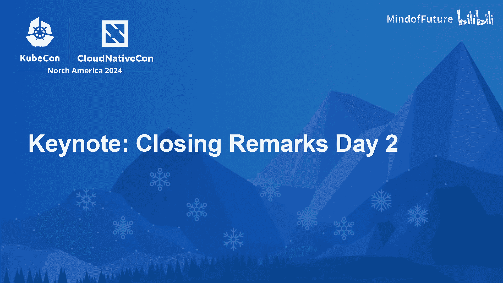
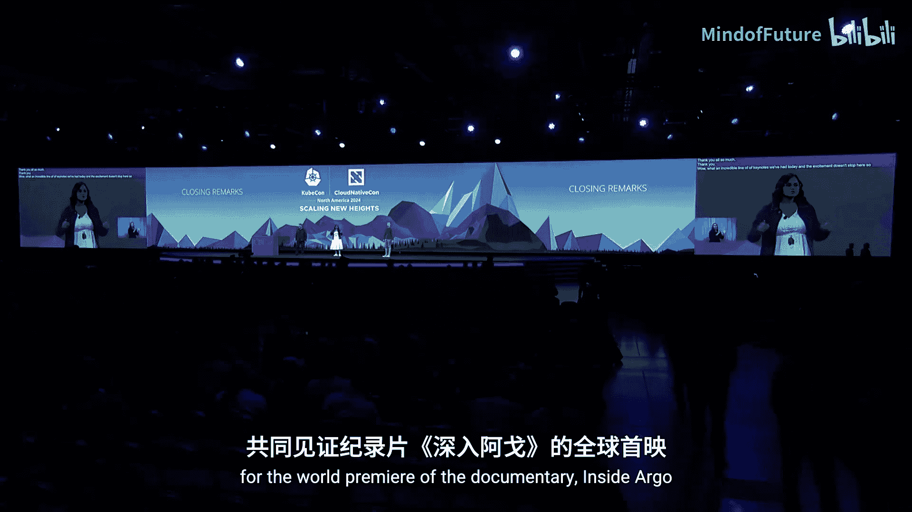
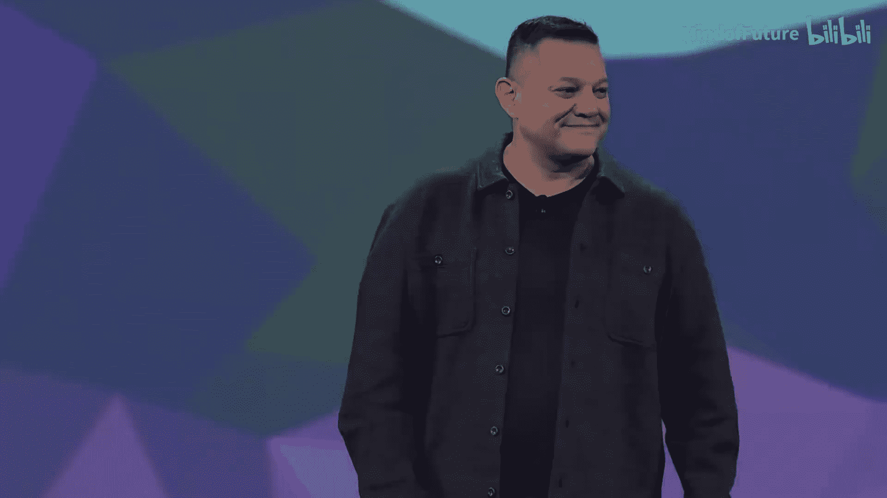

# 【CloudNative】KubeCon+云原生峰会2024-p10-P10-Closing-Remarks--BV1E9wPegEH6_p10-

Wow what an incredible lines of yous we've had today。

And the excitement doesn't stop here， so be sure to join us after the breakout sessions for the world premiere of the documentary In Argo checkca do com for the exact time and location and other details。

 Also join us at 4 PMm in the project pavilion to celebrate our newest graduated projects。

 third manager Debbber Falco and Qub H。 and we are also thrilled to introduce the first ever D E Y。

 community Hub at Qecon Cloudown Ncon sponsored by Google Cloud。

 This hub aims to provide familiar faces and support for underrepresented underrepresented attendees navigating the conference。

😊。

Breakout sessions will start again at 11 AM。 and we hope you've had a great second day here at QeCon Cloud NativeCon。

 See you tomorrow for our last set of keynotes。

卖不。